# Case Study App — MiniSum

Ứng dụng desktop **WinForms (C# / .NET 8)** dùng làm **Application Under Test (AUT)** chung cho toàn bộ demo của Seminar "Automation Testing for Desktop Applications".

MiniSum gồm 2 màn hình: **Đăng nhập** và **Tính tổng A + B**, được build thành 3 phiên bản phục vụ 3 kịch bản demo khác nhau (xem bảng bên dưới).

---

## 1. Ba phiên bản và mục đích sử dụng

| Phiên bản | File chạy | Khác biệt so với bản trước | Dùng cho demo |
|---|---|---|---|
| **v1** | `MiniSum.exe` | Bản gốc: Login + Calculator, **chưa có validation** | Record & Playback, Checkpoint, kiểm thử cơ bản |
| **v2** | `MiniSum_v2.exe` | Đổi `btnSum` → **`btnCalculate`**, thêm màn hình **Lịch sử** (`btnHistory`) | Maintenance & Self-healing (locator bị đổi tên) |
| **v3** | `MiniSum_v3.exe` | Thêm **validation** + nhãn lỗi `lblError`: bỏ trống, không phải số, ngoài miền `[-99, 99]` | Negative test, BVA / Data-Driven Testing |

> **Lưu ý về nguồn gốc:** v2 và v3 đều phát triển từ v1 theo hai hướng độc lập. Vì vậy **v3 vẫn dùng `btnSum`** (không có `btnCalculate`) và **v2 không có `lblError`**. Hãy chọn đúng file theo kịch bản demo.

---

## 2. Yêu cầu môi trường

- Windows 10 / 11 (bật **Developer Mode** nếu chạy cùng WinAppDriver).
- **.NET Desktop Runtime 8.0** trở lên — tải tại <https://dotnet.microsoft.com/download/dotnet/8.0>.
- File `.exe` là bản **framework-dependent single-file**: chỉ cần runtime, **không cần** cài .NET SDK và không cần các file `.dll` đi kèm.

## 3. Cách chạy

Nhấp đúp vào file `.exe` tương ứng, hoặc:

```powershell
.\MiniSum.exe        # v1
.\MiniSum_v2.exe     # v2
.\MiniSum_v3.exe     # v3
```

**Tài khoản hợp lệ:** `admin` / `1234`

---

## 4. Quy tắc nghiệp vụ

### Màn hình Đăng nhập
| Trường hợp | Kết quả |
|---|---|
| Đúng `admin` / `1234` | `lblMessage` = `Dang nhap thanh cong`, sau 1 giây chuyển sang màn hình Tính tổng |
| Sai tài khoản hoặc mật khẩu | `lblMessage` = `Sai tai khoan hoac mat khau`, ô mật khẩu được xoá trắng |
| Bỏ trống cả hai | `lblMessage` = `Vui long nhap tai khoan va mat khau` |
| Bỏ trống tài khoản | `lblMessage` = `Ten dang nhap khong duoc de trong` |
| Bỏ trống mật khẩu | `lblMessage` = `Mat khau khong duoc de trong` |

### Màn hình Tính tổng (v1, v2)
- Nhập A, B là số nguyên → `lblResult` = `Ket qua: {A} + {B} = {A+B}`
- Nhập dữ liệu không phải số → `lblResult` = `Nhap sai dinh dang` (chưa có validation riêng)

### Màn hình Tính tổng (v3)
- Hợp lệ (`A`, `B` ∈ `[-99, 99]`) → `lblResult` = `Ket qua: {A} + {B} = {A+B}`, `lblError` rỗng
- Thiếu dữ liệu → `lblError` = `Vui long nhap day du gia tri A va B`
- Không phải số nguyên → `lblError` = `Gia tri khong hop le: phai la so nguyen`
- A ngoài miền → `lblError` = `A ngoai mien [-99, 99]`
- B ngoài miền → `lblError` = `B ngoai mien [-99, 99]`

> Toàn bộ thông điệp dùng **ASCII không dấu** để so sánh chuỗi trong test script ổn định.

---

## 5. Bảng AutomationId (dùng cho Object Spy / WinAppDriver)

| Màn hình | Control | Loại | AutomationId | Ghi chú |
|---|---|---|---|---|
| Login | Cửa sổ đăng nhập | Window | `winLogin` | Title: `MiniSum - Dang nhap` |
| Login | Ô tài khoản | TextBox | `txtUser` | |
| Login | Ô mật khẩu | TextBox | `txtPass` | Có `UseSystemPasswordChar` |
| Login | Nút đăng nhập | Button | `btnLogin` | |
| Login | Nhãn thông báo | Label | `lblMessage` | |
| Calculator | Cửa sổ tính toán | Window | `winMain` | Title: `MiniSum - Tinh tong` |
| Calculator | Ô nhập A | TextBox | `txtA` | |
| Calculator | Ô nhập B | TextBox | `txtB` | |
| Calculator | Nút tính tổng | Button | `btnSum` (v1, v3) / `btnCalculate` (v2) | **Khác nhau theo phiên bản** |
| Calculator | Nhãn kết quả | Label | `lblResult` | |
| Calculator | Nhãn lỗi | Label | `lblError` | Chỉ có ở **v3** |
| Calculator | Nút lịch sử | Button | `btnHistory` | Chỉ có ở **v2** |
| Calculator | Nút đăng xuất | Button | `btnLogout` | Quay về màn hình Login |
| History | Cửa sổ lịch sử | Window | `winHistory` | Chỉ có ở **v2**, title `MiniSum - Lich su tinh toan` |
| History | Danh sách lịch sử | List | `lstHistory` | |
| History | Nút đóng | Button | `btnClose` | |

Màn hình Lịch sử (v2) mở dạng **modeless** để thao tác mở cửa sổ không chặn luồng automation.

---

## 6. Giao diện

Giao diện được thiết kế lại theo phong cách **Fluent Light** (tham khảo các template desktop hiện đại) nhưng **giữ nguyên toàn bộ "hợp đồng" automation**: AutomationId, loại control, tiêu đề cửa sổ và các chuỗi thông điệp ASCII.

### 6.1 Nguyên tắc thiết kế

- **Bảng màu Fluent Light**: nền `#F3F6FB`, card trắng `#FFFFFF`, viền `#E2E8F0`, màu nhấn `#2563EB`, chữ chính `#0F172A`, chữ phụ `#64748B`.
- **Font Segoe UI** với phân cấp rõ ràng: tiêu đề 18–22pt, nhãn 9pt in hoa, nội dung 10pt, kết quả 14pt đậm.
- **Card bo góc**, dải gradient mảnh ở đỉnh cửa sổ và logo Σ gradient ở màn hình Đăng nhập.
- **Không dùng thư viện UI bên thứ ba**: chỉ WinForms + `System.Drawing` (owner-draw), nên `.exe` vẫn là single-file ~170 KB, không phát sinh dependency khi chạy trên máy khác.
- **Trang trí tách khỏi control nghiệp vụ**: chữ tiêu đề, phụ đề, logo và dấu "!" của banner lỗi được vẽ trực tiếp trong `Paint` (không tạo thêm `Label`), nhờ vậy `lblResult` / `lblError` / `lblMessage` khi rỗng vẫn có `Name = ""`.

### 6.2 Ảnh chụp

**Màn hình Đăng nhập** — dùng chung cho cả 3 phiên bản

| Ban đầu | Sai mật khẩu | Đăng nhập thành công |
|---|---|---|
| 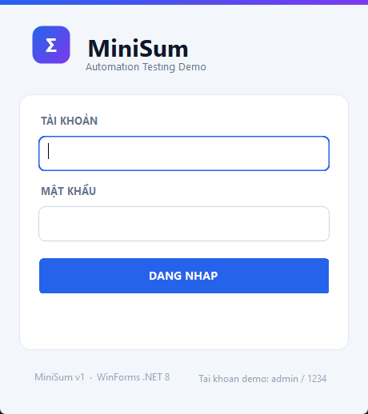 | 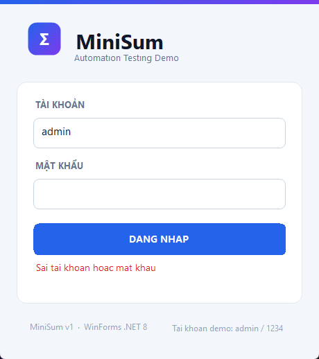 | 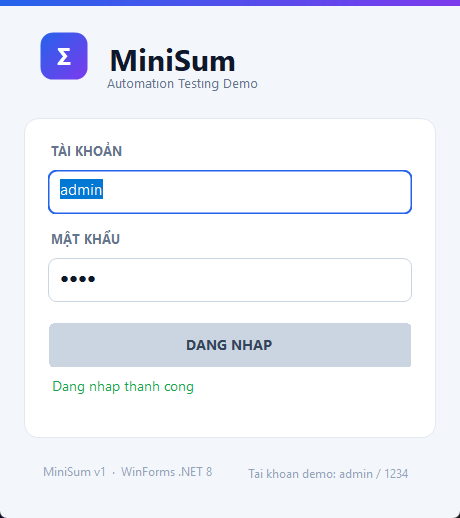 |

**MiniSum v1** — `MiniSum.exe`

| Màn hình Tính tổng | Sau khi tính `5 + 7` |
|---|---|
| 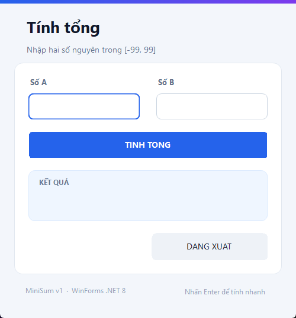 | 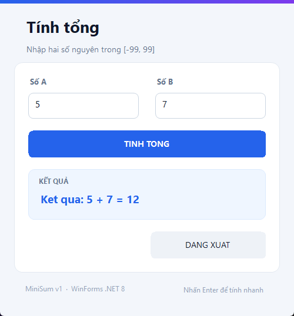 |

**MiniSum v2** — `MiniSum_v2.exe`

| Màn hình Tính tổng | Sau khi tính `5 + 7` | Màn hình Lịch sử |
|---|---|---|
| 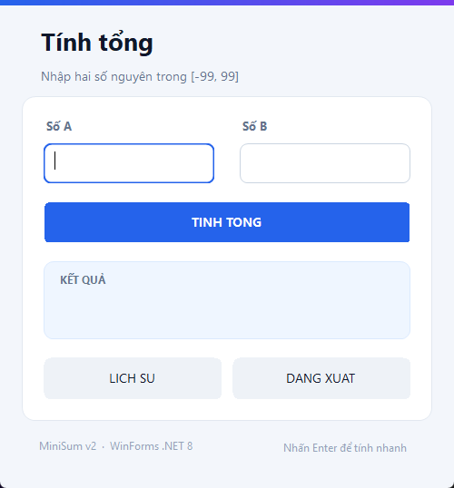 | 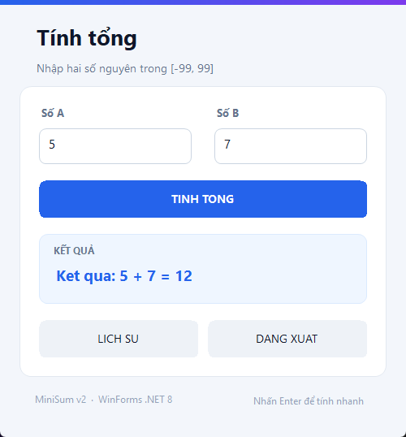 | 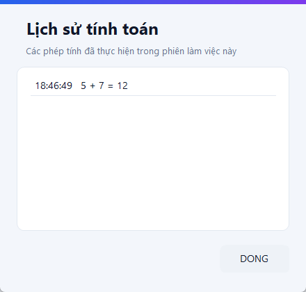 |

**MiniSum v3** — `MiniSum_v3.exe`

| Màn hình Tính tổng | Sau khi tính `5 + 7` | Banner lỗi (nhập `abc`) |
|---|---|---|
| 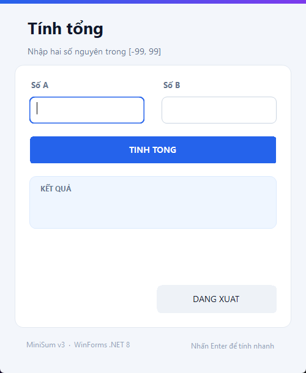 | 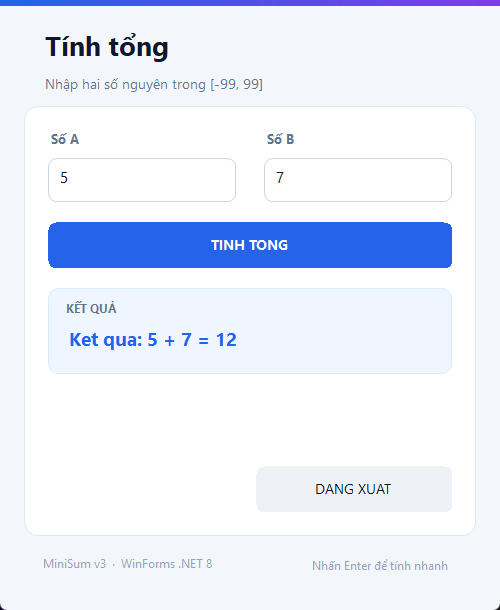 | 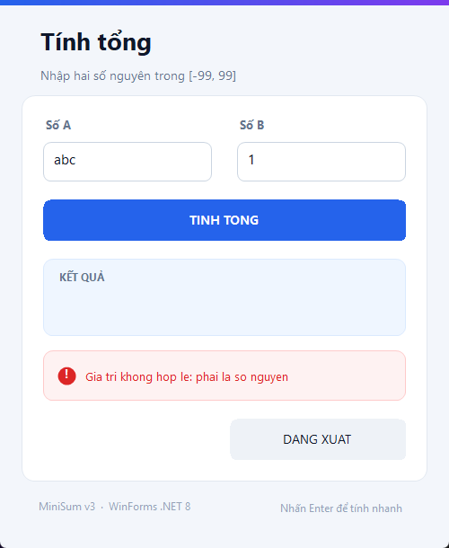 |

### 6.3 Phần thay đổi và phần giữ nguyên

| Hạng mục | Trước | Sau |
|---|---|---|
| Màu nền, font | Xám mặc định Windows, Segoe UI 10pt | Fluent Light, Segoe UI có phân cấp tiêu đề / nhãn / nội dung |
| Kích thước cửa sổ | 400×300 (Login), 440×320 (Calculator), 400×320 (History) | 460×518 (Login), 500×538 (Calculator v1, v2), 500×610 (v3), 440×420 (History) |
| Khung nhập liệu | TextBox viền vuông mặc định | TextBox đặt trong khung bo góc, viền đổi màu khi focus |
| Nút bấm | Nút xám mặc định của Windows | Nút chính nền xanh `#2563EB`, nút phụ nền xám nhạt, đều bo góc |
| Danh sách lịch sử | ListBox mặc định, font Consolas | ListBox `OwnerDrawFixed`, font Segoe UI, dòng kẻ mảnh, dòng chọn nền xanh |
| Banner lỗi (v3) | Chỉ có `lblError` trần | Banner đỏ nhạt có biểu tượng `!`, chỉ hiện khi thực sự có lỗi |

Những điểm **giữ nguyên tuyệt đối** (đã đối chiếu bằng UI Automation với bản build cũ):

| Hạng mục | Giá trị |
|---|---|
| AutomationId | `winLogin`, `txtUser`, `txtPass`, `btnLogin`, `lblMessage`, `winMain`, `txtA`, `txtB`, `btnSum` (v1, v3) / `btnCalculate` (v2), `lblResult`, `lblError` (v3), `btnHistory` (v2), `btnLogout`, `winHistory`, `lstHistory`, `btnClose` |
| Loại control | Window, Edit, Button, Text, List, ListItem — không đổi |
| Tiêu đề cửa sổ | `MiniSum - Dang nhap`, `MiniSum - Tinh tong`, `MiniSum - Lich su tinh toan` |
| Chuỗi thông điệp | Toàn bộ chuỗi ASCII không dấu trong mục 4 giữ nguyên 100% |
| Tên (UIA `Name`) của ô nhập | `Tai khoan:`, `Mat khau:`, `So A:`, `So B:` — gán tường minh qua `AccessibleName` |
| Delay sau đăng nhập | 1000 ms trước khi chuyển màn hình |

> **Vì sao phải gán `AccessibleName`?** Khi thêm nhãn trang trí, WinForms tự gán tên của `Label` đứng trước cho `TextBox` (label association), làm UIA `Name` đổi từ `Tai khoan:` thành `TÀI KHOẢN`. Mỗi ô nhập vì vậy được gán `AccessibleName` đúng bằng giá trị cũ, còn nhãn trang trí được vẽ trực tiếp để không "mượn" tên của control cần assert.

### 6.4 Lưu ý khi viết locator

Giao diện mới thêm một số phần tử trang trí (`lblTitle`, `lblSubtitle`, `lblUser`, `lblPass`, `lblA`, `lblB`, `lblFooter`, …) vào cây UI Automation. Vì vậy:

- **Luôn dùng locator theo AutomationId**, ví dụ `//*[@AutomationId='btnLogin']` (WinAppDriver) hoặc `findElement(By.id('btnLogin'))`.
- **Không dùng XPath theo thứ tự** như `/Window/Pane[1]/Edit[2]` — thứ tự phần tử có thể thay đổi mỗi khi giao diện được cập nhật.
- Nếu buộc phải tìm theo `Name`, dùng đúng giá trị cũ trong mục 5 (ví dụ `Tai khoan:`), **không** dùng chữ có dấu đang hiển thị trên màn hình.

### 6.5 Chụp lại ảnh giao diện

Script `tools/Capture-MiniSumScreens.ps1` mở từng bản, thao tác bằng UI Automation, chụp vùng client của cửa sổ và dump cây UIA để đối chiếu AutomationId:

```powershell
cd case-study-app\MiniSum\tools

powershell -ExecutionPolicy Bypass -File .\Capture-MiniSumScreens.ps1 -Exe ..\..\MiniSum.exe    -Version v1 -OutDir ..\..\..\docs\screenshots\app
powershell -ExecutionPolicy Bypass -File .\Capture-MiniSumScreens.ps1 -Exe ..\..\MiniSum_v2.exe -Version v2 -OutDir ..\..\..\docs\screenshots\app
powershell -ExecutionPolicy Bypass -File .\Capture-MiniSumScreens.ps1 -Exe ..\..\MiniSum_v3.exe -Version v3 -OutDir ..\..\..\docs\screenshots\app
```

Lưu ý:

- Chạy **lần lượt từng phiên bản**, không chạy song song, vì cả 3 bản dùng chung tiêu đề cửa sổ.
- Nên để màn hình ở scale 100%; script tự đưa cửa sổ lên trên cùng nên ảnh không bị cửa sổ khác che.
- Ảnh chỉ chụp **vùng client** (không gồm thanh tiêu đề của Windows) để khớp đúng kích thước thiết kế.

---

## 7. Cấu trúc thư mục

```text
case-study-app/
├── MiniSum.exe                 # Bản build v1
├── MiniSum_v2.exe              # Bản build v2
├── MiniSum_v3.exe              # Bản build v3
├── README.md                   # Tài liệu này
└── MiniSum/                    # Mã nguồn
    ├── MiniSum.sln             # Solution gồm 3 project
    ├── build.ps1               # Build & publish cả 3 phiên bản
    ├── src/                    # Mã nguồn dùng chung
    │   ├── Program.cs
    │   ├── Theme.cs            # Bảng màu, font, helper vẽ giao diện dùng chung
    │   ├── LoginForm.cs
    │   ├── CalculatorForm.cs   # Có #if V2 / #if V3 cho phần khác biệt
    │   ├── HistoryForm.cs      # Chỉ v2
    │   └── CalculationHistory.cs  # Chỉ v2
    ├── v1/MiniSum.csproj
    ├── v2/MiniSum_v2.csproj
    ├── v3/MiniSum_v3.csproj
    └── tools/
        ├── Verify-MiniSum.ps1          # Smoke test UI Automation cho cả 3 bản
        └── Capture-MiniSumScreens.ps1  # Chụp ảnh giao diện + dump cây UIA
```

Ảnh giao diện dùng cho slide/report nằm ở `docs/screenshots/app/`.

## 8. Build lại từ mã nguồn

Yêu cầu **.NET SDK 8.0+**:

```powershell
cd case-study-app\MiniSum
powershell -ExecutionPolicy Bypass -File .\build.ps1
```

Script sẽ publish 3 phiên bản (single-file, framework-dependent) và tự copy `.exe` ra `case-study-app/`.

Build từng phiên bản:

```powershell
dotnet build v1\MiniSum.csproj -c Release
dotnet publish v2\MiniSum_v2.csproj -c Release -r win-x64 --self-contained false -p:PublishSingleFile=true -o out\v2
```

## 9. Kiểm tra nhanh trước khi bàn giao

```powershell
cd case-study-app\MiniSum\tools
powershell -ExecutionPolicy Bypass -File .\Verify-MiniSum.ps1 -Exe ..\..\MiniSum.exe    -Version v1
powershell -ExecutionPolicy Bypass -File .\Verify-MiniSum.ps1 -Exe ..\..\MiniSum_v2.exe -Version v2
powershell -ExecutionPolicy Bypass -File .\Verify-MiniSum.ps1 -Exe ..\..\MiniSum_v3.exe -Version v3
```

Script tự mở app, đăng nhập, tính toán, kiểm tra validation/lịch sử và in kết quả `PASS`/`FAIL` cho từng bước.

## 10. Ghi chú cho phần automation

- Ưu tiên locator theo **AutomationId**; title cửa sổ dùng để chuyển window (`MiniSum - Dang nhap`, `MiniSum - Tinh tong`, `MiniSum - Lich su tinh toan`).
- Sau khi đăng nhập thành công, ứng dụng **giữ màn hình Login thêm 1 giây** để test runner kịp đọc checkpoint `lblMessage` trước khi chuyển màn hình.
- Kịch bản BVA (12 ca, miền `[-99, 99]`) phải chạy trên **`MiniSum_v3.exe`** vì chỉ bản này có `lblError`.
- Đường dẫn tới `.exe` nên đặt thành biến ở đầu script, không hard-code đường dẫn tuyệt đối của máy cá nhân.
- `lstHistory` là ListBox tự vẽ (`OwnerDrawFixed`) nhưng vẫn là `ControlType.List`; đọc từng dòng qua các `ListItem`. UIA `Name` của list lấy theo phụ đề màn hình (trước đây rỗng), nên hãy định vị list bằng **AutomationId** thay vì `Name`.
- Giao diện có thêm phần tử trang trí, vì vậy **không dùng XPath theo thứ tự**; xem mục 6.4.
