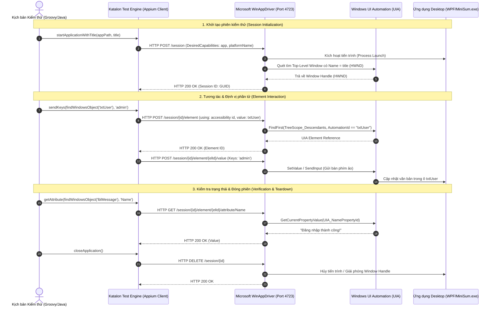
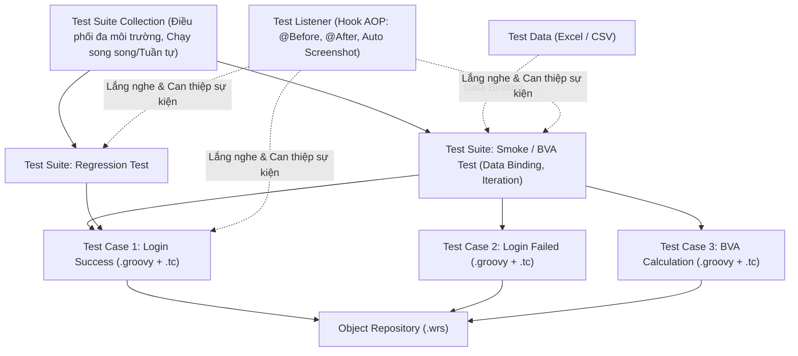

# Nghiên Cứu Công Cụ: Katalon Studio
## Chuyên đề: Automation Testing cho Desktop Applications

- **Người thực hiện:** Kan (Tool A)
- **Mục tiêu báo cáo tuần:** Tổng quan công cụ, nguyên lý hoạt động trên Desktop, 3 năng lực cốt lõi (Record & Playback, Data-Driven, Checkpoints), ưu/nhược điểm và định hướng kịch bản demo.

---

## 1. Tổng quan về Katalon Studio

### 1.1 Thông tin chung
* **Đơn vị phát triển:** Katalon Inc.
* **Mô hình bản quyền:** Freemium (Bản Free đáp ứng đầy đủ các tính năng cơ bản cho kiểm thử Desktop; các gói trả phí Enterprise/TestOps bổ sung tính năng nâng cao và báo cáo đám mây).
* **Phạm vi hỗ trợ:** Đa nền tảng kiểm thử (Web, API, Mobile và Windows Desktop). Đối với Desktop App, công cụ tập trung hỗ trợ nền tảng Windows.
* **Ngôn ngữ viết kịch bản:** Groovy / Java.
* **Chế độ soạn thảo kép (Dual-view):**
  * *Manual View:* Giao diện dạng bảng (Action - Object - Value) trực quan, cho phép xây dựng kịch bản kiểm thử mà không cần viết code.
  * *Script View:* Chế độ code Groovy thuần, cho phép tùy biến logic, xử lý điều kiện, vòng lặp phức tạp.

### 1.2 Lý do lựa chọn cho seminar
1. **Chi phí 0 đồng:** Bản Free không giới hạn thời gian dùng thử (loại bỏ rủi ro hết hạn bản quyền trong quá trình học tập và báo cáo).
2. **Tích hợp sẵn trọn bộ công cụ:** Có sẵn trình ghi kịch bản (Recorder), trình soi phần tử (Object Spy), kho lưu đối tượng tập trung (Object Repository) và hệ thống báo cáo (Reporting).
3. **Phù hợp với nhiều đối tượng:** Người chưa biết lập trình có thể tiếp cận qua Manual View; người muốn can thiệp kỹ thuật có thể viết mã qua Script View.

---

## 2. Nguyên lý hoạt động trên Desktop App

### 2.1 Kiến trúc thực thi chi tiết (Execution Architecture Deep Dive)

Katalon Studio kiểm thử ứng dụng Desktop Windows thông qua kiến trúc phân tầng chuẩn hóa dựa trên giao thức WebDriver. Luồng thực thi diễn ra tuần tự từ kịch bản kiểm thử, qua tầng trung gian WinAppDriver, tới tầng lõi Windows UI Automation và trực tiếp tác động lên ứng dụng đang kiểm thử (AUT).

#### 2.1.1 Sơ đồ kiến trúc phân tầng (Session → Katalon Engine → WinAppDriver → AUT)



#### 2.1.2 Phân tích chi tiết 4 tầng kiến trúc
1. **Tầng 1: Katalon Studio Test Engine (Client Layer)**
   * **Bản chất:** Đóng vai trò là một WebDriver Client. Dưới tầng mã nguồn, Katalon sử dụng thư viện `io.appium.java_client.windows.WindowsDriver` (dựa trên Appium Java Client) để trừu tượng hóa các thao tác giao diện thành bộ từ khóa bậc cao `WindowsBuiltinKeywords` (`Windows.startApplication`, `Windows.setText`, `Windows.click`, `Windows.getAttribute`).
   * **Xử lý đối tượng:** Khi gọi `findWindowsObject('path')`, Katalon đọc file cấu hình `.wrs`, trích xuất `locatorStrategy` và chuỗi `locator`, sau đó đóng gói thành các đối tượng `By` tương ứng (`By.name()`, `By.xpath()`, `By.id()` hoặc custom Accessibility ID) để gửi đi.

2. **Tầng 2: Giao thức giao tiếp WebDriver (Transport / API Layer)**
   * **Cổng mặc định:** `http://127.0.0.1:4723`.
   * **Chuẩn giao tiếp:** Tuân theo đặc tả W3C WebDriver Protocol / JSON Wire Protocol qua giao thức HTTP RESTful. Mọi tương tác đều là các HTTP Request với payload JSON tiêu chuẩn:
     * `POST /session`: Khởi tạo phiên kiểm thử và nhận về chuỗi nhận diện duy nhất `sessionId`.
     * `POST /session/{id}/element`: Tìm kiếm phần tử trên cây giao diện UIA.
     * `POST /session/{id}/element/{elementId}/value`: Gửi chuỗi ký tự hoặc mã phím ảo vào điều khiển.
     * `POST /session/{id}/element/{elementId}/click`: Gửi sự kiện nhấp chuột theo tọa độ tâm phần tử.
     * `GET /session/{id}/element/{elementId}/attribute/{name}`: Truy xuất thuộc tính UIA (như `Name`, `ClassName`, `IsEnabled`).
     * `DELETE /session/{id}`: Hủy phiên làm việc và giải phóng tài nguyên.

3. **Tầng 3: Microsoft WinAppDriver (Translation Layer / REST Server)**
   * **Bản chất:** WinAppDriver là một dịch vụ Windows độc lập (chạy dưới dạng console service hoặc background service) do chính Microsoft phát triển.
   * **Nhiệm vụ thông dịch:** Đóng vai trò như một "Adapter" chuyển dịch các yêu cầu REST/HTTP từ Katalon thành các lệnh gọi hàm Win32 API và COM API của hệ điều hành Windows. WinAppDriver quản lý bảng ánh xạ giữa `Session ID` $\leftrightarrow$ `Process ID (PID)` và `Window Handle (HWND)`.

4. **Tầng 4: Windows UI Automation (UIA) & Ứng dụng kiểm thử (AUT Layer)**
   * **Hạ tầng UIA:** Là framework trợ năng (Accessibility Framework) tích hợp sẵn trong hệ điều hành Windows từ Windows 7 trở lên. UIA tổ chức toàn bộ giao diện màn hình thành một cấu trúc cây thứ bậc (*UI Automation Tree*), bắt đầu từ Desktop Root Window.
   * **Cơ chế Control Patterns:** Mỗi điều khiển trên AUT (WPF, WinForms, Win32) liên kết với một UI Automation Provider. Tùy thuộc vào loại phần tử, nhà phát triển cung cấp các Pattern tương ứng:
     * `ValuePattern`: Dành cho ô nhập liệu cho phép đọc/ghi giá trị (`TextBox`).
     * `InvokePattern`: Dành cho điều khiển có thể kích hoạt hành động (`Button`).
     * `TextPattern`: Hỗ trợ định dạng và duyệt qua các khối văn bản phức tạp.
     * *Lưu ý:* Thẻ `<TextBlock>` trong WPF không thực thi `ValuePattern`, dẫn đến việc WinAppDriver không đọc được qua `getText()` mà bắt buộc phải đọc qua thuộc tính UIA `NamePropertyId`.

#### 2.1.3 Vòng đời Session và Cơ chế quản lý ngữ cảnh (Session Lifecycle)
Một kịch bản kiểm thử Desktop thành công phụ thuộc vào việc duy trì tính toàn vẹn của Session:
* **Khởi tạo (Session Creation):** Khi Katalon gửi yêu cầu `POST /session`, WinAppDriver kích hoạt ứng dụng qua tham số `app` trong `DesiredCapabilities`. WinAppDriver theo dõi tiến trình và gắn kết `Session ID` vào `HWND` của cửa sổ chính được render đầu tiên.
* **Chuyển ngữ cảnh cửa sổ (Window Switching):** Trong các ứng dụng nhiều màn hình (ví dụ: màn hình Login đóng lại bằng `this.Close()` để mở màn hình Calculator bằng `new MainWindow().Show()`), `HWND` ban đầu bị hủy. WinAppDriver sẽ mất quyền kiểm soát (gây lỗi `NoSuchWindowException`). Tester bắt buộc phải chuyển ngữ cảnh sang cửa sổ mới bằng từ khóa:
  ```groovy
  Windows.switchToWindowTitle('MiniSum - Tinh tong')
  ```
  Lệnh này gửi request điều hướng session đính kèm vào `HWND` mới trên cây Desktop.
* **Hủy phiên (Session Teardown):** Lệnh `Windows.closeApplication()` gửi yêu cầu `DELETE /session/{id}` để đóng ứng dụng và hủy socket lắng nghe, tránh rò rỉ bộ nhớ hoặc xung đột port cho các lần chạy kế tiếp.

#### 2.1.4 Điểm nghẽn kiến trúc thực tế: Bẫy Launcher Process trong .NET Core / .NET 6+
Trong quá trình triển khai thực tế trên ứng dụng mẫu WPF `MiniSum.exe`, nhóm phát hiện một điểm nghẽn kiến trúc kinh điển giữa WinAppDriver và các ứng dụng .NET hiện đại:
* **Bản chất vấn đề:** Ứng dụng biên dịch trên .NET 6+ tạo ra một tập tin thực thi nhị phân dạng *AppHost Launcher*. Khi chạy, tiến trình Launcher (PID 1) chỉ có nhiệm vụ khởi động .NET Runtime, tải các file assembly `.dll`, rồi tạo ra một tiến trình thực thi giao diện thực sự (PID 2) và tự kết thúc (exit) sau chưa đầy 1 giây.
* **Hậu quả kiến trúc:** Khi dùng lệnh khởi động mặc định `Windows.startApplication(appPath)`, WinAppDriver theo dõi PID 1. Do PID 1 đã đóng, WinAppDriver không thể tìm thấy bất kỳ cửa sổ nào thuộc về PID này trong thời gian chờ (timeout 7.5 giây) và ném ra lỗi ngoại lệ:
  ```text
  SessionNotCreatedException: Failed to locate opened application window with appId: ... and processId: 21592
  ```
* **Giải pháp khắc phục:** 
  * Sử dụng từ khóa **`Windows.startApplicationWithTitle(appPath, 'Tiêu đề cửa sổ')`**. 
  * Cơ chế: Thay vì neo cứng vào PID của launcher, Katalon hướng dẫn WinAppDriver duyệt qua cây UIA Desktop Root để tìm cửa sổ có thuộc tính `Name` khớp với tiêu đề được chỉ định. Sau khi phát hiện, WinAppDriver sẽ lấy trực tiếp `HWND` của cửa sổ thực tế và khởi tạo Session thành công 100%.

### 2.2 Cơ chế Object Repository và Nhận diện Locator (Object Recognition)

#### 2.2.1 Khái niệm và Vai trò của Object Repository
* **Bản chất:** Object Repository (OR) là kho lưu trữ tập trung toàn bộ các định danh phần tử giao diện (Test Objects). Thay vì gắn cứng locator (hard-coding) trực tiếp trong từng dòng lệnh kiểm thử, kịch bản chỉ gọi đối tượng qua từ khóa tham chiếu:
  ```groovy
  findWindowsObject('Object Repository/MiniSum/Login/txtUser')
  ```
* **Ý nghĩa thực tế đối với chi phí bảo trì (Maintenance Cost):**
  * Trong vòng đời phần mềm, giao diện người dùng (UI) biến đổi liên tục (đổi ID, tái cấu trúc layout, thay nhãn hiển thị). Nếu gắn cứng locator trong script, tester phải rà soát và sửa hàng chục đến hàng trăm test case riêng lẻ (hiện tượng *Kịch bản dễ gãy - Flaky Tests*).
  * Với Object Repository, tester chỉ cần cập nhật locator tại một file duy nhất trong kho lưu trữ, toàn bộ các Test Case liên quan sẽ tự động nhận diện theo thông số mới. Đây là sự hiện thực hóa triết lý **Page Object Model (POM)** ở mức công cụ không mã nguồn (Codeless/Low-code), giúp hạn chế nguyên lý *"Nghịch lý thuốc trừ sâu" (Pesticide Paradox)* khi kiểm thử tự động dài hạn.

#### 2.2.2 Cấu trúc lưu trữ nội bộ của Object Repository trên Desktop (.wrs)
Khác với kiểm thử Web sử dụng định dạng file `.rs` (`WebElementEntity`), kiểm thử Windows Desktop trong Katalon Studio quy định cấu trúc đối tượng nghiêm ngặt:
* **Định dạng file:** Mỗi đối tượng kiểm thử Desktop được lưu dưới dạng một file XML có đuôi mở rộng là **`.wrs`** (`WindowsElementEntity`).
* **Cấu trúc XML chuẩn:**
  ```xml
  <?xml version="1.0" encoding="UTF-8"?>
  <WindowsElementEntity>
     <description>Ô nhập tài khoản</description>
     <name>txtUser</name>
     <tag></tag>
     <locator>txtUser</locator>
     <locatorStrategy>ACCESSIBILITY_ID</locatorStrategy>
     <properties>
        <isSelected>true</isSelected>
        <matchCondition>equals</matchCondition>
        <name>AutomationId</name>
        <type>Main</type>
        <value>txtUser</value>
     </properties>
  </WindowsElementEntity>
  ```
* **Lưu ý kỹ thuật quan trọng:** Nếu tạo nhầm file định dạng Web (`.rs`) hoặc đường dẫn không đúng, hàm `findWindowsObject()` sẽ trả về `null` trong thời gian chạy, gây ra lỗi ngoại lệ `java.lang.IllegalArgumentException: Test object cannot be null`.

#### 2.2.3 Các chiến lược nhận diện Locator (Locator Strategies) trên Windows Desktop
Katalon Studio phối hợp với WinAppDriver để phân giải các thuộc tính UI Automation thành 4 chiến lược định vị chính theo thứ bậc ưu tiên:

| Chiến lược (Locator Strategy) | Thuộc tính UIA tương ứng | Độ ưu tiên | Đặc điểm kỹ thuật & Đánh giá |
|---|---|:---:|---|
| **ACCESSIBILITY_ID** | `AutomationProperties.AutomationId` (WPF) / `AccessibleName` (WinForms) | **Số 1 (Khuyên dùng)** | Định danh bất biến do lập trình viên gắn trong mã nguồn. Hoàn toàn độc lập với ngôn ngữ hiển thị (Localization) và nội dung text. Tốc độ tìm kiếm nhanh nhất. |
| **NAME** | `Name` attribute (Tiêu đề, Text hiển thị của Control) | **Số 2** | Dễ đọc, nhận diện trực quan theo mắt người dùng. Tuy nhiên rất dễ gãy kịch bản khi ứng dụng hỗ trợ đa ngôn ngữ (i18n) hoặc nội dung nhãn thay đổi. |
| **CLASS_NAME / CONTROL_TYPE** | `ClassName` (WPF/Win32) / `ControlType` (`Button`, `Edit`, `Text`) | **Số 3** | Thường không mang tính duy nhất trên màn hình; chỉ dùng làm điều kiện lọc kết hợp khi phần tử thiếu `AutomationId`. |
| **XPATH** | Vị trí cây phân cấp UIA (e.g., `//Window/Grid/StackPanel/Button[1]`) | **Số 4 (Hạn chế)** | Chuỗi XPath trên Windows Desktop rất phức tạp, tốc độ phân giải qua WinAppDriver chậm gấp 3-5 lần; cực kỳ dễ gãy khi lập trình viên thay đổi cấu trúc thẻ bố cục (Grid, StackPanel). |

#### 2.2.4 Các bẫy kỹ thuật thực tế đúc kết từ quá trình thực nghiệm
Qua quá trình triển khai automation thực tế trên ứng dụng WPF `MiniSum.exe`, nhóm đúc kết được 3 bài học kỹ thuật đặc thù:
1. **Bẫy đọc Text trên thẻ WPF `<TextBlock>`:** Thẻ hiển thị văn bản tĩnh `<TextBlock>` trong WPF không hỗ trợ mẫu thuộc tính `ValuePattern`. Khi gọi lệnh `Windows.getText(object)`, WinAppDriver sẽ trả về chuỗi rỗng `""`. Cách xử lý chuẩn là truy xuất thông qua thuộc tính UIA `Name`: `Windows.getAttribute(object, 'Name')`.
2. **Bẫy tương tác nút bấm (Mouse Click Miss vs. Keyboard Activation):** Trong một số layout WPF (như `StackPanel`), lệnh click chuột ảo `Windows.click(btn)` có thể bị trượt tọa độ do sai lệch tỉ lệ co giãn màn hình (DPI Scaling). Giải pháp tối ưu là bổ sung `IsDefault="True"` cho Button trong XAML và gửi kèm phím `ENTER` (`Keys.chord(Keys.ENTER)`) qua `Windows.sendKeys` để kích hoạt sự kiện chắc chắn 100%.
3. **Bẫy chuyển ngữ cảnh cửa sổ (Window Switching):** Khi ứng dụng đóng cửa sổ cha (`LoginWindow.Close()`) để mở cửa sổ con (`MainWindow.Show()`), session của WinAppDriver bị mất ngữ cảnh cũ. Cần sử dụng lệnh `Windows.switchToWindowTitle('Tiêu đề cửa sổ mới')` để cập nhật handle trước khi thao tác tiếp.

### 2.3 Trình soi phần tử giao diện (Windows Object Spy) và Kỹ thuật Bắt Element

#### 2.3.1 Bản chất và Vai trò của Windows Object Spy
* **Khái niệm:** Windows Object Spy là công cụ tích hợp sẵn trong Katalon Studio cho phép tester trực tiếp kiểm tra, phân tích và giải mã cấu trúc cây phân cấp UI Automation (UIA Element Tree) của một ứng dụng Windows đang chạy trong thời gian thực.
* **Vai trò trong quy trình kiểm thử tự động:**
  * **Trích xuất thuộc tính định danh:** Tự động khám phá toàn bộ các thuộc tính quan trọng của điều khiển (`AutomationId`, `Name`, `ClassName`, `ControlType`, `BoundingRectangle`,...).
  * **Kiểm tra thử nghiệm locator (Live Highlight / Verify):** Cho phép tester xác minh xem một locator strategy hoặc XPath có định vị chính xác và duy nhất phần tử trên màn hình hay không trước khi đưa vào kịch bản kiểm thử.
  * **Tự động sinh Test Object chuẩn:** Tự động tạo và lưu trữ các Test Object định dạng `.wrs` (`WindowsElementEntity`) vào đúng thư mục mong muốn trong Object Repository.
  * **Lưu ảnh minh họa trực quan (Element Screenshot):** Hỗ trợ chụp lại hình ảnh thực tế của phần tử giao diện và lưu kèm vào metadata của Test Object, hỗ trợ việc bàn giao và bảo trì kịch bản giữa các thành viên trong nhóm.

#### 2.3.2 Quy trình từng bước sử dụng Windows Object Spy (Step-by-Step Workflow)

```
┌────────────────────────┐      ┌────────────────────────┐      ┌────────────────────────┐
│ Bước 1: Khởi động      │ ───> │ Bước 2: Mở Spy & Chọn  │ ───> │ Bước 3: Bắt Element    │
│ WinAppDriver (Port 4723)│      │ Ứng dụng (AUT)         │      │ bằng phím tắt <Alt + `>│
└────────────────────────┘      └────────────────────────┘      └───────────┬────────────┘
                                                                            │
┌────────────────────────┐      ┌────────────────────────┐                  │
│ Bước 6: Lưu Object vào │ <─── │ Bước 5: Chụp ảnh &     │ <────────────────┘
│ Object Repository      │      │ Verify Highlight       │
└────────────────────────┘      └────────────────────────┘
```

1. **Bước 1: Khởi động dịch vụ WinAppDriver**
   * Đảm bảo `WinAppDriver.exe` đang chạy tại địa chỉ `http://127.0.0.1:4723`. Nếu dịch vụ chưa bật, Object Spy sẽ không thể gửi các lệnh WebDriver để quét cây giao diện.
2. **Bước 2: Mở giao diện Windows Object Spy trong Katalon Studio**
   * Trên thanh công cụ chính (Main Toolbar), nhấp vào biểu tượng chiếc kính lúp **Spy Windows Objects** (hoặc dùng phím tắt/menu `Action -> Spy -> Spy Windows Objects`).
3. **Bước 3: Cấu hình ứng dụng mục tiêu (Configurations & Application Under Test)**
   * Trong cửa sổ Spy, chọn một trong hai hình thức kết nối:
     * *Application File:* Trỏ đường dẫn đến file thực thi `.exe` (ví dụ: `D:\...\MiniSum.exe`).
     * *Running Application:* Gắn trực tiếp vào một cửa sổ đang mở sẵn trên màn hình Desktop (rất hữu ích cho các ứng dụng .NET 6+ hoặc cửa sổ con sau khi đăng nhập).
   * Nhấp nút **Start** để WinAppDriver kết nối và hiển thị cấu trúc cửa sổ.
4. **Bước 4: Bắt phần tử giao diện (Capture Object)**
   * Di chuyển con trỏ chuột đến phần tử cần bắt trên ứng dụng (ví dụ: ô `txtUser`, `btnSubmit`, `lblMessage`).
   * Nhấn tổ hợp phím tắt chuẩn của Katalon Desktop: **`<Alt> + <`** (hoặc `Ctrl + \` tùy phiên bản cấu hình) để khóa và bắt đối tượng (Capture Object).
   * Phần tử được chọn sẽ lập tức xuất hiện trên bảng **All Objects** và cây phân cấp **Element Tree**.
5. **Bước 5: Tinh chỉnh thuộc tính & Kiểm tra độ tin cậy (Locator Selection & Highlight)**
   * Quan sát bảng **Object Properties**:
     * Chọn chiến lược định vị tối ưu nhất (`ACCESSIBILITY_ID` nếu có `AutomationId`, hoặc `NAME`).
     * Tích chọn thuộc tính duy nhất và bỏ tích các thuộc tính động dễ thay đổi (như tọa độ `BoundingRectangle`, hoặc các thuộc tính không ổn định).
   * Nhấn nút **Highlight** hoặc **Verify**: Katalon sẽ gửi lệnh qua WinAppDriver để vẽ một đường viền đỏ xung quanh phần tử trên ứng dụng thực tế $\rightarrow$ xác nhận locator đã hoạt động 100%.
6. **Bước 6: Chụp ảnh phần tử (Element Screenshot)**
   * Trong giao diện Object Spy, nhấp vào tính năng **Capture Screenshot** để chụp lại vùng hiển thị trực quan của phần tử. Ảnh này sẽ được gắn kèm vào Test Object giúp các thành viên khác trong nhóm dễ dàng nhận biết phần tử khi bảo trì kịch bản.
7. **Bước 7: Lưu vào Object Repository**
   * Nhấp nút **Add to Object Repository**.
   * Chọn thư mục đích trong cấu trúc phân cấp (ví dụ: `Object Repository/MiniSum/Login` hoặc `Object Repository/MiniSum/Calculator`).
   * Nhấp **OK** để Katalon tự động sinh file `.wrs` tương ứng.

#### 2.3.3 So sánh Windows Object Spy với các công cụ bắt Element độc lập

| Tiêu chí | Katalon Windows Object Spy | Microsoft Inspect.exe (Windows SDK) | Accessibility Insights for Windows |
|---|---|---|---|
| **Môi trường hoạt động** | Tích hợp sâu trong Katalon Studio IDE | Công cụ độc lập (Win32 trong Windows SDK) | Công cụ độc lập nguồn mở của Microsoft (WPF) |
| **Giao diện & Trải nghiệm** | Hiện đại, trực quan, thao tác theo luồng kiểm thử | Cổ điển (dạng cây Win32), nhiều thông số kỹ thuật | Hiện đại, có giao diện đồ họa đẹp, hỗ trợ kiểm toán tự động |
| **Tự động sinh Test Object** | **Có (Lưu trực tiếp thành file `.wrs`)** | Không (Phải chép tay thuộc tính rồi tự tạo object) | Không (Phải chép tay `AutomationId`/`Name`) |
| **Chụp ảnh Element kèm Object** | **Có (Tích hợp chụp và lưu ảnh)** | Không | Có (Chụp ảnh màn hình kiểm toán) |
| **Kiểm tra tức thời (Live Highlight)** | **Có (Gọi trực tiếp WinAppDriver để test locator)** | Có (Highlight theo chuột) | Có (Highlight theo chuột) |
| **Phù hợp sử dụng** | Tester xây dựng kịch bản automation nhanh chóng trong Katalon | Điều tra chuyên sâu cấp hệ thống COM UIA khi Object Spy bị nghẽn | Kiểm tra độ tuân thủ tiêu chuẩn trợ năng (Accessibility) và UI Control |

#### 2.3.4 Những lưu ý & Kinh nghiệm thực chiến khi dùng Windows Object Spy
1. **Tránh bẫy bắt đối tượng cha (Container Selection):**
   * Trong WPF, các điều khiển thường được lồng trong nhiều lớp bố cục như `<Grid>`, `<Border>`, `<StackPanel>`. Khi di chuột và nhấn phím tắt, hãy chú ý nhìn vào cây phân cấp để chắc chắn bạn đang chọn đúng nút bấm (`Button`) hoặc ô nhập (`TextBox`), thay vì chọn nhầm thẻ bọc bên ngoài (`Border` hay `StackPanel`).
2. **Kỹ thuật bắt các cửa sổ độc lập / Dialog con:**
   * Khi ứng dụng mở ra một hộp thoại (Dialog) hoặc cửa sổ mới (như thông báo Popup), hãy chuyển chế độ sang *Running Application* trên Object Spy và trỏ trực tiếp vào cửa sổ con để làm mới cây phân cấp UIA.
3. **Kiểm tra độ duy nhất của Locator:**
   * Luôn sử dụng tính năng **Verify / Highlight** trước khi bấm lưu. Nếu trình soi báo tìm thấy nhiều hơn 1 phần tử (*Multiple elements found*), cần bổ sung thêm điều kiện lọc hoặc ưu tiên chuyển sang `ACCESSIBILITY_ID` để đảm bảo tính tất định khi chạy tự động.

### 2.4 Cấu trúc Dự án và Tổ chức Thực thi: Test Case, Test Suite và Test Listener

Katalon Studio tổ chức các thành phần kiểm thử theo mô hình phân cấp chặt chẽ từ mức độ chi tiết (nguyên tử) đến mức độ điều phối kịch bản quy mô lớn. Việc nắm vững cấu trúc này giúp tester xây dựng các bộ kịch bản có khả năng mở rộng (scalability), dễ bảo trì và tích hợp mượt mà vào luồng CI/CD.

#### 2.4.1 Mô hình phân cấp kiểm thử (Hierarchy Model)



#### 2.4.2 Chi tiết các thành phần cốt lõi

##### 1. Test Case (Đơn vị kiểm thử cơ sở - Atomic Test Unit)
* **Khái niệm:** Là đơn vị kiểm thử nhỏ nhất, độc lập, thực hiện một chuỗi thao tác nghiệp vụ và xác minh kết quả (Checkpoint/Assertion).
* **Cấu trúc lưu trữ nội bộ:** Mỗi Test Case trong Katalon được tạo thành bởi 2 tập tin:
  * `[TênTestCase].groovy`: Chứa toàn bộ mã nguồn kiểm thử thực thi bằng ngôn ngữ Groovy (gọi các từ khóa `Windows.*`, xử lý luồng logic `if/else`, vòng lặp, `assert`).
  * `[TênTestCase].tc`: Tập tin XML lưu trữ thông tin định danh (UUID), mô tả, các thẻ phân loại (Tags), và đặc biệt là **bảng khai báo biến nội bộ** (`<variableLinks>`).
* **Test Case Variables (Biến tham số hóa):**
  * Định nghĩa trong tab *Variables* của Test Case.
  * Đóng vai trò là các tham số đầu vào (ví dụ: `var_A`, `var_B`, `var_Expected`). Khi chạy đơn lẻ, biến nhận giá trị mặc định (Default Value); khi chạy trong Test Suite, giá trị này sẽ được ghi đè tự động bởi các dòng dữ liệu từ file Excel/CSV.

##### 2. Test Suite & Test Suite Collection (Tổ chức & Điều phối kịch bản)
* **Test Suite (`.ts` / `.tss`):**
  * **Mục đích:** Nhóm các Test Case có chung mục tiêu kiểm thử (ví dụ: Sanity Suite, Regression Suite, hoặc Data-Driven BVA Suite).
  * **Cơ chế Data Binding (Ràng buộc dữ liệu):** Test Suite là trung gian kết nối giữa **Test Data** (file Excel `BVA_TestData.xlsx`) và **Test Case Variables**. Tester thiết lập ánh xạ (Variable Mapping) theo cột dữ liệu. Khi chạy Suite, Katalon sẽ tự động lặp lại Test Case $N$ lần tương ứng với $N$ dòng dữ liệu (đã thực chứng chạy 12 kịch bản biên BVA trong `BVA_TestSuite`).
  * **Tùy chọn thực thi:** Hỗ trợ chạy lại ca kiểm thử bị lỗi (*Retry on Failure*) giúp giảm thiểu sai số do môi trường.
* **Test Suite Collection (`.tsc`):**
  * Nhóm nhiều Test Suite lại với nhau để thực thi trong các đợt phát hành lớn.
  * Hỗ trợ 2 chế độ điều phối:
    * *Sequential:* Chạy lần lượt từng Test Suite.
    * *Parallel:* Phân bổ chạy song song nhiều Test Suite trên nhiều luồng hoặc môi trường khác nhau để rút ngắn thời gian phản hồi kiểm thử.

##### 3. Test Listener (Cơ chế Hook can thiệp vòng đời kiểm thử theo AOP)
* **Bản chất kỹ thuật:** Test Listener áp dụng nguyên lý **Lập trình hướng khía cạnh (Aspect-Oriented Programming - AOP)**. Nó cho phép tester chèn các đoạn mã xử lý xuyên suốt (cross-cutting concerns) vào các mốc thời gian của vòng đời kiểm thử mà không làm biến đổi hay phụ thuộc vào mã nguồn của từng Test Case riêng lẻ.
* **4 Annotation vòng đời cốt lõi (Lifecycle Hooks):**

| Annotation | Thời điểm kích hoạt | Ứng dụng thực tế tiêu biểu |
|---|---|---|
| **`@BeforeTestSuite`** | 1 lần duy nhất ngay trước khi Test Suite bắt đầu chạy | Khởi động tiến trình WinAppDriver, dọn dẹp thư mục báo cáo cũ, chuẩn bị dữ liệu mẫu vào cơ sở dữ liệu. |
| **`@BeforeTestCase`** | Trước mỗi Test Case được gọi | Đảm bảo ứng dụng Desktop sạch trạng thái (kill tiến trình treo cũ), ghi nhận thời gian bắt đầu chạy. |
| **`@AfterTestCase`** | Ngay sau khi mỗi Test Case kết thúc | Dọn dẹp session, đóng ứng dụng kiểm thử, **chụp ảnh màn hình tự động nếu Test Case bị FAIL/ERROR**. |
| **`@AfterTestSuite`** | 1 lần duy nhất sau khi toàn bộ Suite hoàn tất | Đóng WinAppDriver, tổng hợp báo cáo HTML/PDF, kích hoạt Webhook gửi thông báo kết quả vào Slack/Email. |

* **Minh chứng triển khai thực tế trong đồ án (`ScreenshotOnFailure.groovy`):**
  Nhóm đã xây dựng Test Listener chuyên trách chụp ảnh màn hình lỗi, tự động lưu vào thư mục `Reports/Screenshots/` khi có assert thất bại:
  ```groovy
  class ScreenshotOnFailure {
      @AfterTestCase
      def captureOnFailure(TestCaseContext testCaseContext) {
          if (testCaseContext.getTestCaseStatus() == 'FAILED' || testCaseContext.getTestCaseStatus() == 'ERROR') {
              String timestamp = new SimpleDateFormat('yyyyMMdd_HHmmss').format(new Date())
              String tcName = testCaseContext.getTestCaseId().replace('/', '_')
              String screenshotPath = "Reports/Screenshots/FAIL_${tcName}_${timestamp}.png"
              
              Windows.takeScreenshot(screenshotPath)
              println ">>> [TEST LISTENER] Đã tự động chụp ảnh màn hình lỗi: ${screenshotPath}"
          }
      }
  }
  ```
  *Ý nghĩa thực tiễn:* Giúp tester và lập trình viên có ngay bằng chứng trực quan (Visual Evidence) để điều tra lỗi (Root Cause Analysis) mà không cần phải nhồi nhét mã lệnh `try-catch` vào từng Test Case.

#### 2.4.3 Bảng so sánh phạm vi và trách nhiệm (Scope & Responsibility Matrix)

| Tiêu chí | Test Case | Test Suite | Test Listener |
|---|---|---|---|
| **Định dạng tập tin** | `.groovy` (script) + `.tc` (XML) | `.ts` (XML) + `.tss` (snapshot) + `.groovy` | `.groovy` (chứa các hook annotations) |
| **Phạm vi tác động (Scope)** | Cục bộ trong 1 kịch bản kiểm thử | Cụm kịch bản được liên kết trong Suite | Toàn cục xuyên suốt các Suite và Case |
| **Trách nhiệm chính** | Thực hiện các bước thao tác và kiểm tra kết quả nghiệp vụ (Action & Assertion) | Điều phối luồng chạy, ràng buộc dữ liệu Data-Driven, cấu hình Retry | Giám sát trạng thái, thiết lập/dọn dẹp môi trường (Setup/Teardown), chụp ảnh lỗi tự động |
| **Khả năng tái sử dụng** | Có thể được gọi độc lập hoặc gọi lồng nhau qua `callTestCase()` | Tái sử dụng để lập lịch chạy định kỳ hoặc đưa vào CI/CD pipeline | Tự động áp dụng cho mọi kịch bản mà không cần gọi tường minh |

---

## 3. Ba Năng Lực Cốt Lõi (Theo Lý Thuyết Kiểm Thử)

### 3.1 Record & Playback (Ghi & Phát lại kịch bản)
* **Khái niệm:** Kỹ thuật ghi nhận chuỗi thao tác chuột và bàn phím của tester trên ứng dụng thật, sau đó tự động chuyển đổi thành mã kịch bản để thực thi lại.
* **Cách Katalon hỗ trợ:**
  * Tính năng **Windows Recorder** tự động mở ứng dụng, lắng nghe sự kiện người dùng và tự động lưu các control vào Object Repository.
  * Tự sinh ra các từ khóa hành động (`Start Application Window`, `Click`, `Set Text`).
* **Ưu điểm & Hạn chế:**
  * *Ưu điểm:* Xây dựng kịch bản kiểm thử ban đầu rất nhanh, không đòi hỏi kỹ năng lập trình sâu.
  * *Hạn chế:* Dữ liệu bị gán cứng (hard-coded); kịch bản dễ bị lỗi gián đoạn (flaky) nếu không bổ sung các bước chờ đồng bộ (Wait) và chuẩn hóa lại locator.

### 3.2 Checkpoints & Assertions (Điểm kiểm tra kết quả)
* **Khái niệm:** Điểm so sánh giữa kết quả thực tế (**Actual Result**) và kết quả kỳ vọng (**Expected Result**) nhằm tự động hóa vai trò của Test Oracle. Kịch bản không có Checkpoint chỉ là bot thao tác tự động, không thể coi là kịch bản kiểm thử.
* **Bộ từ khóa Verify trong Katalon:**
  * `Kiểm tra văn bản (Text Verification)`: Trên WebUI, Katalon cung cấp `WebUI.verifyElementText()`. Riêng trên nền tảng **Windows Desktop**, do đặc thù WinAppDriver, việc xác minh văn bản được thực hiện tối ưu qua `Windows.getAttribute(object, 'Name')` hoặc `Windows.getText(object)` kết hợp với lệnh `assert` của ngôn ngữ Groovy.
  * `Windows.verifyElementAttributeValue`: Kiểm tra trạng thái thuộc tính (ví dụ: nút bấm chuyển sang Disabled, ô nhập bị khóa).
  * `Windows.verifyElementPresent`: Kiểm tra sự xuất hiện của cửa sổ mới, popup cảnh báo (hỗ trợ chỉ định timeout).
* **Cơ chế bắt lỗi:** Khi giá trị thực tế không khớp với giá trị kỳ vọng, kịch bản tự động dừng hoặc tiếp tục tùy cấu hình, chụp ảnh màn hình tại thời điểm lỗi và ghi log phục vụ báo cáo lỗi (Bug Report).

### 3.3 Data-Driven Testing (Kiểm thử hướng dữ liệu)
* **Khái niệm:** Tách rời kịch bản kiểm thử khỏi tập dữ liệu đầu vào. Một logic kiểm thử duy nhất được tham số hóa bằng các biến và chạy lặp qua nhiều bộ dữ liệu khác nhau.
* **Cách Katalon hỗ trợ:**
  * Hỗ trợ nguồn dữ liệu ngoài: File **Excel**, **CSV**, Database hoặc Internal Data.
  * Tab **Variables** trong Test Case định nghĩa các biến (ví dụ: `var_A`, `var_B`, `var_Expected`).
  * Cơ chế Data Binding trong Test Suite cho phép liên kết từng cột dữ liệu với biến của Test Case.
* **Ý nghĩa thực tế:**
  * Giúp thực thi nhanh chóng các kỹ thuật thiết kế ca kiểm thử hộp đen như **Phân hoạch tương đương (Equivalence Partitioning)** và **Phân tích giá trị biên (Boundary Value Analysis - BVA)**.
  * Mở rộng độ bao phủ kiểm thử mà không cần viết lại kịch bản (chỉ cần bổ sung các dòng dữ liệu vào file Excel).

---

## 4. Đánh Giá Ưu Điểm & Nhược Điểm

### 4.1 Ưu điểm
1. **Tiếp cận nhanh và dễ sử dụng:** Giao diện thân thiện, tài liệu hướng dẫn đầy đủ, cộng đồng người dùng đông đảo.
2. **Tích hợp toàn diện:** Cung cấp sẵn cơ chế quản lý dự án, Object Repository, Test Suite, quản lý dữ liệu và xuất báo cáo (HTML, JUnit) mà không cần cài thêm thư viện ngoài.
3. **Hỗ trợ bảo trì tốt:** Mô hình Object Repository giúp việc cập nhật locator khi phần mềm thay đổi diễn ra tập trung, tránh sửa hàng loạt script.
4. **Sẵn sàng tích hợp CI/CD:** Hỗ trợ chạy kịch bản thông qua dòng lệnh (Katalon Runtime Engine) để tích hợp vào Jenkins, GitHub Actions.

### 4.2 Nhược điểm & Rào cản kỹ thuật
1. **Phụ thuộc vào WinAppDriver:** Dự án WinAppDriver của Microsoft hiện đã ngừng phát triển tính năng mới (archive), điều này tiềm ẩn rủi ro dài hạn về khả năng tương thích với các bản cập nhật Windows tương lai.
2. **Khó nhận diện ứng dụng không chuẩn:** Đối với các ứng dụng desktop dựng bằng công nghệ tùy biến (Custom Controls, giao diện vẽ bằng Canvas/DirectX, Qt thuần không hỗ trợ UIA), Object Spy không thể bắt được control chi tiết.
3. **Tiêu tốn tài nguyên:** IDE tương đối nặng, thời gian khởi động lâu và yêu cầu kết nối mạng để xác thực tài khoản bản quyền khi khởi động.
4. **Hạn chế ở bản Free:** Các tính năng nâng cao như kiểm thử hình ảnh (Visual Testing), AI Self-healing và chạy kiểm thử song song bị giới hạn trong bản miễn phí.

---

## 5. Định Hướng Kịch Bản Demo Cho Nhóm

Để đảm bảo tính khách quan và có thể so sánh công bằng với Tool B, kịch bản demo được thiết kế theo 3 cấp độ:

```
[Demo 1: Thiết lập] ──► [Demo 2: Cơ bản] ──► [Demo 3: Nâng cao]
 Cấu hình môi trường    Record & Playback     Data-Driven (BVA)
 Nhận diện control      Gán Checkpoint        Chuyển trạng thái
```

### 5.1 Demo 1: Cài đặt và chuẩn bị môi trường
* **Mục tiêu:** Chứng minh tính dễ tiếp cận và khả năng kết nối của công cụ.
* **Các bước chính:**
  1. Kích hoạt *Developer Mode* trên Windows và khởi động `WinAppDriver.exe`.
  2. Tạo Project mới kiểu Windows trong Katalon Studio.
  3. Dùng *Windows Object Spy* soi vào ứng dụng mẫu (Calculator hoặc ứng dụng WPF) để kiểm tra các thuộc tính UIA (`AutomationId`, `Name`).

### 5.2 Demo 2: Thao tác cơ bản (Record & Playback + Checkpoint)
* **Mục tiêu:** Minh họa quy trình tự động hóa kịch bản kiểm thử chuẩn (ví dụ: Chức năng Đăng nhập).
* **Các bước chính:**
  1. Dùng *Windows Recorder* ghi lại thao tác nhập tài khoản, mật khẩu và bấm Submit.
  2. Chuẩn hóa lại các đối tượng đã ghi trong Object Repository.
  3. Thêm bước `Verify Element Text` để kiểm tra thông báo kết quả.
  4. Thực thi kịch bản (Playback) và minh họa trường hợp cố tình kiểm tra sai để xem cơ chế báo lỗi (chụp màn hình và xuất log).

### 5.3 Demo 3: Kịch bản nâng cao (Data-Driven BVA + Luồng nghiệp vụ)
* **Mục tiêu:** Minh họa khả năng chạy kiểm thử tự động với dữ liệu lớn theo kỹ thuật phân tích giá trị biên.
* **Các bước chính:**
  1. Chuẩn bị file Excel chứa tập dữ liệu biên (ví dụ: các giá trị biên hợp lệ và không hợp lệ của bài toán tính tổng 2 số nguyên).
  2. Tạo kịch bản tính toán có tham số hóa và thực hiện liên kết dữ liệu (Data Binding).
  3. Thực thi tự động toàn bộ danh sách dữ liệu trong một lần chạy và xem báo cáo kết quả chi tiết từng dòng dữ liệu.

---

## 6. Khi Nào Nên & Không Nên Chọn Katalon Studio

| Nên chọn Katalon Studio | Khi nào nên cân nhắc công cụ khác |
|---|---|
| Đội ngũ có cả nhân sự Manual Tester và Automation Tester (cần Dual-view). | Đội ngũ thuần Developer / SDET muốn viết code kiểm thử trực tiếp trong Visual Studio / VS Code (nên chọn WinAppDriver + C# hoặc PyWinAuto). |
| Cần triển khai nhanh mà không tốn thời gian xây dựng framework từ đầu. | Ứng dụng vẽ hoàn toàn bằng đồ họa custom hoặc công nghệ nhúng không hỗ trợ Windows UIA (cần công cụ so khớp hình ảnh như SikuliX). |
| Dự án có ngân sách hạn chế (cần bản miễn phí ổn định). | Dự án doanh nghiệp quy mô lớn đòi hỏi kiểm thử đa nền tảng (cả macOS, Linux) cho cùng một mã nguồn desktop. |
