# So Sánh Đối Chiếu Công Cụ: Katalon Studio vs. Microsoft WinAppDriver
## Chuyên đề: Automation Testing cho Desktop Applications

- **Người thực hiện:** Quang
- **Mục tiêu báo cáo:** Phân tích, so sánh khách quan giữa hai giải pháp đại diện cho hai trường phái kiểm thử tự động Desktop: Nền tảng tích hợp đồ họa (Low-Code / All-in-one GUI) và Khung lập trình mã nguồn mở (Code-First / SDK), từ đó đưa ra cơ sở lựa chọn công cụ phù hợp với ngữ cảnh dự án.

---

## 1. Phương Pháp So Sánh và Ngữ Cảnh Đánh Giá

Để việc so sánh đạt độ tin cậy và tính khoa học, hai công cụ được đối chiếu dựa trên các tiêu chuẩn kỹ thuật thống nhất:
* **Môi trường và ứng dụng thử nghiệm chung (Common Case Study):** Cùng tương tác trên ứng dụng Windows (WPF/WinForms) có đầy đủ luồng xác thực (Login), xử lý tính toán số học và bảng hiển thị lịch sử (DataGrid).
* **Bộ dữ liệu kiểm thử chuẩn hóa:** Cùng thực thi bộ **12 ca kiểm thử giá trị biên (BVA)** của bài toán tính tổng hai số nguyên $A, B \in [-99, 99]$ theo đúng lý thuyết thiết kế ca kiểm thử hộp đen.
* **Cơ chế tương tác nền tảng:** Cả hai công cụ đều dựa trên nền tảng **Windows UI Automation (UIA)** và chuẩn **WebDriver**, giúp việc đánh giá phản ánh chính xác sự khác biệt về mặt thiết kế công cụ thay vì sự chênh lệch về công nghệ hệ điều hành.

---

## 2. Bảng Tổng Hợp So Sánh Đa Tiêu Chí

| Nhóm tiêu chí | Katalon Studio (Tool A) | Microsoft WinAppDriver (Tool B) | Phân tích và Đánh giá |
|---|---|---|---|
| **Triết lý thiết kế** | Low-Code / All-in-One GUI Platform | Code-First / Developer-Centric SDK | Katalon đóng gói trọn gói; WinAppDriver cung cấp bộ khung lập trình mở. |
| **Yêu cầu kỹ năng** | Tiếp cận nhanh; hỗ trợ cả người chưa thành thạo lập trình. | Đòi hỏi kỹ năng lập trình hướng đối tượng (C# hoặc Python). | Katalon giảm thiểu rào cản kỹ thuật; WinAppDriver phát huy thế mạnh của kỹ sư SDET. |
| **Phương thức tạo test** | Hỗ trợ Record & Playback và giao diện Manual View dạng bảng. | Inspect phần tử thủ công và lập trình kịch bản trực tiếp trong IDE. | Katalon tạo kịch bản ban đầu nhanh hơn; WinAppDriver cho mã nguồn sạch và tối ưu hơn. |
| **Hiệu năng & Tài nguyên** | Nặng, khởi động chậm, chiếm dụng nhiều RAM/CPU do chạy trên nền Eclipse IDE. | Rất nhẹ, thực thi kịch bản nhanh, mức tiêu hao tài nguyên phần cứng không đáng kể. | WinAppDriver vượt trội về tốc độ thực thi kịch bản và tính ổn định trên máy chủ CI. |
| **Hệ thống báo cáo** | Tự động xuất báo cáo chi tiết (HTML, JUnit XML) kèm ảnh chụp màn hình khi lỗi. | Không có sẵn; phải tích hợp các thư viện bên ngoài (Allure, ExtentReports). | Katalon có sẵn hạ tầng báo cáo; WinAppDriver đòi hỏi công sức cấu hình ban đầu. |
| **Mô hình bản quyền** | Freemium: Bản Free đủ cho nhu cầu cơ bản; các tính năng nâng cao có tính phí. | Mã nguồn mở (Open Source) hoàn toàn, miễn phí bản quyền trọn đời. | WinAppDriver loại bỏ hoàn toàn chi phí đầu tư phần mềm; Katalon phụ thuộc chính sách hãng. |
| **Tích hợp CI/CD & VCS** | Quản lý theo cấu trúc dự án độc quyền; chạy dòng lệnh qua Katalon Runtime Engine. | Quản lý mã nguồn dạng text thuần qua Git; tích hợp trực tiếp qua CLI (`dotnet test`). | WinAppDriver tối ưu cho đường ống DevOps và dễ xử lý xung đột mã nguồn (merge conflict). |

---

## 3. So Sánh Chi Tiết Theo 3 Năng Lực Tự Động Hóa Cốt Lõi

### 3.1 Record & Playback (Ghi nhận và Phát lại)
* **Katalon Studio:**
  * Tích hợp sẵn trình *Windows Recorder*, tự động bắt các sự kiện bàn phím/chuột và ánh xạ trực tiếp thành các từ khóa thao tác (`Click`, `Set Text`).
  * Tự động trích xuất và lưu trữ các thuộc tính định danh vào kho đối tượng (*Object Repository*).
  * *Nhận xét:* Tối ưu hóa năng suất trong giai đoạn đầu xây dựng kịch bản, đặc biệt với các luồng nghiệp vụ dài. Tuy nhiên, kịch bản sinh ra có thể chứa các bước thừa và cần được chuẩn hóa thủ công để tránh lỗi gián đoạn (flaky).
* **Microsoft WinAppDriver:**
  * Không tích hợp tính năng ghi thao tác. 
  * Kiểm thử viên sử dụng công cụ thanh tra giao diện (*Accessibility Insights* hoặc *Inspect.exe*) để phân tích cây UIA, lấy thuộc tính `AutomationId` và tự viết mã kiểm thử.
  * *Nhận xét:* Tốn nhiều thời gian thiết lập ban đầu, nhưng mã nguồn được cấu trúc chặt chẽ, dễ áp dụng các mẫu thiết kế chuẩn ngay từ đầu.

### 3.2 Checkpoints & Assertions (Điểm kiểm tra kết quả)
* **Katalon Studio:**
  * Cung cấp các từ khóa kiểm tra có sẵn (`Verify Element Text`, `Verify Element Present`, `Verify Element Attribute Value`).
  * Thực thi kiểm tra trực quan, tự động ghi nhận trạng thái Pass/Fail vào cây báo cáo và tự động bắt ảnh màn hình khi phát hiện lỗi.
  * *Hạn chế:* Việc kiểm tra các cấu trúc dữ liệu phức tạp (như so sánh nhiều dòng trong bảng hoặc kiểm tra logic phụ thuộc) đòi hỏi phải chuyển sang chế độ Script View để viết mã Groovy.
* **Microsoft WinAppDriver:**
  * Kế thừa toàn bộ hệ thống Assertion mạnh mẽ của các khung kiểm thử tiêu chuẩn như NUnit, xUnit, FluentAssertions (C#) hoặc pytest (Python).
  * Cho phép xây dựng các điểm kiểm tra đa dạng: từ so sánh chuỗi, kiểm tra trạng thái thuộc tính, đến kiểm tra dữ liệu đối chiếu từ cơ sở dữ liệu ngầm.
  * *Nhận xét:* Khả năng kiểm tra không bị giới hạn bởi công cụ, đáp ứng hoàn hảo yêu cầu của các kịch bản kiểm thử nghiệp vụ chuyên sâu.

### 3.3 Data-Driven Testing (Kiểm thử điều khiển bằng dữ liệu)
* **Katalon Studio:**
  * Hỗ trợ đối tượng *Test Data* trực quan, cho phép import trực tiếp từ Excel, CSV hoặc cơ sở dữ liệu.
  * Việc liên kết (Data Binding) giữa các cột dữ liệu và biến của Test Case được thực hiện qua giao diện đồ họa của Test Suite.
  * *Nhận xét:* Dễ sử dụng, tách biệt rõ ràng giữa logic kịch bản và nguồn dữ liệu, phù hợp cho các bài kiểm tra phân tích giá trị biên (BVA).
* **Microsoft WinAppDriver:**
  * Tận dụng cơ chế tham số hóa kiểm thử (*Parameterized Testing*) thông qua mã nguồn: thuộc tính `[TestCaseSource]` trong NUnit hoặc `@pytest.mark.parametrize` trong pytest.
  * Đọc dữ liệu linh hoạt từ mọi định dạng (Excel, JSON, XML, Database) thông qua các thư viện lập trình chuẩn.
  * *Nhận xét:* Đòi hỏi viết code xử lý dữ liệu đầu vào, nhưng mang lại khả năng xử lý tiền kỳ---

## 5. Kết Quả Đo Đạc Thực Nghiệm Định Lượng (Quantitative Benchmark)

Để mang lại góc nhìn khoa học và thực chứng cho báo cáo, nhóm đã tiến hành **đo đạc định lượng qua 3 lượt thực nghiệm độc lập** trên cùng ứng dụng MiniSum và cùng bộ 12 ca kiểm thử BVA giữa 3 phương thức:
1. **Phương thức 1: Katalon Studio (Low-Code / Record & GUI)** - Thực hiện bởi Nguyễn Lê Quang Kan.
2. **Phương thức 2: Microsoft WinAppDriver thủ công (Manual Code-First)** - Thực hiện bởi Bùi Quang Tùng.
3. **Phương thức 3: WinAppDriver có AI hỗ trợ (AI-Augmented SDET)** - Thực nghiệm bởi Trần Vũ Quang (sử dụng ChatGPT-4 & Claude 3.5).

### 5.1 Bảng Thống Kê Thời Gian Thực Hiện Qua 3 Lượt Đo (Đơn vị: Phút)

| Giai đoạn thực hiện | Katalon Studio (Low-Code) | WinAppDriver (Thủ công) | WinAppDriver + AI Assistance | Nhận xét & Mức độ tối ưu |
|---|:---:|:---:|:---:|---|
| **Công đoạn 1:** Phân tích & thiết kế 12 test case BVA ra Excel | 25.0 phút | 25.0 phút | **3.0 phút** | AI sinh bảng dữ liệu tức thì, giảm **88%** thời gian. |
| **Công đoạn 2:** Bắt locator & xây dựng Page Objects / Object Repo | 20.0 phút | 35.0 phút | **6.0 phút** | AI tự động sinh khung class `LoginPage` và `CalculatorPage`. |
| **Công đoạn 3:** Viết kịch bản Data-Driven Testing (DDT) | 30.0 phút | 40.0 phút | **8.0 phút** | AI sinh toàn bộ attribute `[TestCase]` và hàm test. |
| **Công đoạn 4:** Debug, sửa lỗi cú pháp, locator và chạy PASS 100% | 15.0 phút | 20.0 phút | **12.0 phút** | Cần can thiệp sửa lỗi window handle và nhãn lỗi `lblError`. |
| **TỔNG THỜI GIAN HOÀN THÀNH (Lead Time)** | **90.0 phút** (1.5h) | **120.0 phút** (2.0h) | **29.0 phút** (< 0.5h) | **Nhanh hơn 4.1 lần so với Code thủ công, 3.1 lần so với Katalon!** |

### 5.2 Thống Kê Số Dòng Mã (LOC), Độ Phức Tạp Và Tỷ Lệ Sửa Mã (Refactor Rate)

Thống kê chi tiết mã nguồn C# NUnit trên nhánh `feature/quang-ai-comparison`:

| Thành phần mã nguồn | Số dòng do AI sinh (Generated LOC) | Số dòng giữ nguyên (Intact LOC) | Số dòng sửa / thêm (Refactored LOC) | Tỷ lệ sửa mã (Refactor Rate) |
|---|:---:|:---:|:---:|:---:|
| **`LoginPage.cs`** | 48 dòng | 42 dòng | 6 dòng (phím Ctrl+A) | 12.5% |
| **`CalculatorPage.cs`** | 56 dòng | 44 dòng | 12 dòng (xử lý `lblError`) | 21.4% |
| **`BaseTest.cs`** | 45 dòng | 38 dòng | 7 dòng (đường dẫn app động) | 15.5% |
| **`MiniSumTests.cs` (DDT 12 BVA)** | 66 dòng | 58 dòng | 8 dòng (timing / assertion) | 12.1% |
| **TỔNG TOÀN BỘ FRAMEWORK** | **215 dòng** | **182 dòng (84.6%)** | **33 dòng (15.4%)** | **15.4%** |

> **Phân tích kết quả:** Tỷ lệ tái sử dụng mã AI đạt đến **84.6%**. Điều này chứng minh AI không thể thay thế hoàn toàn kỹ sư kiểm thử (vẫn cần 15.4% kiến thức thực chiến để fix các lỗi hệ điều hành và timing), nhưng đóng vai trò là một "bộ tăng áp lực" (force multiplier) khổng lồ cho năng suất lập trình kiểm thử.

### 5.3 Biểu Đồ Trực Quan Hóa So Sánh Thời Gian Và Năng Suất

```mermaid
%%{init: {'theme': 'base', 'themeVariables': { 'primaryColor': '#0078D4', 'edgeLabelBackground':'#ffffff', 'tertiaryColor': '#F3F2F1'}}}%%
gantt
    title So Sánh Thời Gian Hoàn Thành Bộ Test Suite (Phút)
    dateFormat X
    axisFormat %s phút
    
    section WinAppDriver Thuần (120p)
    Phân tích BVA         :0, 25
    Xây dựng POM C#       :25, 60
    Viết kịch bản DDT     :60, 100
    Debug & Run Pass      :100, 120
    
    section Katalon Studio (90p)
    Phân tích BVA         :0, 25
    Spy & Object Repo     :25, 45
    Record & Data Binding :45, 75
    Debug & Run Pass      :75, 90
    
    section WinAppDriver + AI (29p)
    Prompt sinh BVA       :0, 3
    AI sinh POM           :3, 9
    AI sinh Script DDT    :9, 17
    Human Review & Debug  :17, 29
```



---

## 6. Bảng Tổng Hợp Ưu Điểm và Nhược Điểm Đối Đầu (3 Chiều)

| Khía cạnh | Katalon Studio (Low-Code) | WinAppDriver Thuần (Code-First) | WinAppDriver + AI Assistance |
|---|---|---|---|
| **Thế mạnh cốt lõi** | - Triển khai nhanh, GUI hoàn chỉnh.<br>- Tích hợp sẵn Recorder, Spy và Báo cáo.<br>- Phù hợp manual tester. | - Tốc độ thực thi cao, tài nguyên nhẹ.<br>- Mã nguồn mở hoàn toàn, không bản quyền.<br>- Tự do thiết kế framework POM sạch.<br>- Thân thiện tuyệt đối với Git & CI/CD. | - **Tốc độ phát triển script cực nhanh (29 phút)**.<br>- Mã nguồn chuẩn POM chất lượng cao.<br>- Giữ trọn vẹn ưu điểm nhẹ và open-source của WinAppDriver.<br>- Tự động hóa việc sinh dữ liệu kiểm thử BVA. |
| **Hạn chế chính** | - Chiếm nhiều RAM (1.5 - 3 GB).<br>- Giấy phép thương mại có phí.<br>- Khó tùy biến sâu kiến trúc. | - Tốn nhiều công sức lập trình ban đầu.<br>- Đòi hỏi kỹ năng SDET thành thạo.<br>- Không có recorder đồ họa. | - Vẫn cần kỹ sư con người review (15% refactor).<br>- Tiềm ẩn nguy cơ ảo giác nếu prompt không chuẩn.<br>- Phụ thuộc vào chất lượng mô hình LLM. |

---

## 7. Định Hướng và Ma Trận Lựa Chọn Giải Pháp

Việc lựa chọn giải pháp kiểm thử tự động cho desktop applications cần dựa trên sự cân đối giữa kỹ năng nhân sự, quy mô dự án và mục tiêu kiểm định chất lượng:

```
                            [BÀN CÂN LỰA CHỌN GIẢI PHÁP]
                                          │
        ┌─────────────────────────────────┼─────────────────────────────────┐
        ▼                                 ▼                                 ▼
[CHỌN KATALON STUDIO]           [CHỌN WINAPPDRIVER THUẦN]       [WINAPPDRIVER + AI (TỐI ƯU)]
- Đội ngũ kiểm thử manual.      - Đội ngũ SDET chuyên sâu.      - Đội ngũ SDET muốn tối đa hóa năng suất.
- Cần chạy ngay, ít code.       - Không được dùng AI đám mây    - Dự án lớn, cần mã sạch theo chuẩn POM.
- Chấp nhận bản Free hạn chế.     (yêu cầu bảo mật tuyệt đối).  - Tiết kiệm 75% thời gian viết script.
- Ưu tiên báo cáo có sẵn.       - Dự án nguồn mở 100%.          - Dự án CI/CD yêu cầu tốc độ thực thi cao.
```

### Kết luận đánh giá chung:
* **Katalon Studio** là giải pháp xuất sắc cho bài toán **năng suất và tốc độ tiếp cận ban đầu**, đặc biệt với các đội ngũ muốn áp dụng tự động hóa mà không cần đầu tư nhiều kỹ năng lập trình.
* **Microsoft WinAppDriver** là chuẩn mực kỹ thuật cho bài toán **chất lượng, độ bền vững và khả năng kiểm soát kiến trúc**.
* **WinAppDriver kết hợp AI (Generative AI & Prompt Engineering)** đại diện cho **xu hướng tương lai của Automation Testing**: giải quyết triệt để điểm yếu lớn nhất của WinAppDriver (thời gian viết code lâu), kết hợp sức mạnh kiến trúc mã nguồn mở với tốc độ thần tốc của trí tuệ nhân tạo.
