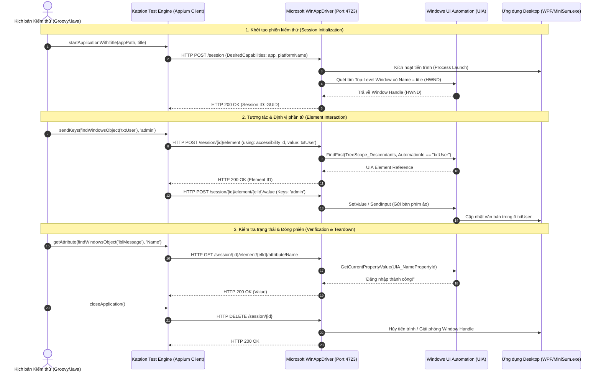
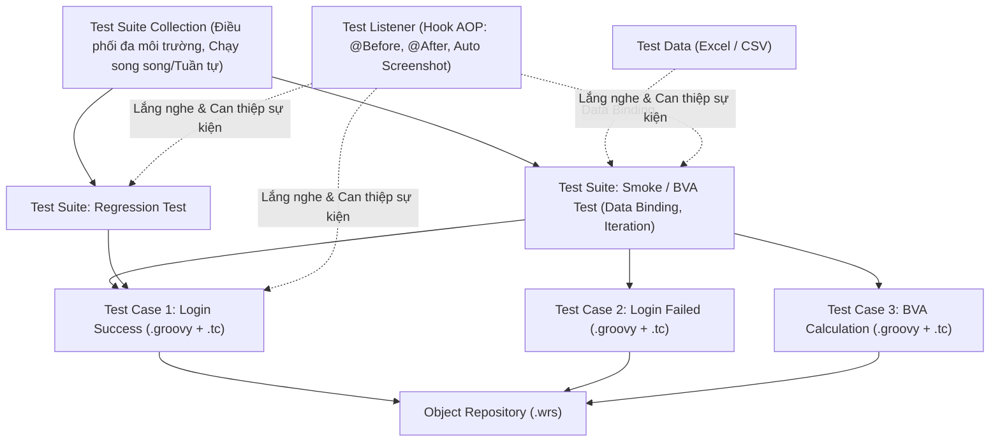

# BÁO CÁO TOÀN VĂN CHUYÊN ĐỀ SEMINAR
# AUTOMATION TESTING FOR DESKTOP APPLICATIONS
## Tự Động Hóa Kiểm Thử Cho Ứng Dụng Desktop (Windows)

> **Môn học:** Software Testing (Kiểm thử phần mềm)  
> **Khoa:** Công nghệ Thông tin – Trường Đại học Khoa học Tự nhiên, ĐHQG-HCM  
> **Nhóm thực hiện:** Nhóm 02 (ZipTool)  
> **Học kỳ:** HK1 – Năm học 2026-2027  
> **Thời gian nộp bài:** 30/10/2026 (Hạn chót giảng viên: 31/10/2026)

---

## 👥 THÀNH VIÊN VÀ ĐÁNH GIÁ ĐÓNG GÓP THỰC TẾ (LẦN 2)

| STT | Họ và Tên | MSSV | Vai trò chính Lần 2 | Đóng góp thực tế | % Chốt | Trạng thái |
|:---:|---|:---:|---|---|:---:|:---:|
| 1 | **Phan Trung Tín** | 23120372 | **Trưởng nhóm (Team Lead)**<br>Phát triển 3 bản `MiniSum.exe`, viết lý thuyết POM/Flaky/Wait/Oracle, slide PPTX, thực nghiệm AI, tích hợp & đóng gói | 42.0h (22 tasks) | **35.0%** | Hoàn thành xuất sắc |
| 2 | **Nguyễn Lê Quang Kan** | 23120279 | **Chuyên trách Katalon Studio**<br>Thực nghiệm 3 demo Katalon, viết Custom Keyword `LoginKeyword.groovy`, Data-Driven BVA, 16 ảnh thực nghiệm, video YouTube | 42.0h (18 tasks) | **35.0%** | Hoàn thành xuất sắc |
| 3 | **Bùi Quang Tùng** | 20120397 | **Chuyên trách WinAppDriver**<br>Thực nghiệm WinAppDriver + C# NUnit, cài đặt Page Object Model (POM), DDT 12 ca BVA, chụp ảnh kiểm thử | 36.0h (21 tasks) | **30.0%** | Hoàn thành tốt |
| 4 | **Trần Vũ Quang** | 23120346 | Thành viên nhóm | 0.0h (0 tasks) | **0.0%** | Không đạt tiến độ |
| 5 | **Phạm Tấn Phát** | 20120636 | Thành viên nhóm | 0.0h (0 tasks) | **0.0%** | Không đạt tiến độ |
| **Tổng** | | | | **120.0h (61 tasks)** | **100.0%** | |

---

## 📋 MỤC LỤC TỔNG QUAN

1. [Phần 1: Giới Thiệu & Bối Cảnh (Introduction)](#phan-1)
2. [Phần 2: Cơ Sở Lý Thuyết Kiểm Thử Tự Động Desktop (Theory)](#phan-2)
3. [Phần 3: Khảo Sát Thị Trường & Bộ Tiêu Chí Đánh Giá (Tool Survey)](#phan-3)
4. [Phần 4: Nghiên Cứu Công Cụ Đại Diện A – Katalon Studio](#phan-4)
5. [Phần 5: Nghiên Cứu Công Cụ Đại Diện B – Microsoft WinAppDriver](#phan-5)
6. [Phần 6: So Sánh Đối Chiếu Toàn Diện (Comparison)](#phan-6)
7. [Phần 7: Ứng Dụng Trí Tuệ Nhân Tạo (AI) Trong Desktop Automation](#phan-7)
8. [Phần 8: Hệ Thống Bài Tập Thực Hành Đề Xuất (Exercise)](#phan-8)
9. [Phần 9: Minh Chứng Thực Nghiệm, Kê Khai AI & Kết Luận](#phan-9)

---


# Phần 1: Giới Thiệu & Bối Cảnh (Introduction) <a id="phan-1"></a>

# Automation Testing for Desktop Applications
## Phần 1: Introduction

> **Seminar – Phụ trách:** Tín  
> **Nội dung:** Bối cảnh · Lý do chọn đề tài · Mục tiêu seminar · Phạm vi kiểm thử  
> **Cập nhật lần cuối:** 02/10/2026  
> **Trạng thái:** Hoàn thành  

---

## 1. Bối cảnh

Phần mềm desktop vẫn chiếm vai trò đặc biệt quan trọng trong nhiều lĩnh vực: tài chính, ngân hàng, y tế, sản xuất công nghiệp, thiết kế đồ họa, kỹ thuật và quản trị nội bộ doanh nghiệp. Không giống như các ứng dụng web chạy trên nền trình duyệt, desktop app được cài đặt và vận hành trực tiếp trên hệ điều hành máy tính, tương tác sâu với tài nguyên phần cứng (file system, registry, drivers, thiết bị ngoại vi, GPU…) và đòi hỏi tiêu chuẩn rất cao về tính ổn định, độ bảo mật và hiệu năng.

Trong kỷ nguyên phát triển phần mềm theo các mô hình Agile/DevOps và CI/CD, chu kỳ phát hành phần mềm bị rút ngắn đáng kể. Các phương pháp kiểm thử thủ công (manual testing) thuần túy không còn đáp ứng kịp thời về tốc độ phản hồi lẫn độ phủ thử nghiệm, dễ dẫn đến hiện tượng trôi bug hoặc chậm tiến độ. Do đó, **Automation Testing** (Kiểm thử tự động) cho desktop applications trở thành một giải pháp tất yếu nhằm nâng cao chất lượng phần mềm và tối ưu chi phí kiểm thử dài hạn.

---

## 2. Lý do chọn đề tài

| Vấn đề thực tiễn | Lý do quan tâm nghiên cứu |
|---|---|
| **Vị trí của desktop app trong doanh nghiệp** | Nhiều hệ thống cốt lõi vẫn chạy trên desktop (ERP, SCADA, POS, ứng dụng xử lý dữ liệu nặng), nhu cầu kiểm thử chất lượng không suy giảm. |
| **Chi phí và hạn chế của kiểm thử thủ công** | Kiểm thử hồi quy bằng tay qua nhiều phiên bản tốn rất nhiều thời gian, công sức và dễ phát sinh sai sót do thao tác lặp lại. |
| **Độ phức tạp đặc thù của kiểm thử desktop** | Khác với web vốn chuẩn hóa theo DOM và HTML, desktop app phân mảnh sâu sắc theo framework UI (Win32, WPF, WinForms, Qt, Electron), đòi hỏi công cụ và kỹ thuật định danh chuyên biệt. |
| **Thách thức trong việc lựa chọn công cụ** | Hệ sinh thái công cụ automation desktop rất đa dạng (mã nguồn mở, thương mại, GUI-based, code-based), đội ngũ kiểm thử cần bộ tiêu chí rõ ràng để chọn đúng giải pháp. |
| **Xu hướng ứng dụng trí tuệ nhân tạo (AI)** | Các công nghệ GenAI và Computer Vision đang định hình lại cách sinh kịch bản kiểm thử, tự phục hồi selector (self-healing) và phân tích log lỗi. |

---

## 3. Mục tiêu seminar

```
┌─────────────────────────────────────────────────────────┐
│              MỤC TIÊU CỐT LÕI CỦA SEMINAR               │
│                                                         │
│  1. Làm chủ lý thuyết nền tảng về Automation Testing    │
│     dành riêng cho môi trường Desktop Applications      │
│                                                         │
│  2. Khảo sát thị trường và thiết lập bộ tiêu chí chuẩn  │
│     nhằm đánh giá, so sánh 2 công cụ đại diện           │
│                                                         │
│  3. Xây dựng kịch bản thực nghiệm và demo thực tế:      │
│     - Quy trình cài đặt môi trường                      │
│     - Kịch bản kiểm thử cơ bản (Record & Playback, DDT) │
│     - Kịch bản workflow phức tạp                        │
│                                                         │
│  4. Nghiên cứu tiềm năng ứng dụng AI trong hỗ trợ       │
│     tự động hóa kiểm thử desktop                        │
│                                                         │
│  5. Thiết kế bài tập thực hành ứng dụng cho lớp         │
└─────────────────────────────────────────────────────────┘
```

---

## 4. Phạm vi seminar

- **Hệ điều hành mục tiêu:** Môi trường Microsoft Windows (chiếm đa số các ứng dụng desktop doanh nghiệp).
- **Công nghệ ứng dụng thử nghiệm:** Ứng dụng xây dựng trên các nền tảng phổ biến như WinForms, WPF, Win32 hoặc Electron.
- **Kỹ thuật kiểm thử trọng tâm:**
  - Record & Playback (Ghi nhận và phát lại hành vi thao tác)
  - Data-Driven Testing (Kiểm thử điều khiển bằng dữ liệu)
  - Checkpoints & Assertions (Điểm kiểm tra trạng thái và dữ liệu)
  - Quản lý và xử lý đồng bộ hóa giao diện (Synchronization & Waits)
- **Mức độ nội dung:** Kết hợp từ cơ sở lý thuyết chuẩn mực đến thực hành triển khai mã nguồn demo và bài tập cụ thể.


# Phần 2: Cơ Sở Lý Thuyết Kiểm Thử Tự Động Desktop (Theory) <a id="phan-2"></a>

# Automation Testing for Desktop Applications
## Phần 2: Theory

> **Seminar – Phụ trách:** Tín  
> **Nội dung:** Khái niệm cốt lõi · Kỹ thuật tự động hóa · Thách thức đặc thù · Thuật ngữ  
> **Cập nhật lần cuối:** 27/10/2026 (bổ sung Lần 2: POM, Flaky Test, Wait, Test Oracle, Recovery Testing)  
> **Trạng thái:** Hoàn thành  

---

## Mục lục

1. [Automation Testing là gì?](#1-automation-testing-là-gì)
2. [Desktop Application Testing](#2-desktop-application-testing)
   - 2.1 [Phân loại Desktop Application](#21-phân-loại-desktop-application)
   - 2.2 [Các loại kiểm thử áp dụng cho Desktop App](#22-các-loại-kiểm-thử-áp-dụng-cho-desktop-app)
3. [Đặc điểm & Khó khăn đặc thù](#3-đặc-điểm--khó-khăn-đặc-thù)
   - 3.1 [Đặc điểm nổi bật](#31-đặc-điểm-nổi-bật)
   - 3.2 [Khó khăn đặc thù khi Automation](#32-khó-khăn-đặc-thù-khi-automation)
4. [Record & Playback](#4-record--playback)
   - 4.1 [Khái niệm](#41-khái-niệm)
   - 4.2 [Luồng hoạt động](#42-luồng-hoạt-động)
   - 4.3 [Ưu điểm & Nhược điểm](#43-ưu-điểm--nhược-điểm)
5. [Data-Driven Testing (DDT)](#5-data-driven-testing-ddt)
   - 5.1 [Khái niệm](#51-khái-niệm)
   - 5.2 [Ví dụ thực tế kịch bản đăng nhập](#52-ví-dụ-thực-tế-kịch-bản-đăng-nhập)
6. [Checkpoints & Assertions](#6-checkpoints--assertions)
   - 6.1 [Khái niệm](#61-khái-niệm)
   - 6.2 [Phân loại Checkpoint](#62-phân-loại-checkpoint)
   - 6.3 [Kiến trúc Assertion](#63-kiến-trúc-assertion)
7. [Page Object Model (POM)](#7-page-object-model-pom)
   - 7.1 [Khái niệm](#71-khái-niệm)
   - 7.2 [Ví dụ trên MiniSum](#72-ví-dụ-trên-minisum)
   - 7.3 [POM trong Katalon Studio và WinAppDriver](#73-pom-trong-katalon-studio-và-winappdriver)
   - 7.4 [Ưu điểm, nhược điểm và nguyên tắc áp dụng](#74-ưu-điểm-nhược-điểm-và-nguyên-tắc-áp-dụng)
8. [Flaky Test](#8-flaky-test)
   - 8.1 [Khái niệm và biểu hiện](#81-khái-niệm-và-biểu-hiện)
   - 8.2 [Nguyên nhân gốc rễ](#82-nguyên-nhân-gốc-rễ)
   - 8.3 [Cách phát hiện](#83-cách-phát-hiện)
   - 8.4 [Cách xử lý](#84-cách-xử-lý)
9. [Wait Strategy – Implicit, Explicit và Fluent Wait](#9-wait-strategy--implicit-explicit-và-fluent-wait)
   - 9.1 [Vì sao phải chờ](#91-vì-sao-phải-chờ)
   - 9.2 [Implicit Wait](#92-implicit-wait)
   - 9.3 [Explicit Wait](#93-explicit-wait)
   - 9.4 [Fluent Wait](#94-fluent-wait)
   - 9.5 [So sánh và cách chọn](#95-so-sánh-và-cách-chọn)
10. [Test Oracle](#10-test-oracle)
   - 10.1 [Khái niệm](#101-khái-niệm)
   - 10.2 [Phân loại Test Oracle](#102-phân-loại-test-oracle)
   - 10.3 [Test Oracle trong kiểm thử tự động](#103-test-oracle-trong-kiểm-thử-tự-động)
   - 10.4 [Bài toán Oracle và giới hạn](#104-bài-toán-oracle-và-giới-hạn)
11. [Recovery Testing](#11-recovery-testing)
   - 11.1 [Khái niệm](#111-khái-niệm)
   - 11.2 [Kịch bản sự cố thường gặp](#112-kịch-bản-sự-cố-thường-gặp)
   - 11.3 [Cơ chế phục hồi trong automation](#113-cơ-chế-phục-hồi-trong-automation)
   - 11.4 [Checklist kiểm tra khả năng phục hồi](#114-checklist-kiểm-tra-khả-năng-phục-hồi)
12. [Fully vs Semi-Automated](#12-fully-vs-semi-automated)
   - 12.1 [Fully Automated](#121-fully-automated)
   - 12.2 [Semi-Automated](#122-semi-automated)
   - 12.3 [So sánh chi tiết](#123-so-sánh-chi-tiết)
13. [Ưu điểm & Nhược điểm của Automation Testing](#13-ưu-điểm--nhược-điểm-của-automation-testing)
14. [Khi nào nên dùng Automation Testing?](#14-khi-nào-nên-dùng-automation-testing)
15. [Bảng thuật ngữ chuyên ngành](#15-bảng-thuật-ngữ-chuyên-ngành)

---

## 1. Automation Testing là gì?

**Automation Testing** (Kiểm thử tự động) là quá trình áp dụng các công cụ phần mềm chuyên dụng nhằm thực thi tự động các kịch bản kiểm thử (test cases), tự động nhập dữ liệu đầu vào, tương tác với giao diện người dùng hoặc tầng API, và so sánh kết quả thực tế (actual results) với kết quả kỳ vọng (expected results) mà không cần sự can thiệp thủ công của con người trong quá trình chạy.

```
┌──────────────┐    Kịch bản kiểm thử    ┌──────────────────┐
│   Tester     │ ──────────────────────► │  Automation Tool │
│  (Thiết kế,  │                         │  (Thực thi test) │
│   Phân tích) │ ◄────────────────────── │                  │
└──────────────┘      Báo cáo kết quả    └────────┬─────────┘
                                                  │ Tương tác
                                                  ▼
                                         ┌──────────────────┐
                                         │  Ứng dụng cần    │
                                         │  kiểm thử (AUT)  │
                                         └──────────────────┘
```

> **Lưu ý:** Kiểm thử tự động không nhằm mục đích thay thế hoàn toàn con người. Tester vẫn giữ vai trò quyết định trong việc xây dựng chiến lược kiểm thử, thiết kế kịch bản kiểm thử biên/ngoại lệ, phân tích nguyên nhân lỗi và bảo trì bộ kịch bản tự động.

---

## 2. Desktop Application Testing

### 2.1 Phân loại Desktop Application

Khác với web applications chủ yếu dựa trên kiến trúc DOM HTML/CSS, các ứng dụng desktop được xây dựng trên nhiều kiến trúc và công nghệ giao diện khác nhau:

```
Desktop Applications
├── Ứng dụng bản địa thuần túy (Windows Native Apps)
│   ├── Win32 / MFC (C++, giao diện Windows truyền thống)
│   ├── WinForms (.NET Framework, mô hình hướng sự kiện)
│   ├── WPF (Windows Presentation Foundation - kiến trúc XAML, DirectX)
│   └── UWP (Universal Windows Platform - ứng dụng hiện đại từ Windows Store)
├── Ứng dụng đa nền tảng (Cross-Platform Native Apps)
│   ├── Qt (C++/QML, phổ biến trong hệ thống nhúng và công nghiệp)
│   └── JavaFX / Swing (Java Virtual Machine)
└── Ứng dụng lai (Hybrid / Embedded Web Apps)
    ├── Electron (Đóng gói Chromium + Node.js: VS Code, Slack, Teams)
    └── .NET MAUI / Blazor Hybrid (Kết hợp WebView2 và .NET)
```

Mỗi nền tảng UI trên đòi hỏi cơ chế nhận diện phần tử (Accessibility layer / UI Automation API) khác nhau, ảnh hưởng trực tiếp đến khả năng hỗ trợ của từng công cụ kiểm thử tự động.

### 2.2 Các loại kiểm thử áp dụng cho Desktop App

| Loại kiểm thử | Mục đích chính | Khả năng tự động hóa |
|---|---|---|
| **Functional Testing** | Xác minh các chức năng nghiệp vụ hoạt động đúng đặc tả | Rất phù hợp (Mức độ cao) |
| **Regression Testing** | Đảm bảo mã nguồn mới không làm hỏng tính năng đang chạy ổn định | Rất phù hợp (Mức độ rất cao) |
| **Smoke / Sanity Testing** | Kiểm tra nhanh các luồng cơ bản sau mỗi bản build mới | Rất phù hợp (Mức độ cao) |
| **UI Testing** | Kiểm tra bố cục, màu sắc, font chữ, trạng thái component | Phù hợp (Mức độ trung bình) |
| **Performance Testing** | Đo lường thời gian khởi động, mức chiếm dụng CPU, RAM, disk I/O | Rất phù hợp (Mức độ cao) |
| **Usability Testing** | Đánh giá độ thân thiện và trải nghiệm người dùng | Hạn chế (Cần con người đánh giá) |
| **Exploratory Testing** | Khám phá tự do nhằm tìm lỗi tiềm ẩn ngoài kịch bản định sẵn | Không khả thi (Đòi hỏi tư duy sáng tạo) |

---

## 3. Đặc điểm & Khó khăn đặc thù

### 3.1 Đặc điểm nổi bật

- **Tương tác sâu với hệ điều hành:** Desktop app chạy trực tiếp trên OS, truy cập trực tiếp vào hệ thống tệp tin, registry, tiến trình hệ thống, bộ nhớ và các dịch vụ nền.
- **Phụ thuộc cấu hình phần cứng và môi trường:** Độ phân giải màn hình, tỷ lệ co giãn DPI (DPI scaling), số lượng màn hình phụ (multi-monitor), card đồ họa, máy in, scanner... đều có thể làm thay đổi cách ứng dụng kết xuất giao diện.
- **Không có chuẩn DOM đồng nhất:** Mỗi công nghệ UI (Win32, WPF, Qt, Electron) dùng cây cấu trúc giao diện và thuộc tính nhận dạng hoàn toàn khác nhau.

### 3.2 Khó khăn đặc thù khi Automation

```
CÁC THÁCH THỨC CHÍNH TRONG DESKTOP AUTOMATION TESTING
───────────────────────────────────────────────────────────────
1. Nhận diện phần tử giao diện (Object Recognition)
   • Không có chuẩn CSS Selector hay thuộc tính ID nhất quán như web.
   • Nhiều control cũ (Win32 custom controls) không hỗ trợ UI Automation.
   • Giao diện bị ảnh hưởng bởi theme hệ điều hành, ngôn ngữ và DPI.

2. Đồng bộ hóa thời gian thực (Synchronization & Timing)
   • Không có sự kiện "Page Load" hay "Network Idle" rõ ràng như trình duyệt.
   • Dễ dẫn đến lỗi kịch bản chạy nhanh hơn tốc độ render của app (Flaky test).
   • Cần cơ chế chờ thông minh (Explicit Wait) thay vì thời gian chờ cố định (Sleep).

3. Quản lý cửa sổ và hộp thoại hệ thống
   • Các popup hệ điều hành (Open/Save File Dialog, Print Dialog) là tiến trình riêng.
   • Xử lý đa cửa sổ (MDI - Multiple Document Interface) đòi hỏi chuyển đổi ngữ cảnh.

4. Môi trường thực thi kịch bản (Execution Environment)
   • Khó chạy chế độ không màn hình (Headless mode) như web; cần Desktop Session thật.
   • Màn hình bị khóa (Lock screen) hoặc thu nhỏ (Minimize) có thể làm gián đoạn test.

5. Chi phí bảo trì kịch bản kiểm thử (Script Maintenance)
   • Khi nhà phát triển thay đổi giao diện, selector có thể bị đứt gãy hàng loạt.
   • Chi phí bảo trì nếu thiết kế kịch bản kém có thể vượt quá chi phí kiểm thử thủ công.
```

---

## 4. Record & Playback

### 4.1 Khái niệm

**Record & Playback** (Ghi và Phát lại) là kỹ thuật kiểm thử tự động trong đó công cụ lắng nghe và ghi nhận các thao tác chuột (click, drag-drop) và bàn phím (keystrokes) của người dùng trên ứng dụng cần kiểm thử. Sau đó, công cụ lưu lại chuỗi hành động này dưới dạng kịch bản để có thể tự động chạy lại nhiều lần.

```
GIAI ĐOẠN GHI (RECORD)               GIAI ĐOẠN PHÁT LẠI (PLAYBACK)
──────────────────────               ────────────────────────────
Tester thao tác trực tiếp            Công cụ tự động gửi tín hiệu
trên ứng dụng (AUT)       ──Script──► mô phỏng hành vi người dùng
                                     và kiểm tra kết quả kỳ vọng
Công cụ bắt đối tượng UI
và sinh mã kịch bản
```

### 4.2 Luồng hoạt động

```
[Bắt đầu quá trình Record]
            │
            ▼
[Tester thao tác các bước kiểm thử trên AUT]
            │
            ▼
[Công cụ bắt sự kiện: Control Name, AutomationId, Tọa độ, Thao tác nhập]
            │
            ▼
[Công cụ tự động sinh mã kịch bản (C#, Python, Groovy, VBScript...)]
            │
            ▼
[Tester bổ sung các Checkpoint / Assertion và tối ưu hóa selector]
            │
            ▼
[Chạy Playback: Công cụ điều khiển AUT và đối chiếu kết quả]
            │
            ▼
[Xuất báo cáo kết quả kiểm thử (Thành công / Thất bại)]
```

### 4.3 Ưu điểm & Nhược điểm

| Tiêu chí | Ưu điểm | Nhược điểm |
|---|---|---|
| **Độ dốc tiếp cận** | Rất dễ học, người kiểm thử không cần kiến thức lập trình sâu. | Dễ phụ thuộc vào công cụ, khó tùy biến luồng phức tạp. |
| **Thời gian tạo test** | Nhanh chóng tạo được kịch bản kiểm thử ban đầu. | Kịch bản sinh ra thường dài dòng, dư thừa nhiều thao tác thừa. |
| **Bảo trì** | Thích hợp tạo nhanh smoke test đơn giản ban đầu. | Rất dễ bị gãy (fragile) khi giao diện thay đổi dù chỉ một vị trí nhỏ. |
| **Xử lý dữ liệu** | Phù hợp với dữ liệu cố định trong kịch bản mẫu. | Không xử lý được dữ liệu động, logic phân nhánh hay vòng lặp. |

---

## 5. Data-Driven Testing (DDT)

### 5.1 Khái niệm

**Data-Driven Testing (DDT)** là phương pháp kiểm thử tự động tách rời hoàn toàn **logic của kịch bản kiểm thử** khỏi **tập dữ liệu kiểm thử**. Một kịch bản logic duy nhất được tham số hóa (parameterized) và thực thi lặp lại nhiều lần với từng dòng dữ liệu lấy từ nguồn lưu trữ bên ngoài (Excel, CSV, JSON, Database hoặc API).

```
┌────────────────────────┐      ┌──────────────────────────────────┐
│ Kịch bản kiểm thử      │◄─────│ Nguồn dữ liệu kiểm thử           │
│ (Logic kịch bản chung) │      │ (Excel / CSV / DB / JSON)        │
└───────────┬────────────┘      │                                  │
            │                   │ Dòng 1: admin / P@ssw0rd1        │
            │ Lần chạy 1        │ Dòng 2: user_01 / wrong_pass     │
            │ Lần chạy 2        │ Dòng 3: empty_user / 123456      │
            │ Lần chạy 3        └──────────────────────────────────┘
            ▼
┌────────────────────────┐
│ Báo cáo kết quả        │
│ (Kết quả chi tiết cho  │
│ từng bộ dữ liệu)       │
└────────────────────────┘
```

### 5.2 Ví dụ thực tế kịch bản đăng nhập

Kịch bản kiểm thử tổng quát cho chức năng đăng nhập:

```
HÀM KIỂM THỬ: test_login(username, password, expected_outcome)
───────────────────────────────────────────────────────────────────
Bước 1: Khởi chạy ứng dụng và điều hướng đến màn hình Đăng nhập
Bước 2: Xóa trường Username và nhập giá trị: {username}
Bước 3: Xóa trường Password và nhập giá trị: {password}
Bước 4: Nhấn nút "Đăng nhập"
Bước 5: Kiểm tra kết quả thực tế hiển thị phải khớp với: {expected_outcome}
```

Bảng dữ liệu đầu vào (tập tin `login_dataset.xlsx`):

| Trường hợp | username | password | expected_outcome |
|---|---|---|---|
| TC01: Đăng nhập hợp lệ | `admin_system` | `Secured#2026` | Chuyển đến màn hình Dashboard chính |
| TC02: Sai mật khẩu | `admin_system` | `wrong_pass` | Thông báo: "Mật khẩu không chính xác" |
| TC03: Để trống tài khoản | *(để trống)* | `12345678` | Thông báo: "Tên đăng nhập không được để trống" |
| TC04: Để trống mật khẩu | `admin_system` | *(để trống)* | Thông báo: "Mật khẩu không được để trống" |
| TC05: Tài khoản bị khóa | `locked_user` | `User@1234` | Thông báo: "Tài khoản hiện đang bị tạm khóa" |

---

## 6. Checkpoints & Assertions

### 6.1 Khái niệm

**Checkpoint** (hay **Assertion**) là điểm kiểm tra trong kịch bản tự động, tại đó công cụ lấy trạng thái/giá trị thực tế của ứng dụng (Actual Result) và đem so sánh với trạng thái/giá trị kỳ vọng (Expected Result).

> **Lưu ý:** Một kịch bản tự động thực hiện từ đầu đến cuối mà **không có checkpoint** thì chỉ là một đoạn script mô phỏng thao tác người dùng (bot tự động), không thể coi là kịch bản kiểm thử hợp lệ vì không có cơ chế kết luận PASS hay FAIL.

### 6.2 Phân loại Checkpoint

| Loại Checkpoint | Đối tượng kiểm tra | Ví dụ áp dụng trên Desktop App |
|---|---|---|
| **Text / Value Checkpoint** | Nội dung chuỗi ký tự hiển thị trên control | Kiểm tra nhãn trạng thái hiển thị "Đăng nhập thành công" |
| **Property Checkpoint** | Thuộc tính của thành phần giao diện | Nút "Lưu" chuyển từ Disabled sang Enabled sau khi điền đủ form |
| **Bitmap / Image Checkpoint** | So sánh ảnh chụp pixel hoặc vùng ảnh | Kiểm tra đồ thị phân tích hoặc hình vẽ kết xuất đúng chuẩn |
| **Table / DataGrid Checkpoint** | Toàn bộ dữ liệu hiển thị trong bảng | Đối chiếu danh sách 100 giao dịch hiển thị trên DataGridView |
| **File Checkpoint** | Tệp tin xuất ra từ ứng dụng | So sánh tệp báo cáo PDF/Excel xuất ra với tệp chuẩn mẫu |
| **Database Checkpoint** | Dữ liệu lưu xuống cơ sở dữ liệu ngầm | Kiểm tra sau khi nhấn Save, một bản ghi mới được thêm vào DB |

### 6.3 Kiến trúc Assertion

```
[Thực hiện hành động thao tác trên AUT]
                  │
                  ▼
[Trích xuất giá trị thực tế từ phần tử UI (Actual Value)]
                  │
                  ▼
[So sánh đối chiếu với giá trị kỳ vọng (Expected Value)]
                  │
        ┌─────────┴─────────┐
        ▼                   ▼
  Khớp giá trị         Không khớp giá trị
(Test Case PASS)       (Test Case FAIL)
                            │
                            ▼
              [Chụp ảnh màn hình tại thời điểm lỗi]
              [Ghi log chi tiết thông số và stacktrace]
              [Đánh dấu trạng thái lỗi vào báo cáo]
```

---

## 7. Page Object Model (POM)

### 7.1 Khái niệm

**Page Object Model (POM)** là mẫu thiết kế (design pattern) trong kiểm thử tự động, trong đó **mỗi màn hình hoặc cửa sổ của ứng dụng được biểu diễn bằng một lớp (class) riêng**. Lớp này đóng gói ba thành phần:

1. **Locator** – định danh các phần tử giao diện (`AutomationId`, `Name`, `XPath`…).
2. **Hành động** – các thao tác người dùng thực hiện được trên màn hình (nhập liệu, nhấn nút, chuyển màn hình).
3. **Truy vấn trạng thái** – các hàm đọc dữ liệu phục vụ checkpoint (lấy nội dung nhãn, kiểm tra nút đang Enabled hay Disabled).

Kịch bản kiểm thử **không thao tác trực tiếp lên control**, mà gọi các phương thức nghiệp vụ do page object cung cấp. Nhờ vậy khi giao diện thay đổi, chỉ cần sửa **một chỗ** trong page object thay vì sửa toàn bộ kịch bản.

```
        Không dùng POM                        Dùng POM
┌───────────────────────────┐        ┌───────────────────────────┐
│ TC01_Login                │        │ TC01_Login                │
│  find("txtUser").sendKeys│        │  loginPage.Login(u, p)    │
│  find("txtPass").sendKeys│        │  Assert(lblMessage)       │
│  find("btnLogin").click  │        └─────────────┬─────────────┘
│  find("lblMessage")...   │                      │ gọi
└───────────────────────────┘        ┌─────────────▼─────────────┐
   Locator rải khắp test case        │ LoginPage                 │
   → đổi UI phải sửa nhiều nơi       │  locator + Login()        │
                                     └───────────────────────────┘
                                        Locator tập trung một nơi
```

### 7.2 Ví dụ trên MiniSum

Giả sử cần kiểm thử màn hình đăng nhập của `MiniSum.exe`. Cách viết **không có POM** lặp lại locator trong từng test case:

```csharp
// TC01 - lặp locator ngay trong test
driver.FindElementByAccessibilityId("txtUser").SendKeys("admin");
driver.FindElementByAccessibilityId("txtPass").SendKeys("1234");
driver.FindElementByAccessibilityId("btnLogin").Click();
Assert.AreEqual("Dang nhap thanh cong",
    driver.FindElementByAccessibilityId("lblMessage").Text);
```

Cách viết **có POM** – tách thành `LoginPage` và `CalculatorPage`:

```csharp
// PageObjects/LoginPage.cs
public class LoginPage
{
    private readonly WindowsDriver<WindowsElement> driver;

    public LoginPage(WindowsDriver<WindowsElement> driver) => this.driver = driver;

    private WindowsElement TxtUser => driver.FindElementByAccessibilityId("txtUser");
    private WindowsElement TxtPass => driver.FindElementByAccessibilityId("txtPass");
    private WindowsElement BtnLogin => driver.FindElementByAccessibilityId("btnLogin");
    private WindowsElement LblMessage => driver.FindElementByAccessibilityId("lblMessage");

    public void Login(string user, string pass)
    {
        TxtUser.Clear();
        TxtUser.SendKeys(user);
        TxtPass.SendKeys(pass);
        BtnLogin.Click();
    }

    public string Message => LblMessage.Text;
}
```

```csharp
// TC01_Login_Success.cs - test case chỉ còn nghiệp vụ
var loginPage = new LoginPage(driver);
loginPage.Login("admin", "1234");

Assert.AreEqual("Dang nhap thanh cong", loginPage.Message);
var calculatorPage = new CalculatorPage(driver);
Assert.IsTrue(calculatorPage.IsDisplayed());
```

Khi bản **v2** đổi `btnSum` thành `btnCalculate`, chỉ `CalculatorPage` phải sửa; toàn bộ test case dùng lại vẫn giữ nguyên. Đây chính là kịch bản **maintenance & self-healing** được demo trong seminar.

### 7.3 POM trong Katalon Studio và WinAppDriver

| Công cụ | Cách hiện thực POM | Ghi chú |
|---|---|---|
| **Katalon Studio** | **Object Repository** đóng vai trò kho locator dùng chung; mỗi màn hình là một thư mục (`MiniSum/Login`, `MiniSum/Calculator`). Test case tham chiếu `findWindowsObject('Object Repository/...')` thay vì khai báo locator trực tiếp. Có thể bọc thêm **Custom Keyword** để tạo lớp hành vi (`LoginKeyword.login()`) | POM ở mức “locator tập trung”, chưa phải class đầy đủ |
| **WinAppDriver + C# NUnit** | Tạo thư mục `PageObjects/` với `LoginPage.cs`, `CalculatorPage.cs`; test case chỉ gọi phương thức | POM đầy đủ theo hướng lập trình hướng đối tượng |

### 7.4 Ưu điểm, nhược điểm và nguyên tắc áp dụng

| Ưu điểm | Nhược điểm |
|---|---|
| Locator tập trung → bảo trì nhanh khi UI đổi | Tốn công thiết kế ban đầu, nhiều file hơn |
| Test case đọc như tài liệu nghiệp vụ, giảm trùng lặp | Với ứng dụng rất nhỏ, POM có thể là over-engineering |
| Tái sử dụng hành động giữa nhiều test case | Dễ phình to nếu nhồi cả logic kiểm thử vào page object |
| Hỗ trợ phân công: người viết page object và người viết test case độc lập | Cần kỷ luật đặt tên, nếu không sẽ thành “God class” |

**Nguyên tắc áp dụng:**
- Page object **chỉ mô tả giao diện**, **không chứa assertion**; assertion thuộc về test case.
- Một page object tương ứng một màn hình (hoặc một thành phần tái sử dụng như dialog, toolbar).
- Phương thức nên diễn đạt **ý định nghiệp vụ** (`Login`, `Calculate`, `OpenHistory`) thay vì `ClickButton1`.
- Trả về page object tiếp theo khi hành động làm chuyển màn hình (`Login()` trả về `CalculatorPage`) để test case mô tả đúng luồng.

---

## 8. Flaky Test

### 8.1 Khái niệm và biểu hiện

**Flaky Test** là kịch bản kiểm thử cho kết quả **không ổn định giữa các lần chạy dù mã nguồn ứng dụng và mã kiểm thử không thay đổi**: lần chạy PASS, lần chạy FAIL, có khi FAIL rồi PASS khi chạy lại ngay lập tức.

Flaky test là vấn đề nghiêm trọng hơn việc “không có test”, vì:

- Đội phát triển **mất niềm tin** vào bộ kiểm thử: khi test báo FAIL, không ai biết là ứng dụng lỗi thật hay test lỗi.
- Tốn thời gian điều tra lại các lỗi “ma”, làm chậm pipeline CI/CD.
- Che giấu lỗi thật: một khi nhóm đã quen với việc “chạy lại là PASS”, lỗi thật sẽ bị bỏ qua.

**Biểu hiện thường gặp trên desktop automation:**

| Biểu hiện | Ví dụ với MiniSum |
|---|---|
| PASS/FAIL xen kẽ trên cùng máy | `TC03_BVA` lúc đọc được `lblResult`, lúc đọc được chuỗi rỗng |
| Chỉ FAIL trên máy CI hoặc máy chậm hơn | Máy yếu nên cửa sổ Calculator xuất hiện sau khi script đã tìm control |
| Phụ thuộc thứ tự chạy | Chạy riêng thì PASS, chạy cả suite thì FAIL do cửa sổ cũ còn mở |
| FAIL khi màn hình bị khoá / đổi độ phân giải | Toạ độ click sai khi scale 125% hoặc khi RDP |

### 8.2 Nguyên nhân gốc rễ

| Nhóm nguyên nhân | Mô tả | Ví dụ |
|---|---|---|
| **Timing / bất đồng bộ** | Script chạy nhanh hơn tốc độ ứng dụng phản hồi | Đọc `lblMessage` trước khi ứng dụng kịp cập nhật sau khi click |
| **Locator không ổn định** | Dùng locator sinh động (XPath theo index, toạ độ) | `//Button[3]` đổi vị trí khi thêm nút mới |
| **Trạng thái dùng chung** | Test này để lại dữ liệu/cửa sổ ảnh hưởng test khác | Test trước không đóng app, test sau mở thêm instance |
| **Dữ liệu test không cô lập** | Dùng chung file Excel/DB, không reset trước mỗi lần chạy | Lịch sử tính toán (v2) tích luỹ qua nhiều test |
| **Môi trường** | DPI, độ phân giải, ngôn ngữ, focus, phần mềm diệt virus | Windows scale 150% làm toạ độ click lệch |
| **Tài nguyên / session** | WinAppDriver session chết, port 4723 bị chiếm | Chạy song song nhiều test trên cùng session |

### 8.3 Cách phát hiện

1. **Chạy lặp**: thực thi cùng test N lần (ví dụ 10–20 lần) và thống kê tỉ lệ PASS. Test có tỉ lệ PASS < 100% là flaky.
2. **Ghi log đầy đủ**: timestamp từng bước, ảnh chụp màn hình tại thời điểm FAIL, giá trị Actual/Expected.
3. **Đo “flaky rate”** theo từng test case để ưu tiên sửa: test FAIL 1/20 lần vẫn phải xử lý.
4. **Chạy trên nhiều cấu hình**: máy nhanh/chậm, độ phân giải khác nhau, có/không có màn hình phụ.

### 8.4 Cách xử lý

| Biện pháp | Cách làm | Lưu ý |
|---|---|---|
| **Chờ tường minh (Explicit Wait)** | Chờ *điều kiện* cụ thể thay vì chờ cố định: `waitForElementPresent`, `WebDriverWait.Until(...)` | Ưu tiên số 1, xem mục 9 – Wait Strategy |
| **Locator ổn định** | Dùng `AutomationId` do đội phát triển đặt, tránh XPath theo index/toạ độ | MiniSum đặt sẵn `txtUser`, `btnLogin`, `lblResult`… |
| **Cô lập test** | Mỗi test tự chuẩn bị trạng thái đầu vào và dọn dẹp ở `finally`/`TearDown` | Không phụ thuộc test chạy trước |
| **Dữ liệu riêng** | Sinh dữ liệu cho từng lần chạy hoặc reset file test data | Tránh ghi đè chéo giữa các test |
| **Retry có kiểm soát** | Chỉ retry test đã được xác định là flaky, có ghi log số lần retry | Không dùng retry để “che” lỗi thật |
| **Quarantine** | Tách test flaky khỏi suite chính, theo dõi riêng cho tới khi sửa xong | Giữ suite chính luôn “xanh” và đáng tin |

**Phân biệt flaky test và lỗi thật:**

| Tiêu chí | Flaky Test | Lỗi thật của ứng dụng |
|---|---|---|
| Chạy lại nhiều lần | Kết quả thay đổi | Luôn FAIL |
| Thay đổi môi trường | Có thể PASS/FAIL khác nhau | FAIL ở mọi môi trường |
| Log/ảnh chụp | Thường cho thấy script thao tác sai thời điểm | Cho thấy giá trị thực tế sai so với đặc tả |
| Hành động | Sửa script (wait, locator, isolation) | Báo lỗi cho đội phát triển |

> **Liên hệ MiniSum:** sau khi đăng nhập thành công, ứng dụng cố ý **giữ màn hình Login thêm 1 giây** trước khi mở cửa sổ Calculator. Nếu script không chờ mà đọc `lblMessage` hoặc tìm `winMain` ngay lập tức, test sẽ flaky. Đây là tình huống được dùng để minh hoạ wait strategy ở mục tiếp theo.

---

## 9. Wait Strategy – Implicit, Explicit và Fluent Wait

### 9.1 Vì sao phải chờ

Trong desktop app, giao diện **không cập nhật đồng bộ với thao tác của script**: cửa sổ cần thời gian khởi tạo handle, hiệu ứng chuyển màn hình có animation, xử lý nghiệp vụ chạy trên UI thread, dữ liệu được tải từ đĩa/dịch vụ. Nếu script tìm control hoặc đọc giá trị ngay sau khi click, nó có thể chạy *trước* khi ứng dụng kịp phản hồi → sinh ra flaky test.

Có ba cơ chế chờ phổ biến trong automation desktop, đều được hỗ trợ bởi WinAppDriver/Appium và Katalon Studio.

### 9.2 Implicit Wait

**Implicit Wait** là thời gian chờ mặc định được cấu hình **một lần cho toàn bộ driver**. Mỗi khi gọi tìm phần tử, driver sẽ thử lại liên tục trong khoảng thời gian này trước khi ném `NoSuchElementException`.

```csharp
// C# – WinAppDriver: chờ tối đa 10 giây cho MỌI lệnh tìm phần tử
driver.Manage().Timeouts().ImplicitWait = TimeSpan.FromSeconds(10);
```

- **Ưu điểm:** cấu hình một dòng, áp dụng cho mọi locator, script gọn.
- **Nhược điểm:** không phân biệt được “phần tử chưa xuất hiện” với “phần tử không bao giờ xuất hiện” → test chậm và khó chẩn đoán; không kiểm tra được điều kiện phức tạp (text đã đổi chưa, nút đã Enabled chưa). Khi một phần tử thật sự không tồn tại, mỗi lần tìm đều phải chờ hết timeout.

### 9.3 Explicit Wait

**Explicit Wait** chờ **một điều kiện cụ thể** trên **một phần tử cụ thể**, với timeout riêng cho từng bước. Đây là cách được khuyến nghị.

```csharp
// C# – WinAppDriver: chờ cửa sổ Calculator xuất hiện (tối đa 10 giây)
var wait = new WebDriverWait(driver, TimeSpan.FromSeconds(10));
wait.Until(d => d.FindElementByAccessibilityId("winMain").Displayed);

// Chờ nhãn kết quả có nội dung mong đợi
var result = wait.Until(d =>
{
    var text = d.FindElementByAccessibilityId("lblResult").Text;
    return text == "Ket qua: 5 + 7 = 12" ? text : null;
});
```

```groovy
// Katalon Studio (Windows Desktop) – chờ cửa sổ và phần tử
Windows.waitForElementPresent(
    findWindowsObject('Object Repository/MiniSum/Calculator/winMain'), 10)
Windows.switchToWindowTitle('MiniSum - Tinh tong')
Windows.waitForElementPresent(
    findWindowsObject('Object Repository/MiniSum/Calculator/lblResult'), 10)
```

- **Ưu điểm:** rõ ràng về mặt ý định, chỉ chờ đúng nơi cần, timeout ngắn và dễ chẩn đoán khi FAIL, có thể chờ điều kiện phức tạp.
- **Nhược điểm:** phải viết thêm code; nếu quên ở một bước vẫn có thể flaky.

### 9.4 Fluent Wait

**Fluent Wait** là dạng mở rộng của Explicit Wait, cho phép cấu hình **tần suất kiểm tra (polling interval)** và **danh sách exception được bỏ qua** trong lúc chờ.

```csharp
var fluentWait = new DefaultWait<WindowsDriver<WindowsElement>>(driver)
{
    Timeout = TimeSpan.FromSeconds(15),
    PollingInterval = TimeSpan.FromMilliseconds(500)
};
fluentWait.IgnoreExceptionTypes(typeof(NoSuchElementException), typeof(StaleElementReferenceException));

string message = fluentWait.Until(d =>
{
    var el = d.FindElementByAccessibilityId("lblMessage");
    return string.IsNullOrWhiteSpace(el.Text) ? null : el.Text;
});
```

- **Ưu điểm:** kiểm soát chi tiết nhịp kiểm tra, bỏ qua các lỗi tạm thời (phần tử bị dựng lại → `StaleElementReference`), phù hợp với ứng dụng khởi động chậm hoặc có animation dài.
- **Nhược điểm:** cấu hình phức tạp, dễ lạm dụng thành “chờ vô tội vạ” làm test chậm.

### 9.5 So sánh và cách chọn

| Tiêu chí | Implicit Wait | Explicit Wait | Fluent Wait |
|---|---|---|---|
| Phạm vi | Toàn bộ driver | Từng bước | Từng bước |
| Điều kiện chờ | Chỉ “tìm thấy phần tử” | Mọi điều kiện tự định nghĩa | Mọi điều kiện + polling + ignore exception |
| Cấu hình | Một lần | Mỗi lần gọi | Mỗi lần gọi, nhiều tham số |
| Khả năng chẩn đoán khi FAIL | Thấp (chỉ biết timeout) | Cao | Cao |
| Khuyến nghị | Chỉ dùng làm lưới an toàn, timeout nhỏ (3–5s) | **Mặc định nên dùng** | Khi cần kiểm soát chi tiết |

**Nguyên tắc thực hành:**
- **Không dùng `Thread.Sleep`/`delay` cố định** làm cơ chế chờ chính: máy nhanh thì lãng phí, máy chậm vẫn flaky. Chỉ dùng khi thật sự cần (ví dụ chờ animation ngắn) và phải ghi chú lý do.
- Mỗi bước chờ nên gắn với **một điều kiện nghiệp vụ** (“cửa sổ Calculator đã mở”, “lblResult đã có nội dung”) thay vì “chờ 2 giây”.
- Đặt timeout theo **thời gian phản hồi thực tế đo được × 2–3**, không đặt quá lớn.
- Tránh trộn Implicit Wait với Explicit Wait trong cùng session vì thời gian chờ thực tế sẽ khó dự đoán.

> **Áp dụng cho MiniSum:** sau khi đăng nhập thành công, ứng dụng giữ màn hình Login 1 giây rồi mới mở Calculator. Script nên dùng `waitForElementPresent(winMain, 10)` / `WebDriverWait` thay vì `Thread.Sleep(1000)`; cách này vừa nhanh hơn khi máy khoẻ, vừa không flaky khi máy chậm.

---

## 10. Test Oracle

### 10.1 Khái niệm

**Test Oracle** là **cơ chế hoặc nguồn thông tin dùng để xác định một kết quả kiểm thử là ĐÚNG hay SAI**. Nói cách khác, oracle trả lời câu hỏi: *“Làm sao biết giá trị ứng dụng trả về là chấp nhận được?”*

Một test case không có oracle chỉ là chuỗi thao tác mô phỏng người dùng; nó không thể kết luận PASS/FAIL. Oracle tồn tại **độc lập với công cụ kiểm thử**: Katalon, WinAppDriver hoặc một script PowerShell đều chỉ là phương tiện thực thi, còn tính đúng/sai do oracle quyết định.

```
Test Case: nhập A = 5, B = 7, nhấn TINH TONG
                     │
                     ▼
        Giá trị thực tế: lblResult = "Ket qua: 5 + 7 = 12"
                     │
        ┌────────────┴─────────────┐
        ▼                          ▼
   Oracle: đặc tả quy tắc      So sánh
   "lblResult = Ket qua: A + B = A+B"
        │
        ▼
   Khớp → PASS  |  Không khớp → FAIL
```

### 10.2 Phân loại Test Oracle

| Loại oracle | Nguồn xác định kết quả đúng | Ví dụ trên MiniSum |
|---|---|---|
| **Specified oracle** (theo đặc tả) | Yêu cầu/tài liệu đặc tả của hệ thống | Đặc tả ghi: đăng nhập sai phải hiển thị `Sai tai khoan hoac mat khau` |
| **Derived oracle** (suy dẫn) | Tính toán từ công thức, bảng quyết định, giá trị biên | Với A = -99, B = 99 → kỳ vọng `Ket qua: -99 + 99 = 0` |
| **Implicit oracle** (ngầm định) | Kỳ vọng hiển nhiên: không crash, không treo, không rò rỉ | Sau khi nhấn TINH TONG, ứng dụng vẫn phản hồi và không hiện hộp thoại lỗi .NET |
| **Consistency oracle** (nhất quán) | So sánh giữa hai lần chạy / hai phiên bản / hai môi trường | Cùng bộ dữ liệu BVA, kết quả của v1 và v3 phải giống nhau ở miền hợp lệ |
| **Human oracle** (con người) | Chuyên gia/người dùng đánh giá bằng mắt | Kiểm tra bố cục, màu sắc, thông báo lỗi có dễ hiểu không |
| **Metamorphic oracle** (biến đổi) | So sánh quan hệ giữa các lần chạy có dữ liệu biến đổi | Đổi chỗ A và B thì tổng không đổi: `f(a,b) = f(b,a)` |

### 10.3 Test Oracle trong kiểm thử tự động

Trong automation, oracle được **hiện thực hoá bằng checkpoint/assertion**. Mỗi assertion cần trả lời rõ ba câu hỏi:

1. **Kiểm tra cái gì?** – phần tử nào, thuộc tính nào (`lblResult.Text`, `btnLogin.Enabled`…).
2. **Giá trị kỳ vọng là bao nhiêu?** – lấy từ nguồn oracle nào (đặc tả, công thức, dữ liệu chuẩn).
3. **Khi lệch thì kết luận gì?** – FAIL kèm thông điệp chứa Actual và Expected để điều tra.

```csharp
// Oracle dạng specified/derived: công thức A + B và định dạng chuỗi theo đặc tả
int a = 5, b = 7;
string expected = $"Ket qua: {a} + {b} = {a + b}";
string actual = calculatorPage.Result;

Assert.AreEqual(expected, actual,
    $"Sai ket qua hien thi. Expected='{expected}', Actual='{actual}'");
```

**Lưu ý chất lượng oracle:**
- Oracle **quá yếu** (“chỉ cần không crash”) sẽ cho PASS giả, không phát hiện lỗi nghiệp vụ.
- Oracle **quá chặt** vào chi tiết giao diện (toạ độ, font, màu) sẽ FAIL oan mỗi khi đổi UI.
- Kỳ vọng phải được tính **độc lập với cách ứng dụng tính** — nếu lấy chính kết quả của app làm kỳ vọng thì test không có giá trị.

### 10.4 Bài toán Oracle và giới hạn

**Oracle problem** là tình huống rất khó hoặc rất tốn kém để xác định đâu là kết quả đúng, ví dụ:

- Giao diện phức tạp, kết quả là hình ảnh/đồ thị → khó so sánh tự động.
- Ứng dụng có nhiều kết quả “đúng” tương đương (thứ tự hiển thị không quan trọng).
- Không có đặc tả rõ ràng, hoặc đặc tả lỗi thời.

**Cách giảm nhẹ:**
- Ưu tiên dữ liệu kiểm thử có **kỳ vọng tính được bằng công thức** (BVA, bảng quyết định) như bộ 12 ca của MiniSum.
- Kết hợp nhiều loại oracle (specified + implicit + consistency) trong cùng một test.
- Với phần giao diện khó so sánh, dùng **human oracle** hoặc **bitmap checkpoint** có ngưỡng sai lệch hợp lý.

> **Liên hệ MiniSum:** bộ dữ liệu BVA gồm 12 ca là ví dụ của **derived oracle** – kỳ vọng được tính từ quy tắc `A + B` và miền giá trị `[-99, 99]`, hoàn toàn độc lập với cách ứng dụng hiển thị.

---

## 11. Recovery Testing

### 11.1 Khái niệm

**Recovery Testing** (kiểm thử phục hồi) là loại kiểm thử đánh giá khả năng của hệ thống **tự phục hồi sau sự cố** và **tiếp tục hoạt động đúng**: ứng dụng bị treo/crash, mất kết nối, tiến trình bị kill, dữ liệu bị hỏng hoặc tài nguyên bị chiếm dụng.

Trong bối cảnh automation, khái niệm này có hai tầng:

1. **Kiểm thử khả năng phục hồi của AUT** – AUT có tự khôi phục trạng thái, có báo lỗi rõ ràng, có giữ dữ liệu đã nhập không?
2. **Cơ chế tự phục hồi của bộ test** – khi một test hoặc session automation gặp sự cố, suite có dọn dẹp đúng cách và tiếp tục chạy các test còn lại không?

Tầng thứ hai đặc biệt quan trọng với desktop automation vì WinAppDriver/Katalon **giữ session gắn với tiến trình ứng dụng**: chỉ cần một cửa sổ “ma” còn sót lại là các test sau có thể FAIL hàng loạt.

### 11.2 Kịch bản sự cố thường gặp

| Sự cố | Hậu quả nếu không xử lý | Cách phát hiện |
|---|---|---|
| Ứng dụng crash giữa chừng | Script treo tới hết timeout, các test sau FAIL dây chuyền | Tiến trình biến mất, `NoSuchWindowException` |
| Ứng dụng treo (Not Responding) | Lệnh click chờ vô hạn, suite bị block | Cửa sổ không phản hồi, timeout liên tiếp |
| Session WinAppDriver chết / port bị chiếm | Không mở được app ở test kế tiếp | `WebDriverException`, lỗi kết nối `127.0.0.1:4723` |
| Popup/dialog bất ngờ | Click trúng sai phần tử, kết quả sai | Ảnh chụp màn hình cho thấy dialog lạ |
| Cửa sổ cũ còn mở | Mở thêm instance, đọc nhầm window | Nhiều cửa sổ cùng title trong danh sách |
| Dữ liệu bẩn từ lần chạy trước | Kết quả phụ thuộc lịch sử (ví dụ danh sách lịch sử v2) | Kết quả khác nhau giữa lần chạy đầu và lần sau |

### 11.3 Cơ chế phục hồi trong automation

**a) Dọn dẹp trong `TearDown` / `finally` (bắt buộc)**

```csharp
[TestFixture]
public class MiniSumTests
{
    private WindowsDriver<WindowsElement> driver;

    [SetUp]
    public void StartApp()
    {
        var options = new AppiumOptions();
        options.AddAdditionalCapability("app", MiniSumPath);
        driver = new WindowsDriver<WindowsElement>(new Uri("http://127.0.0.1:4723"), options);
    }

    [TearDown]
    public void CloseApp()
    {
        try
        {
            if (driver != null)
            {
                // Nếu test FAIL, chụp ảnh trước khi đóng để còn bằng chứng
                if (TestContext.CurrentContext.Result.Outcome.Status == NUnit.Framework.Interfaces.TestStatus.Failed)
                {
                    ScreenshotHelper.Capture(driver, TestContext.CurrentContext.Test.Name);
                }
                driver.Quit();
            }
        }
        catch (Exception ex)
        {
            // Không để lỗi dọn dẹp che mất kết quả test
            TestContext.Progress.WriteLine($"Cleanup warning: {ex.Message}");
        }
        finally
        {
            driver = null;
        }
    }
}
```

**b) Khởi tạo lại session khi session chết**

```csharp
private void EnsureSessionAlive()
{
    try
    {
        _ = driver.SessionId;          // truy cập nhẹ để kiểm tra session
    }
    catch (WebDriverException)
    {
        driver = CreateDriver();       // tạo session mới thay vì bỏ cả suite
    }
}
```

**c) Test Listener của Katalon Studio**

Katalon cho phép can thiệp vào vòng đời test qua **Test Listener**, ví dụ `ScreenshotOnFailure` đã dùng trong dự án:

```groovy
class ScreenshotOnFailure {
    @AfterTestCase
    def afterTestCase(TestCaseContext testCaseContext) {
        if (testCaseContext.getTestCaseStatus() == 'FAILED') {
            WebUI.takeScreenshot("Reports/screenshots/${testCaseContext.getTestCaseId()}.png")
        }
        // Dọn dẹp: đóng ứng dụng nếu còn mở
        Windows.closeApplication()
    }
}
```

**d) Nguyên tắc chung**
- Mỗi test phải để hệ thống ở trạng thái sạch khi kết thúc, **kể cả khi test FAIL**.
- Không “nuốt” exception trong `catch` mà không ghi log.
- Chụp ảnh + log ngay tại thời điểm lỗi, trước khi dọn dẹp.
- Với suite chạy dài, tách **test độc lập** để một test hỏng không kéo theo cả suite.

### 11.4 Checklist kiểm tra khả năng phục hồi

- [ ] Ứng dụng bị kill giữa lúc chạy test → suite vẫn tiếp tục được test kế tiếp.
- [ ] Sau mỗi test, không còn tiến trình `MiniSum*.exe` hay cửa sổ nào sót lại.
- [ ] Test FAIL có ảnh chụp màn hình và log giá trị Actual/Expected.
- [ ] Session WinAppDriver được tạo mới nếu kết nối cũ không còn.
- [ ] Dữ liệu test (file Excel, lịch sử trong bộ nhớ) được reset trước mỗi lần chạy.
- [ ] Khi AUT báo lỗi nghiệp vụ (ví dụ `lblError`), test kết luận FAIL/PASS đúng chứ không crash.

> **Liên hệ MiniSum:** ứng dụng không lưu dữ liệu xuống đĩa, lịch sử tính toán (v2) chỉ nằm trong bộ nhớ nên mỗi lần khởi động lại là trạng thái sạch. Tuy vậy, script vẫn phải đóng ứng dụng trong `TearDown`; nếu để sót cửa sổ, lần chạy sau sẽ mở thêm instance và test sẽ đọc nhầm cửa sổ cũ.

---

## 12. Fully vs Semi-Automated

### 12.1 Fully Automated

Toàn bộ quy trình kiểm thử từ khâu thiết lập môi trường, chuẩn bị dữ liệu, mở ứng dụng, thực thi các bước, kiểm tra kết quả cho tới khâu xuất báo cáo và dọn dẹp môi trường đều diễn ra tự động hoàn toàn mà không cần sự can thiệp của con người.

```
Đường ống hoàn toàn tự động (Fully Automated Pipeline):
Kích hoạt CI/CD ──► Biên dịch mã ──► Triển khai build ──► Chạy Test Suite ──► Xuất báo cáo ──► Gửi thông báo
                                                              (Tự động 100%)
```

**Trường hợp áp dụng tối ưu:**
- Bộ kịch bản kiểm thử hồi quy (Regression Test Suite) đã ổn định
- Kiểm thử Smoke Test nhanh sau mỗi bản build mới
- Kịch bản chạy theo lịch định kỳ ban đêm (Nightly Builds)

### 12.2 Semi-Automated

Kết hợp giữa công cụ tự động và thao tác thủ công của kiểm thử viên. Công cụ sẽ đảm nhận các bước lặp lại tốn thời gian (như tạo tài khoản hàng loạt, nhập form dài, điều hướng đến màn hình cần kiểm tra), sau đó nhường quyền cho con người quan sát, đánh giá trực quan hoặc can thiệp các bước đặc biệt.

```
Quy trình bán tự động (Semi-Automated Flow):
[Tự động]: Tạo 50 bản ghi dữ liệu mẫu và mở sẵn form chỉnh sửa chi tiết
     │
     ▼
[Thủ công]: Tester kiểm tra độ mượt đồ họa, cảm quan giao diện và khả năng tương tác
     │
     ▼
[Tự động]: Công cụ lưu log, chụp ảnh màn hình và cập nhật kết quả vào hệ thống quản lý test
```

**Trường hợp áp dụng tối ưu:**
- Kiểm thử trải nghiệm người dùng (Usability Testing) đòi hỏi cảm nhận con người
- Kiểm thử khám phá (Exploratory Testing) cần công cụ hỗ trợ chuẩn bị dữ liệu
- Các trường hợp kiểm thử liên quan đến thiết bị phần cứng đặc biệt cần cắm/rút thủ công

### 12.3 So sánh chi tiết

| Tiêu chí | Fully Automated | Semi-Automated |
|---|---|---|
| **Chi phí đầu tư ban đầu** | Cao (cần thiết kế framework, wait thông minh, tích hợp CI) | Trung bình (script đơn giản hỗ trợ từng tác vụ) |
| **Tốc độ thực thi** | Rất nhanh, có thể chạy không cần giám sát | Phụ thuộc vào tốc độ thao tác của người kiểm thử |
| **Độ ổn định** | Cao nếu framework chuẩn, nhạy cảm với thay đổi UI | Linh hoạt cao vì con người xử lý được các tình huống bất ngờ |
| **Khả năng tích hợp CI/CD** | Tích hợp hoàn hảo vào đường ống tự động | Không tích hợp hoàn toàn được vì cần tương tác người |
| **Ứng dụng chính** | Regression Testing, Smoke Testing, Performance Testing | Usability Testing, Exploratory Testing, Phần cứng đặc thù |

---

## 13. Ưu điểm & Nhược điểm của Automation Testing

### Ưu điểm

| STT | Ưu điểm | Phân tích giá trị |
|---|---|---|
| 1 | **Tốc độ thực thi vượt trội** | Script thực hiện các thao tác nhập liệu và kiểm tra nhanh hơn con người nhiều lần. |
| 2 | **Độ bao phủ cao** | Có khả năng chạy hàng trăm kịch bản kiểm thử với hàng nghìn bộ dữ liệu khác nhau trong thời gian ngắn. |
| 3 | **Độ chính xác và tính nhất quán** | Loại bỏ hoàn toàn sự mệt mỏi, nhầm lẫn hay bỏ sót bước thường gặp ở con người khi làm việc lặp lại. |
| 4 | **Khả năng tái sử dụng (Reusability)** | Kịch bản sau khi xây dựng có thể tái sử dụng cho nhiều bản build, phiên bản phát hành và môi trường khác nhau. |
| 5 | **Phát hiện sớm lỗi hồi quy** | Tự động cảnh báo ngay lập tức nếu thay đổi code mới làm hỏng các tính năng cũ đã ổn định. |
| 6 | **Vận hành không giới hạn 24/7** | Có thể lên lịch chạy ngoài giờ làm việc hoặc trên các máy chủ tự động mà không cần nhân sự trực tiếp. |
| 7 | **Hỗ trợ tối đa cho CI/CD** | Cung cấp phản hồi tức thì (fast feedback loop) cho đội ngũ phát triển sau mỗi lần tích hợp mã nguồn. |

### Nhược điểm

| STT | Nhược điểm | Thách thức thực tế |
|---|---|---|
| 1 | **Chi phí đầu tư ban đầu lớn** | Tốn chi phí mua bản quyền công cụ (nếu dùng tool thương mại) và thời gian xây dựng framework ban đầu. |
| 2 | **Gánh nặng bảo trì (Maintenance Overhead)** | Khi giao diện phần mềm thay đổi, kịch bản kiểm thử cần cập nhật liên tục; nếu thiết kế kém có thể gây nợ kỹ thuật. |
| 3 | **Không thể thay thế kiểm thử thủ công hoàn toàn** | Không phát hiện được các lỗi về mặt thị giác tinh tế, trải nghiệm người dùng hoặc các kịch bản bất thường ngoài logic lập trình. |
| 4 | **Yêu cầu kỹ năng lập trình chuyên sâu** | Đòi hỏi kiểm thử viên phải có tư duy phát triển phần mềm, hiểu về cấu trúc ứng dụng và kỹ thuật viết mã sạch. |
| 5 | **Nguy cơ lỗi sai lệch (False Positives / Negatives)** | Kịch bản có thể báo lỗi do thời gian chờ không chuẩn (chứ không phải app lỗi), làm mất thời gian điều tra nguyên nhân. |
| 6 | **Thời gian hoàn vốn (ROI) cần độ trễ** | Không mang lại hiệu quả ngay lập tức cho các dự án ngắn hạn, quy mô nhỏ hoặc đang trong giai đoạn thử nghiệm ý tưởng. |

---

## 14. Khi nào nên dùng Automation Testing?

```
BẢNG QUYẾT ĐỊNH ÁP DỤNG KIỂM THỬ TỰ ĐỘNG
──────────────────────────────────────────────────────────────────────────
NÊN ÁP DỤNG AUTOMATION                      KHÔNG NÊN ÁP DỤNG AUTOMATION
──────────────────────────────────          ──────────────────────────────
• Kịch bản kiểm thử lặp đi lặp lại nhiều lần • Kịch bản chỉ chạy 1 đến 2 lần rồi bỏ
• Bộ kịch bản kiểm thử hồi quy quy mô lớn   • Ứng dụng có giao diện thay đổi liên tục
• Kiểm thử cần số lượng dữ liệu lớn (DDT)   • Kiểm thử đòi hỏi cảm nhận và phán đoán chủ quan
• Kịch bản cần chạy trên nhiều cấu hình OS   • Chi phí viết kịch bản lớn hơn thời gian tiết kiệm
• Cần kết quả kiểm tra nhanh trong CI/CD    • Dự án ngắn hạn, gấp rút về thời gian bàn giao
• Tính năng nghiệp vụ cốt lõi đã ổn định    • Tính năng đang trong giai đoạn thiết kế thử nghiệm
```

> **Quy tắc thực tế (Rule of Thumb):** Nếu một kịch bản kiểm thử dự kiến phải thực thi lặp lại **từ 3 lần trở lên** trong vòng đời sản phẩm, đó là ứng viên sáng giá để chuyển đổi sang kịch bản tự động hóa.

---

## 15. Bảng thuật ngữ chuyên ngành

| Thuật ngữ tiếng Anh | Viết tắt | Định nghĩa và giải thích ý nghĩa |
|---|---|---|
| **Automation Testing** | AT | Quá trình sử dụng phần mềm để thực thi kiểm thử và so sánh kết quả tự động |
| **Application Under Test** | AUT | Ứng dụng cụ thể đang được hướng tới để thực hiện kiểm thử |
| **Record & Playback** | R&P | Kỹ thuật ghi lại các hành vi tương tác và phát lại tự động |
| **Data-Driven Testing** | DDT | Phương pháp kiểm thử tách rời logic và dữ liệu kiểm thử |
| **Checkpoint / Assertion** | — | Điểm kiểm tra logic để kết luận kịch bản đạt (PASS) hay không đạt (FAIL) |
| **Regression Testing** | — | Kiểm thử hồi quy nhằm đảm bảo việc sửa lỗi hoặc thêm tính năng mới không làm hỏng tính năng cũ |
| **Smoke Testing** | — | Kiểm thử sơ bộ các luồng chức năng quan trọng nhất để quyết định chấp nhận bản build |
| **Continuous Integration / Continuous Delivery** | CI/CD | Phương pháp tích hợp và bàn giao mã nguồn tự động liên tục |
| **False Positive** | — | Hiện tượng kịch bản báo kiểm thử thất bại (FAIL) nhưng thực tế ứng dụng vẫn hoạt động đúng |
| **False Negative** | — | Hiện tượng kịch bản báo kiểm thử thành công (PASS) nhưng thực tế ứng dụng đang tồn tại lỗi |
| **Flaky Test** | — | Kịch bản kiểm thử không ổn định, cho kết quả khác nhau giữa các lần chạy dù mã nguồn không đổi |
| **Test Suite** | — | Tập hợp các kịch bản kiểm thử liên quan được gom nhóm để thực thi cùng nhau |
| **Page Object Model** | POM | Mẫu thiết kế phần mềm tách biệt giao diện màn hình khỏi logic các bước kiểm thử |
| **Keyword-Driven Testing** | KDT | Phương pháp kiểm thử dựa trên các từ khóa hành động được định nghĩa trước |
| **Windows Presentation Foundation** | WPF | Nền tảng phát triển giao diện Windows dựa trên ngôn ngữ XAML và DirectX |
| **Universal Windows Platform** | UWP | Nền tảng ứng dụng đa thiết bị hiện đại của Microsoft Windows |
| **UI Automation** | UIA | Bộ giao diện lập trình ứng dụng (API) của Windows cho phép đọc và điều khiển thành phần UI |
| **Return on Investment** | ROI | Tỷ số hoàn vốn đầu tư, đo lường hiệu quả kinh tế của việc áp dụng automation |

---

> **Phụ trách:** Tín  
> **Cập nhật lần cuối:** 02/10/2026  
> **Trạng thái:** Hoàn thành


# Phần 3: Khảo Sát Thị Trường & Bộ Tiêu Chí Đánh Giá (Tool Survey) <a id="phan-3"></a>

# Automation Testing for Desktop Applications
## Phần 3: Tool Survey & Selection Criteria

> **Seminar – Phụ trách:** Tín  
> **Nội dung:** Khảo sát công cụ thị trường · Bộ tiêu chí đánh giá · Ma trận đối chiếu · Tài liệu tham khảo  
> **Cập nhật lần cuối:** 02/10/2026  
> **Trạng thái:** Hoàn thành  

---

## Mục lục

1. [Khảo sát các công cụ phổ biến trên thị trường](#1-khảo-sát-các-công-cụ-phổ-biến-trên-thị-trường)
2. [Bộ tiêu chí đánh giá công cụ Desktop Automation](#2-bộ-tiêu-chí-đánh-giá-công-cụ-desktop-automation)
   - 2.1 [Sơ đồ cấu trúc 6 nhóm tiêu chí](#21-sơ-đồ-cấu-trúc-6-nhóm-tiêu-chí)
   - 2.2 [Nhóm 1: Tiêu chí Kỹ thuật (Technical Capabilities)](#22-nhóm-1-tiêu-chí-kỹ-thuật-technical-capabilities)
   - 2.3 [Nhóm 2: Khả năng sử dụng (Usability & Learning Curve)](#23-nhóm-2-khả-năng-sử-dụng-usability--learning-curve)
   - 2.4 [Nhóm 3: Hiệu năng & Tính ổn định (Performance & Reliability)](#24-nhóm-3-hiệu-năng--tính-ổn-định-performance--reliability)
   - 2.5 [Nhóm 4: Chi phí & Giá trị đầu tư (Cost & ROI)](#25-nhóm-4-chi-phí--giá-trị-đầu-tư-cost--roi)
   - 2.6 [Nhóm 5: Khả năng bảo trì & Tính linh hoạt (Maintainability)](#26-nhóm-5-khả-năng-bảo-trì--tính-linh-hoạt-maintainability)
   - 2.7 [Nhóm 6: Hệ sinh thái & Khả năng mở rộng (Ecosystem)](#27-nhóm-6-hệ-sinh-thái--khả-năng-mở-rộng-ecosystem)
3. [Ma trận đánh giá so sánh (Biểu mẫu Template)](#3-ma-trận-đánh-giá-so-sánh-biểu-mẫu-template)
4. [Định hướng lựa chọn 2 công cụ nghiên cứu chuyên sâu](#4-định-hướng-lựa-chọn-2-công-cụ-nghiên-cứu-chuyên-sâu)
5. [Tài liệu tham khảo](#5-tài-liệu-tham-khảo)

---

## 1. Khảo sát các công cụ phổ biến trên thị trường

Hiện nay, thị trường kiểm thử tự động cho ứng dụng desktop được chia thành nhiều phân khúc: giải pháp mã nguồn mở của Microsoft, phần mềm thương mại trọn gói cho doanh nghiệp lớn, và các thư viện lập trình tự động hóa dựa trên đồ họa/tọa độ.

| Tên công cụ | Đơn vị phát triển | Mô hình bản quyền | Ngôn ngữ viết kịch bản | Đặc điểm và thế mạnh nổi bật |
|---|---|---|---|---|
| **WinAppDriver** | Microsoft | Mã nguồn mở (Free) | C#, Java, Python, JavaScript | Hỗ trợ chuẩn WebDriver (Appium), tương thích hoàn hảo với UWP, WPF, Win32 trên Windows 10/11. |
| **TestComplete** | SmartBear | Thương mại (Commercial) | Python, JavaScript, VBScript | Nhận diện đối tượng thông minh, tích hợp AI nhận dạng thành phần giao diện, hỗ trợ Record & Playback mạnh mẽ. |
| **Ranorex Studio** | Ranorex | Thương mại (Commercial) | C#, VB.NET | Công cụ nhận diện RanoreXPath cực kỳ chuẩn xác, giao diện chuyên nghiệp, hỗ trợ đa dạng framework desktop. |
| **OpenText UFT One** | OpenText (Micro Focus) | Thương mại (Commercial) | VBScript | Giải pháp lâu đời, phù hợp cho hệ thống doanh nghiệp lớn tích hợp phức tạp (SAP, Oracle, mainframe, desktop). |
| **Katalon Studio** | Katalon | Freemium (Miễn phí / Trả phí) | Groovy, Java | Giao diện đồ họa thân thiện, tích hợp sẵn Record & Playback cho desktop (dựa trên WinAppDriver engine). |
| **PyAutoGUI** | Cộng đồng | Mã nguồn mở (Free) | Python | Điều khiển chuột và bàn phím dựa trên tọa độ màn hình và so khớp hình ảnh mẫu; đơn giản, dễ tiếp cận. |
| **SikuliX** | Cộng đồng | Mã nguồn mở (Free) | Python (Jython), Java | Cơ chế nhận diện đối tượng dựa trên thị giác máy tính (OpenCV), kiểm thử được các giao diện không thể inspect bằng UIA. |
| **AutoIt** | AutoIt Team | Miễn phí (Freeware) | Ngôn ngữ script AutoIt | Rất nhẹ, chuyên dùng tự động hóa các tác vụ hệ thống Windows và xử lý popup/dialog hệ điều hành. |
| **Robot Framework** | Cộng đồng | Mã nguồn mở (Free) | Robot DSL (Python backend) | Kiến trúc kiểm thử hướng từ khóa (Keyword-Driven), có thể mở rộng qua WhiteLibrary hoặc FlaUI library. |

---

## 2. Bộ tiêu chí đánh giá công cụ Desktop Automation

### 2.1 Sơ đồ cấu trúc 6 nhóm tiêu chí

```
BỘ TIÊU CHÍ ĐÁNH GIÁ CÔNG CỤ AUTOMATION TESTING CHO DESKTOP
═══════════════════════════════════════════════════════════════════════════════

  ┌────────────────────────────────────────────────────────────────────────┐
  │                 6 NHÓM TIÊU CHÍ ĐÁNH GIÁ CỐT LÕI                       │
  └────────────────────────────────────────────────────────────────────────┘

  1. NĂNG LỰC KỸ THUẬT                  2. KHẢ NĂNG SỬ DỤNG
  ─────────────────────────────────     ───────────────────────────────────────
  • Hỗ trợ các công nghệ UI desktop     • Độ dốc học tập (Learning Curve)
  • Năng lực nhận diện đối tượng (UIA)   • Chất lượng tài liệu và hướng dẫn
  • Tính năng Record & Playback         • Độ lớn cộng đồng hỗ trợ
  • Khả năng Data-Driven Testing        • Khả năng tích hợp IDE (VS Code, VS)
  • Hệ thống Checkpoint & Báo cáo       • Độ tiện dụng của giao diện công cụ

  3. HIỆU NĂNG & TÍNH ỔN ĐỊNH           4. CHI PHÍ & GIÁ TRỊ ĐẦU TƯ
  ─────────────────────────────────     ───────────────────────────────────────
  • Tốc độ thực thi kịch bản            • Bản quyền phần mềm (Free/Commercial)
  • Độ ổn định (chống flaky test)       • Chi phí thiết lập môi trường ban đầu
  • Cơ chế đồng bộ hóa (Wait handling)  • Chi phí đào tạo nhân sự
  • Mức tiêu hao tài nguyên hệ thống    • Khả năng thu hồi vốn đầu tư (ROI)

  5. BẢO TRÌ & TÍNH LINH HOẠT           6. HỆ SINH THÁI & MỞ RỘNG
  ─────────────────────────────────     ───────────────────────────────────────
  • Khả năng chịu biến động UI          • Khả năng mở rộng qua Plugin
  • Hỗ trợ mô hình thiết kế (POM)       • Tích hợp thư viện kiểm thử phổ biến
  • Tái sử dụng thành phần kịch bản     • Khả năng tích hợp CI/CD Pipelines
  • Tương thích quản lý mã nguồn (Git)  • Tính năng ứng dụng AI/Smart Testing
```

---

### 2.2 Nhóm 1: Tiêu chí Kỹ thuật (Technical Capabilities)

| Mã số | Tiêu chí đánh giá | Nội dung mô tả chi tiết | Trọng số (1–5) |
|---|---|---|---|
| T1 | **Hỗ trợ công nghệ UI** | Khả năng tương thích với các framework phổ biến: Win32, WinForms, WPF, UWP, Electron, Qt, Java Swing. | 5 |
| T2 | **Nhận diện đối tượng (Object Recognition)** | Hỗ trợ bắt thuộc tính qua Microsoft UI Automation (AutomationId, Name, ClassName, XPath) hoặc Image Matching. | 5 |
| T3 | **Chất lượng Record & Playback** | Cơ chế tự động ghi nhận hành vi, lọc nhiễu thao tác và phát lại ổn định trên ứng dụng thật. | 4 |
| T4 | **Hỗ trợ Data-Driven Testing** | Khả năng kết nối và đọc trực tiếp từ các nguồn dữ liệu bên ngoài: Excel, CSV, JSON, XML, Database, REST API. | 4 |
| T5 | **Đa dạng Checkpoints & Assertions** | Hỗ trợ phong phú các loại kiểm tra: Text, Thuộc tính đối tượng, Ảnh chụp, Bảng dữ liệu, File xuất ra, Database. | 5 |
| T6 | **Hệ thống Báo cáo (Reporting)** | Tự động xuất báo cáo chi tiết: thời gian thực thi, log từng bước, ảnh chụp màn hình khi lỗi, video quay phiên test. | 4 |
| T7 | **Tích hợp đường ống CI/CD** | Hỗ trợ chạy kịch bản qua dòng lệnh (CLI), dễ tích hợp vào Jenkins, GitHub Actions, Azure DevOps, GitLab CI. | 4 |
| T8 | **Khả năng đa nền tảng (Cross-platform)** | Khả năng kiểm thử các ứng dụng desktop trên các hệ điều hành khác ngoài Windows (macOS, Linux). | 3 |
| T9 | **Ngôn ngữ lập trình kịch bản** | Hỗ trợ các ngôn ngữ phổ biến trong ngành: C#, Python, Java, JavaScript/TypeScript, Groovy. | 4 |
| T10 | **Thực thi song song (Parallel Execution)** | Năng lực chạy đồng thời nhiều kịch bản trên các máy ảo hoặc phiên desktop khác nhau để rút ngắn thời gian. | 3 |

---

### 2.3 Nhóm 2: Khả năng sử dụng (Usability & Learning Curve)

| Mã số | Tiêu chí đánh giá | Nội dung mô tả chi tiết | Trọng số (1–5) |
|---|---|---|---|
| U1 | **Độ dốc tiếp cận (Learning Curve)** | Mức độ dễ dàng làm quen cho người mới bắt đầu hoặc người kiểm thử chuyển từ manual sang automation. | 5 |
| U2 | **Chất lượng tài liệu chính thức** | Hệ thống tài liệu (Documentation), cẩm nang hướng dẫn (Tutorials), ví dụ mẫu và API reference rõ ràng, cập nhật. | 4 |
| U3 | **Cộng đồng và diễn đàn hỗ trợ** | Số lượng câu hỏi và giải đáp trên Stack Overflow, GitHub Issues, Reddit hoặc diễn đàn chính thức của hãng. | 4 |
| U4 | **Tích hợp môi trường lập trình (IDE)** | Khả năng tích hợp trực tiếp vào các IDE phổ biến như Visual Studio, Visual Studio Code, IntelliJ, PyCharm. | 3 |
| U5 | **Giao diện người dùng trực quan (GUI)** | Cung cấp giao diện đồ họa trực quan để theo dõi cây đối tượng (Object Spy/Inspector), quản lý test suite. | 3 |

---

### 2.4 Nhóm 3: Hiệu năng & Tính ổn định (Performance & Reliability)

| Mã số | Tiêu chí đánh giá | Nội dung mô tả chi tiết | Trọng số (1–5) |
|---|---|---|---|
| P1 | **Tốc độ thực thi** | Tốc độ gửi sự kiện và phản hồi kiểm tra trên phần tử UI; không bị trễ thời gian vô lý giữa các thao tác. | 4 |
| P2 | **Độ ổn định của kịch bản** | Kịch bản chạy ổn định qua nhiều lần thực thi, hạn chế tối đa hiện tượng Flaky Test (khi pass khi fail không lý do). | 5 |
| P3 | **Cơ chế đồng bộ hóa (Synchronization)** | Cung cấp các hàm chờ thông minh (Explicit Wait, Fluent Wait) dựa trên trạng thái thật của đối tượng UI thay vì sleep cứng. | 5 |
| P4 | **Mức tiêu hao tài nguyên** | Mức độ chiếm dụng bộ nhớ RAM và xung nhịp CPU của công cụ khi đang vận hành trong phiên kiểm thử. | 3 |

---

### 2.5 Nhóm 4: Chi phí & Giá trị đầu tư (Cost & ROI)

| Mã số | Tiêu chí đánh giá | Nội dung mô tả chi tiết | Trọng số (1–5) |
|---|---|---|---|
| C1 | **Chi phí bản quyền phần mềm** | Thuộc diện Mã nguồn mở miễn phí, Freemium, hay Thương mại tính phí theo người dùng (Per-user/Node-locked/Floating). | 5 |
| C2 | **Chi phí cấu hình và thiết lập ban đầu** | Thời gian và độ phức tạp cần thiết để cài đặt driver, runtime, chứng chỉ số và môi trường vận hành. | 4 |
| C3 | **Chi phí đào tạo nhân sự** | Thời gian và chi phí cần bỏ ra để đội ngũ kiểm thử làm chủ được công cụ và quy trình làm việc. | 4 |
| C4 | **Khả năng thu hồi vốn đầu tư (ROI)** | Mức độ tiết kiệm thời gian và nguồn lực kiểm thử đạt được so với tổng chi phí bỏ ra sau chu kỳ 6-12 tháng. | 4 |

---

### 2.6 Nhóm 5: Khả năng bảo trì & Tính linh hoạt (Maintainability)

| Mã số | Tiêu chí đánh giá | Nội dung mô tả chi tiết | Trọng số (1–5) |
|---|---|---|---|
| M1 | **Kháng biến động giao diện (UI Resilience)** | Cơ chế nhận diện có bị gãy đổ khi lập trình viên thay đổi nhỏ về tọa độ, màu sắc hay vị trí thứ tự hay không. | 5 |
| M2 | **Hỗ trợ kiến trúc thiết kế chuẩn** | Khả năng triển khai các mẫu thiết kế hướng cấu trúc như Page Object Model (POM), Screenplay Pattern, Keyword-Driven. | 4 |
| M3 | **Khả năng tái sử dụng (Reusability)** | Cho phép đóng gói các hàm thao tác dùng chung, thư viện dùng chung và bộ dữ liệu kiểm thử dùng chung dễ dàng. | 4 |
| M4 | **Quản lý phiên bản mã nguồn (VCS / Git)** | Định dạng tệp kịch bản là text thuần (code) dễ merge/diff bằng Git, hay là tệp nhị phân độc quyền khó kiểm soát xung đột. | 4 |

---

### 2.7 Nhóm 6: Hệ sinh thái & Khả năng mở rộng (Ecosystem)

| Mã số | Tiêu chí đánh giá | Nội dung mô tả chi tiết | Trọng số (1–5) |
|---|---|---|---|
| E1 | **Khả năng mở rộng qua Plugin** | Hỗ trợ cài đặt hoặc tự phát triển các extension/plugin bổ sung khi phát sinh yêu cầu đặc thù. | 4 |
| E2 | **Tương thích Framework kiểm thử chuẩn** | Tương thích mượt mà với các test runner và assertion framework chuẩn: NUnit, xUnit, MSTest, pytest, JUnit, TestNG. | 4 |
| E3 | **Mức độ hỗ trợ từ cộng đồng** | Tần suất cập nhật phiên bản mới, tính thường xuyên của các bản vá lỗi và sự tích cực đóng góp từ cộng đồng. | 5 |
| E4 | **Chất lượng hỗ trợ từ hãng (Vendor Support)** | Cam kết hỗ trợ kỹ thuật trực tiếp từ nhà cung cấp (SLA, hỗ trợ qua ticket, tư vấn giải pháp kỹ thuật). | 3 |
| E5 | **Tính năng ứng dụng trí tuệ nhân tạo (AI)** | Tích hợp tính năng AI tự động nhận diện control khi thuộc tính đổi (Self-healing), tự sinh kịch bản từ ngôn ngữ tự nhiên. | 4 |

---

## 3. Ma trận đánh giá so sánh (Biểu mẫu Template)

> **Hướng dẫn dành cho thành viên phụ trách Tool A (Kan) và Tool B (Tùng):**  
> Mỗi tiêu chí chấm theo thang điểm từ **1 đến 5** (1 = Kém / Không hỗ trợ, 5 = Xuất sắc / Hoàn thiện).  
> Điểm có trọng số = Điểm đánh giá × Trọng số tiêu chí. Điểm tối đa chuẩn hóa về thang **100 điểm**.

| Nhóm tiêu chí | Tiêu chí đánh giá | Trọng số (W) | Điểm Tool A (1-5) | Điểm Tool B (1-5) | Ghi chú đánh giá thực tế |
|---|---|---|---|---|---|
| **Kỹ thuật** | T1. Hỗ trợ công nghệ UI | 5 | /5 | /5 | |
| | T2. Năng lực Object Recognition | 5 | /5 | /5 | |
| | T3. Tính năng Record & Playback | 4 | /5 | /5 | |
| | T4. Hỗ trợ Data-Driven Testing | 4 | /5 | /5 | |
| | T5. Đa dạng Checkpoint / Assertion | 5 | /5 | /5 | |
| | T6. Hệ thống Báo cáo kết quả | 4 | /5 | /5 | |
| | T7. Khả năng tích hợp CI/CD | 4 | /5 | /5 | |
| | T9. Ngôn ngữ lập trình hỗ trợ | 4 | /5 | /5 | |
| **Khả năng sử dụng** | U1. Độ dốc tiếp cận (Learning curve) | 5 | /5 | /5 | |
| | U2. Chất lượng tài liệu hướng dẫn | 4 | /5 | /5 | |
| | U3. Độ lớn cộng đồng hỗ trợ | 4 | /5 | /5 | |
| **Hiệu năng & Ổn định** | P1. Tốc độ thực thi kịch bản | 4 | /5 | /5 | |
| | P2. Độ ổn định (Chống Flaky test) | 5 | /5 | /5 | |
| | P3. Cơ chế chờ đồng bộ (Waits) | 5 | /5 | /5 | |
| **Chi phí & Đầu tư** | C1. Bản quyền phần mềm | 5 | /5 | /5 | |
| | C2. Độ phức tạp thiết lập ban đầu | 4 | /5 | /5 | |
| **Bảo trì & Linh hoạt** | M1. Kháng biến động giao diện UI | 5 | /5 | /5 | |
| | M2. Hỗ trợ thiết kế chuẩn (POM) | 4 | /5 | /5 | |
| **Hệ sinh thái** | E3. Mức độ hỗ trợ từ cộng đồng | 5 | /5 | /5 | |
| | E5. Tính năng thông minh / AI | 4 | /5 | /5 | |
| **TỔNG KẾT** | **Tổng điểm đánh giá chuẩn hóa** | **--** | **/100** | **/100** | |

---

## 4. Định hướng lựa chọn 2 công cụ nghiên cứu chuyên sâu

Nhằm đảm bảo tính khách quan và chiều sâu khoa học cho buổi seminar, việc lựa chọn 2 công cụ đại diện (Tool A và Tool B) cần tuân thủ 4 nguyên tắc định hướng sau:

1. **Đại diện cho 2 trường phái giải pháp đối lập:**
   - *Lựa chọn gợi ý 1:* Một công cụ **Mã nguồn mở hướng lập trình (Code-based / Open Source)** đối trọng với một công cụ **Thương mại trọn gói có giao diện đồ họa (GUI-based / All-in-one Commercial)**.
   - *Ví dụ tiêu biểu:* **WinAppDriver** (hoặc FlaUI) đối chiếu với **TestComplete** (hoặc Katalon Studio / Ranorex).
2. **Cùng có khả năng thực thi trên một ứng dụng mẫu chung (Common Case Study):**
   - Hai công cụ phải cùng tương tác được trên một phần mềm thử nghiệm cụ thể (ví dụ: ứng dụng máy tính Windows Calculator, ứng dụng quản lý nhân sự WPF, hoặc ứng dụng POS) để đối chiếu trực tiếp độ phức tạp khi viết test, độ ổn định và thời gian chạy.
3. **Có tài liệu đầy đủ và môi trường khả thi trong điều kiện học tập:**
   - Công cụ phải cho phép cài đặt, cấp giấy phép dùng thử (Trial) hoặc mã nguồn mở miễn phí để các thành viên có thể dựng môi trường và ghi hình demo thực tế.
4. **Có cộng đồng và tiềm năng ứng dụng cao trong công nghiệp:**
   - Giúp sinh viên nắm bắt được những kỹ năng thực tế mà các doanh nghiệp phần mềm đang sử dụng.

---

## 5. Tài liệu tham khảo

1. Myers, G. J., Sandler, C., & Badgett, T. (2011). *The Art of Software Testing* (3rd ed.). John Wiley & Sons.
2. Fewster, M., & Graham, D. (1999). *Software Test Automation: Effective Use of Test Execution Tools*. ACM Press / Addison-Wesley.
3. Microsoft Corporation. (2024). *UI Automation Overview & Windows Application Driver Documentation*. Microsoft Learn. https://learn.microsoft.com/en-us/dotnet/framework/ui-automation/
4. SmartBear Software. (2024). *TestComplete Documentation & Automated UI Testing Best Practices*. SmartBear Documentation Portal. https://support.smartbear.com/testcomplete/
5. International Software Testing Qualifications Board (ISTQB). (2023). *Certified Tester Foundation Level (CTFL) Syllabus & Specialist Test Automation Engineer*. ISTQB Guidelines. https://www.istqb.org/
6. Crispin, L., & Gregory, J. (2009). *Agile Testing: A Practical Guide for Testers and Agile Teams*. Addison-Wesley Professional.

---

> **Phụ trách:** Tín  
> **Cập nhật lần cuối:** 02/10/2026  
> **Trạng thái:** Hoàn thành


# Phần 4: Nghiên Cứu Công Cụ Đại Diện A – Katalon Studio <a id="phan-4"></a>

# Nghiên Cứu Công Cụ: Katalon Studio
## Chuyên đề: Automation Testing cho Desktop Applications

- **Người thực hiện:** Kan (Tool A)
- **Mục tiêu báo cáo tuần:** Tổng quan công cụ, nguyên lý hoạt động trên Desktop, 3 năng lực cốt lõi (Record & Playback, Data-Driven, Checkpoints), ưu/nhược điểm và định hướng kịch bản demo.

---

## 1. Tổng quan về Katalon Studio

### 1.1 Thông tin chung
* **Đơn vị phát triển:** Katalon Inc.
* **Mô hình bản quyền:** Freemium (Bản Free đáp ứng đầy đủ các tính năng cơ bản cho kiểm thử Desktop; các gói trả phí Enterprise/TestOps bổ sung tính năng nâng cao và báo cáo đám mây).
* **Phạm vi hỗ trợ:** Đa nền tảng kiểm thử (Web, API, Mobile và Windows Desktop). Đối với Desktop App, công cụ tập trung hỗ trợ nền tảng Windows.
* **Ngôn ngữ viết kịch bản:** Groovy / Java.
* **Chế độ soạn thảo kép (Dual-view):**
  * *Manual View:* Giao diện dạng bảng (Action - Object - Value) trực quan, cho phép xây dựng kịch bản kiểm thử mà không cần viết code.
  * *Script View:* Chế độ code Groovy thuần, cho phép tùy biến logic, xử lý điều kiện, vòng lặp phức tạp.

### 1.2 Lý do lựa chọn cho seminar
1. **Chi phí 0 đồng:** Bản Free không giới hạn thời gian dùng thử (loại bỏ rủi ro hết hạn bản quyền trong quá trình học tập và báo cáo).
2. **Tích hợp sẵn trọn bộ công cụ:** Có sẵn trình ghi kịch bản (Recorder), trình soi phần tử (Object Spy), kho lưu đối tượng tập trung (Object Repository) và hệ thống báo cáo (Reporting).
3. **Phù hợp với nhiều đối tượng:** Người chưa biết lập trình có thể tiếp cận qua Manual View; người muốn can thiệp kỹ thuật có thể viết mã qua Script View.

---

## 2. Nguyên lý hoạt động trên Desktop App

### 2.1 Kiến trúc thực thi chi tiết (Execution Architecture Deep Dive)

Katalon Studio kiểm thử ứng dụng Desktop Windows thông qua kiến trúc phân tầng chuẩn hóa dựa trên giao thức WebDriver. Luồng thực thi diễn ra tuần tự từ kịch bản kiểm thử, qua tầng trung gian WinAppDriver, tới tầng lõi Windows UI Automation và trực tiếp tác động lên ứng dụng đang kiểm thử (AUT).

#### 2.1.1 Sơ đồ kiến trúc phân tầng (Session → Katalon Engine → WinAppDriver → AUT)



#### 2.1.2 Phân tích chi tiết 4 tầng kiến trúc
1. **Tầng 1: Katalon Studio Test Engine (Client Layer)**
   * **Bản chất:** Đóng vai trò là một WebDriver Client. Dưới tầng mã nguồn, Katalon sử dụng thư viện `io.appium.java_client.windows.WindowsDriver` (dựa trên Appium Java Client) để trừu tượng hóa các thao tác giao diện thành bộ từ khóa bậc cao `WindowsBuiltinKeywords` (`Windows.startApplication`, `Windows.setText`, `Windows.click`, `Windows.getAttribute`).
   * **Xử lý đối tượng:** Khi gọi `findWindowsObject('path')`, Katalon đọc file cấu hình `.wrs`, trích xuất `locatorStrategy` và chuỗi `locator`, sau đó đóng gói thành các đối tượng `By` tương ứng (`By.name()`, `By.xpath()`, `By.id()` hoặc custom Accessibility ID) để gửi đi.

2. **Tầng 2: Giao thức giao tiếp WebDriver (Transport / API Layer)**
   * **Cổng mặc định:** `http://127.0.0.1:4723`.
   * **Chuẩn giao tiếp:** Tuân theo đặc tả W3C WebDriver Protocol / JSON Wire Protocol qua giao thức HTTP RESTful. Mọi tương tác đều là các HTTP Request với payload JSON tiêu chuẩn:
     * `POST /session`: Khởi tạo phiên kiểm thử và nhận về chuỗi nhận diện duy nhất `sessionId`.
     * `POST /session/{id}/element`: Tìm kiếm phần tử trên cây giao diện UIA.
     * `POST /session/{id}/element/{elementId}/value`: Gửi chuỗi ký tự hoặc mã phím ảo vào điều khiển.
     * `POST /session/{id}/element/{elementId}/click`: Gửi sự kiện nhấp chuột theo tọa độ tâm phần tử.
     * `GET /session/{id}/element/{elementId}/attribute/{name}`: Truy xuất thuộc tính UIA (như `Name`, `ClassName`, `IsEnabled`).
     * `DELETE /session/{id}`: Hủy phiên làm việc và giải phóng tài nguyên.

3. **Tầng 3: Microsoft WinAppDriver (Translation Layer / REST Server)**
   * **Bản chất:** WinAppDriver là một dịch vụ Windows độc lập (chạy dưới dạng console service hoặc background service) do chính Microsoft phát triển.
   * **Nhiệm vụ thông dịch:** Đóng vai trò như một "Adapter" chuyển dịch các yêu cầu REST/HTTP từ Katalon thành các lệnh gọi hàm Win32 API và COM API của hệ điều hành Windows. WinAppDriver quản lý bảng ánh xạ giữa `Session ID` $\leftrightarrow$ `Process ID (PID)` và `Window Handle (HWND)`.

4. **Tầng 4: Windows UI Automation (UIA) & Ứng dụng kiểm thử (AUT Layer)**
   * **Hạ tầng UIA:** Là framework trợ năng (Accessibility Framework) tích hợp sẵn trong hệ điều hành Windows từ Windows 7 trở lên. UIA tổ chức toàn bộ giao diện màn hình thành một cấu trúc cây thứ bậc (*UI Automation Tree*), bắt đầu từ Desktop Root Window.
   * **Cơ chế Control Patterns:** Mỗi điều khiển trên AUT (WPF, WinForms, Win32) liên kết với một UI Automation Provider. Tùy thuộc vào loại phần tử, nhà phát triển cung cấp các Pattern tương ứng:
     * `ValuePattern`: Dành cho ô nhập liệu cho phép đọc/ghi giá trị (`TextBox`).
     * `InvokePattern`: Dành cho điều khiển có thể kích hoạt hành động (`Button`).
     * `TextPattern`: Hỗ trợ định dạng và duyệt qua các khối văn bản phức tạp.
     * *Lưu ý:* Thẻ `<TextBlock>` trong WPF không thực thi `ValuePattern`, dẫn đến việc WinAppDriver không đọc được qua `getText()` mà bắt buộc phải đọc qua thuộc tính UIA `NamePropertyId`.

#### 2.1.3 Vòng đời Session và Cơ chế quản lý ngữ cảnh (Session Lifecycle)
Một kịch bản kiểm thử Desktop thành công phụ thuộc vào việc duy trì tính toàn vẹn của Session:
* **Khởi tạo (Session Creation):** Khi Katalon gửi yêu cầu `POST /session`, WinAppDriver kích hoạt ứng dụng qua tham số `app` trong `DesiredCapabilities`. WinAppDriver theo dõi tiến trình và gắn kết `Session ID` vào `HWND` của cửa sổ chính được render đầu tiên.
* **Chuyển ngữ cảnh cửa sổ (Window Switching):** Trong các ứng dụng nhiều màn hình (ví dụ: màn hình Login đóng lại bằng `this.Close()` để mở màn hình Calculator bằng `new MainWindow().Show()`), `HWND` ban đầu bị hủy. WinAppDriver sẽ mất quyền kiểm soát (gây lỗi `NoSuchWindowException`). Tester bắt buộc phải chuyển ngữ cảnh sang cửa sổ mới bằng từ khóa:
  ```groovy
  Windows.switchToWindowTitle('MiniSum - Tinh tong')
  ```
  Lệnh này gửi request điều hướng session đính kèm vào `HWND` mới trên cây Desktop.
* **Hủy phiên (Session Teardown):** Lệnh `Windows.closeApplication()` gửi yêu cầu `DELETE /session/{id}` để đóng ứng dụng và hủy socket lắng nghe, tránh rò rỉ bộ nhớ hoặc xung đột port cho các lần chạy kế tiếp.

#### 2.1.4 Điểm nghẽn kiến trúc thực tế: Bẫy Launcher Process trong .NET Core / .NET 6+
Trong quá trình triển khai thực tế trên ứng dụng mẫu WPF `MiniSum.exe`, nhóm phát hiện một điểm nghẽn kiến trúc kinh điển giữa WinAppDriver và các ứng dụng .NET hiện đại:
* **Bản chất vấn đề:** Ứng dụng biên dịch trên .NET 6+ tạo ra một tập tin thực thi nhị phân dạng *AppHost Launcher*. Khi chạy, tiến trình Launcher (PID 1) chỉ có nhiệm vụ khởi động .NET Runtime, tải các file assembly `.dll`, rồi tạo ra một tiến trình thực thi giao diện thực sự (PID 2) và tự kết thúc (exit) sau chưa đầy 1 giây.
* **Hậu quả kiến trúc:** Khi dùng lệnh khởi động mặc định `Windows.startApplication(appPath)`, WinAppDriver theo dõi PID 1. Do PID 1 đã đóng, WinAppDriver không thể tìm thấy bất kỳ cửa sổ nào thuộc về PID này trong thời gian chờ (timeout 7.5 giây) và ném ra lỗi ngoại lệ:
  ```text
  SessionNotCreatedException: Failed to locate opened application window with appId: ... and processId: 21592
  ```
* **Giải pháp khắc phục:** 
  * Sử dụng từ khóa **`Windows.startApplicationWithTitle(appPath, 'Tiêu đề cửa sổ')`**. 
  * Cơ chế: Thay vì neo cứng vào PID của launcher, Katalon hướng dẫn WinAppDriver duyệt qua cây UIA Desktop Root để tìm cửa sổ có thuộc tính `Name` khớp với tiêu đề được chỉ định. Sau khi phát hiện, WinAppDriver sẽ lấy trực tiếp `HWND` của cửa sổ thực tế và khởi tạo Session thành công 100%.

### 2.2 Cơ chế Object Repository và Nhận diện Locator (Object Recognition)

#### 2.2.1 Khái niệm và Vai trò của Object Repository
* **Bản chất:** Object Repository (OR) là kho lưu trữ tập trung toàn bộ các định danh phần tử giao diện (Test Objects). Thay vì gắn cứng locator (hard-coding) trực tiếp trong từng dòng lệnh kiểm thử, kịch bản chỉ gọi đối tượng qua từ khóa tham chiếu:
  ```groovy
  findWindowsObject('Object Repository/MiniSum/Login/txtUser')
  ```
* **Ý nghĩa thực tế đối với chi phí bảo trì (Maintenance Cost):**
  * Trong vòng đời phần mềm, giao diện người dùng (UI) biến đổi liên tục (đổi ID, tái cấu trúc layout, thay nhãn hiển thị). Nếu gắn cứng locator trong script, tester phải rà soát và sửa hàng chục đến hàng trăm test case riêng lẻ (hiện tượng *Kịch bản dễ gãy - Flaky Tests*).
  * Với Object Repository, tester chỉ cần cập nhật locator tại một file duy nhất trong kho lưu trữ, toàn bộ các Test Case liên quan sẽ tự động nhận diện theo thông số mới. Đây là sự hiện thực hóa triết lý **Page Object Model (POM)** ở mức công cụ không mã nguồn (Codeless/Low-code), giúp hạn chế nguyên lý *"Nghịch lý thuốc trừ sâu" (Pesticide Paradox)* khi kiểm thử tự động dài hạn.

#### 2.2.2 Cấu trúc lưu trữ nội bộ của Object Repository trên Desktop (.wrs)
Khác với kiểm thử Web sử dụng định dạng file `.rs` (`WebElementEntity`), kiểm thử Windows Desktop trong Katalon Studio quy định cấu trúc đối tượng nghiêm ngặt:
* **Định dạng file:** Mỗi đối tượng kiểm thử Desktop được lưu dưới dạng một file XML có đuôi mở rộng là **`.wrs`** (`WindowsElementEntity`).
* **Cấu trúc XML chuẩn:**
  ```xml
  <?xml version="1.0" encoding="UTF-8"?>
  <WindowsElementEntity>
     <description>Ô nhập tài khoản</description>
     <name>txtUser</name>
     <tag></tag>
     <locator>txtUser</locator>
     <locatorStrategy>ACCESSIBILITY_ID</locatorStrategy>
     <properties>
        <isSelected>true</isSelected>
        <matchCondition>equals</matchCondition>
        <name>AutomationId</name>
        <type>Main</type>
        <value>txtUser</value>
     </properties>
  </WindowsElementEntity>
  ```
* **Lưu ý kỹ thuật quan trọng:** Nếu tạo nhầm file định dạng Web (`.rs`) hoặc đường dẫn không đúng, hàm `findWindowsObject()` sẽ trả về `null` trong thời gian chạy, gây ra lỗi ngoại lệ `java.lang.IllegalArgumentException: Test object cannot be null`.

#### 2.2.3 Các chiến lược nhận diện Locator (Locator Strategies) trên Windows Desktop
Katalon Studio phối hợp với WinAppDriver để phân giải các thuộc tính UI Automation thành 4 chiến lược định vị chính theo thứ bậc ưu tiên:

| Chiến lược (Locator Strategy) | Thuộc tính UIA tương ứng | Độ ưu tiên | Đặc điểm kỹ thuật & Đánh giá |
|---|---|:---:|---|
| **ACCESSIBILITY_ID** | `AutomationProperties.AutomationId` (WPF) / `AccessibleName` (WinForms) | **Số 1 (Khuyên dùng)** | Định danh bất biến do lập trình viên gắn trong mã nguồn. Hoàn toàn độc lập với ngôn ngữ hiển thị (Localization) và nội dung text. Tốc độ tìm kiếm nhanh nhất. |
| **NAME** | `Name` attribute (Tiêu đề, Text hiển thị của Control) | **Số 2** | Dễ đọc, nhận diện trực quan theo mắt người dùng. Tuy nhiên rất dễ gãy kịch bản khi ứng dụng hỗ trợ đa ngôn ngữ (i18n) hoặc nội dung nhãn thay đổi. |
| **CLASS_NAME / CONTROL_TYPE** | `ClassName` (WPF/Win32) / `ControlType` (`Button`, `Edit`, `Text`) | **Số 3** | Thường không mang tính duy nhất trên màn hình; chỉ dùng làm điều kiện lọc kết hợp khi phần tử thiếu `AutomationId`. |
| **XPATH** | Vị trí cây phân cấp UIA (e.g., `//Window/Grid/StackPanel/Button[1]`) | **Số 4 (Hạn chế)** | Chuỗi XPath trên Windows Desktop rất phức tạp, tốc độ phân giải qua WinAppDriver chậm gấp 3-5 lần; cực kỳ dễ gãy khi lập trình viên thay đổi cấu trúc thẻ bố cục (Grid, StackPanel). |

#### 2.2.4 Các bẫy kỹ thuật thực tế đúc kết từ quá trình thực nghiệm
Qua quá trình triển khai automation thực tế trên ứng dụng WPF `MiniSum.exe`, nhóm đúc kết được 3 bài học kỹ thuật đặc thù:
1. **Bẫy đọc Text trên thẻ WPF `<TextBlock>`:** Thẻ hiển thị văn bản tĩnh `<TextBlock>` trong WPF không hỗ trợ mẫu thuộc tính `ValuePattern`. Khi gọi lệnh `Windows.getText(object)`, WinAppDriver sẽ trả về chuỗi rỗng `""`. Cách xử lý chuẩn là truy xuất thông qua thuộc tính UIA `Name`: `Windows.getAttribute(object, 'Name')`.
2. **Bẫy tương tác nút bấm (Mouse Click Miss vs. Keyboard Activation):** Trong một số layout WPF (như `StackPanel`), lệnh click chuột ảo `Windows.click(btn)` có thể bị trượt tọa độ do sai lệch tỉ lệ co giãn màn hình (DPI Scaling). Giải pháp tối ưu là bổ sung `IsDefault="True"` cho Button trong XAML và gửi kèm phím `ENTER` (`Keys.chord(Keys.ENTER)`) qua `Windows.sendKeys` để kích hoạt sự kiện chắc chắn 100%.
3. **Bẫy chuyển ngữ cảnh cửa sổ (Window Switching):** Khi ứng dụng đóng cửa sổ cha (`LoginWindow.Close()`) để mở cửa sổ con (`MainWindow.Show()`), session của WinAppDriver bị mất ngữ cảnh cũ. Cần sử dụng lệnh `Windows.switchToWindowTitle('Tiêu đề cửa sổ mới')` để cập nhật handle trước khi thao tác tiếp.

### 2.3 Trình soi phần tử giao diện (Windows Object Spy) và Kỹ thuật Bắt Element

#### 2.3.1 Bản chất và Vai trò của Windows Object Spy
* **Khái niệm:** Windows Object Spy là công cụ tích hợp sẵn trong Katalon Studio cho phép tester trực tiếp kiểm tra, phân tích và giải mã cấu trúc cây phân cấp UI Automation (UIA Element Tree) của một ứng dụng Windows đang chạy trong thời gian thực.
* **Vai trò trong quy trình kiểm thử tự động:**
  * **Trích xuất thuộc tính định danh:** Tự động khám phá toàn bộ các thuộc tính quan trọng của điều khiển (`AutomationId`, `Name`, `ClassName`, `ControlType`, `BoundingRectangle`,...).
  * **Kiểm tra thử nghiệm locator (Live Highlight / Verify):** Cho phép tester xác minh xem một locator strategy hoặc XPath có định vị chính xác và duy nhất phần tử trên màn hình hay không trước khi đưa vào kịch bản kiểm thử.
  * **Tự động sinh Test Object chuẩn:** Tự động tạo và lưu trữ các Test Object định dạng `.wrs` (`WindowsElementEntity`) vào đúng thư mục mong muốn trong Object Repository.
  * **Lưu ảnh minh họa trực quan (Element Screenshot):** Hỗ trợ chụp lại hình ảnh thực tế của phần tử giao diện và lưu kèm vào metadata của Test Object, hỗ trợ việc bàn giao và bảo trì kịch bản giữa các thành viên trong nhóm.

#### 2.3.2 Quy trình từng bước sử dụng Windows Object Spy (Step-by-Step Workflow)

```
┌────────────────────────┐      ┌────────────────────────┐      ┌────────────────────────┐
│ Bước 1: Khởi động      │ ───> │ Bước 2: Mở Spy & Chọn  │ ───> │ Bước 3: Bắt Element    │
│ WinAppDriver (Port 4723)│      │ Ứng dụng (AUT)         │      │ bằng phím tắt <Alt + `>│
└────────────────────────┘      └────────────────────────┘      └───────────┬────────────┘
                                                                            │
┌────────────────────────┐      ┌────────────────────────┐                  │
│ Bước 6: Lưu Object vào │ <─── │ Bước 5: Chụp ảnh &     │ <────────────────┘
│ Object Repository      │      │ Verify Highlight       │
└────────────────────────┘      └────────────────────────┘
```

1. **Bước 1: Khởi động dịch vụ WinAppDriver**
   * Đảm bảo `WinAppDriver.exe` đang chạy tại địa chỉ `http://127.0.0.1:4723`. Nếu dịch vụ chưa bật, Object Spy sẽ không thể gửi các lệnh WebDriver để quét cây giao diện.
2. **Bước 2: Mở giao diện Windows Object Spy trong Katalon Studio**
   * Trên thanh công cụ chính (Main Toolbar), nhấp vào biểu tượng chiếc kính lúp **Spy Windows Objects** (hoặc dùng phím tắt/menu `Action -> Spy -> Spy Windows Objects`).
3. **Bước 3: Cấu hình ứng dụng mục tiêu (Configurations & Application Under Test)**
   * Trong cửa sổ Spy, chọn một trong hai hình thức kết nối:
     * *Application File:* Trỏ đường dẫn đến file thực thi `.exe` (ví dụ: `D:\...\MiniSum.exe`).
     * *Running Application:* Gắn trực tiếp vào một cửa sổ đang mở sẵn trên màn hình Desktop (rất hữu ích cho các ứng dụng .NET 6+ hoặc cửa sổ con sau khi đăng nhập).
   * Nhấp nút **Start** để WinAppDriver kết nối và hiển thị cấu trúc cửa sổ.
4. **Bước 4: Bắt phần tử giao diện (Capture Object)**
   * Di chuyển con trỏ chuột đến phần tử cần bắt trên ứng dụng (ví dụ: ô `txtUser`, `btnSubmit`, `lblMessage`).
   * Nhấn tổ hợp phím tắt chuẩn của Katalon Desktop: **`<Alt> + <`** (hoặc `Ctrl + \` tùy phiên bản cấu hình) để khóa và bắt đối tượng (Capture Object).
   * Phần tử được chọn sẽ lập tức xuất hiện trên bảng **All Objects** và cây phân cấp **Element Tree**.
5. **Bước 5: Tinh chỉnh thuộc tính & Kiểm tra độ tin cậy (Locator Selection & Highlight)**
   * Quan sát bảng **Object Properties**:
     * Chọn chiến lược định vị tối ưu nhất (`ACCESSIBILITY_ID` nếu có `AutomationId`, hoặc `NAME`).
     * Tích chọn thuộc tính duy nhất và bỏ tích các thuộc tính động dễ thay đổi (như tọa độ `BoundingRectangle`, hoặc các thuộc tính không ổn định).
   * Nhấn nút **Highlight** hoặc **Verify**: Katalon sẽ gửi lệnh qua WinAppDriver để vẽ một đường viền đỏ xung quanh phần tử trên ứng dụng thực tế $\rightarrow$ xác nhận locator đã hoạt động 100%.
6. **Bước 6: Chụp ảnh phần tử (Element Screenshot)**
   * Trong giao diện Object Spy, nhấp vào tính năng **Capture Screenshot** để chụp lại vùng hiển thị trực quan của phần tử. Ảnh này sẽ được gắn kèm vào Test Object giúp các thành viên khác trong nhóm dễ dàng nhận biết phần tử khi bảo trì kịch bản.
7. **Bước 7: Lưu vào Object Repository**
   * Nhấp nút **Add to Object Repository**.
   * Chọn thư mục đích trong cấu trúc phân cấp (ví dụ: `Object Repository/MiniSum/Login` hoặc `Object Repository/MiniSum/Calculator`).
   * Nhấp **OK** để Katalon tự động sinh file `.wrs` tương ứng.

#### 2.3.3 So sánh Windows Object Spy với các công cụ bắt Element độc lập

| Tiêu chí | Katalon Windows Object Spy | Microsoft Inspect.exe (Windows SDK) | Accessibility Insights for Windows |
|---|---|---|---|
| **Môi trường hoạt động** | Tích hợp sâu trong Katalon Studio IDE | Công cụ độc lập (Win32 trong Windows SDK) | Công cụ độc lập nguồn mở của Microsoft (WPF) |
| **Giao diện & Trải nghiệm** | Hiện đại, trực quan, thao tác theo luồng kiểm thử | Cổ điển (dạng cây Win32), nhiều thông số kỹ thuật | Hiện đại, có giao diện đồ họa đẹp, hỗ trợ kiểm toán tự động |
| **Tự động sinh Test Object** | **Có (Lưu trực tiếp thành file `.wrs`)** | Không (Phải chép tay thuộc tính rồi tự tạo object) | Không (Phải chép tay `AutomationId`/`Name`) |
| **Chụp ảnh Element kèm Object** | **Có (Tích hợp chụp và lưu ảnh)** | Không | Có (Chụp ảnh màn hình kiểm toán) |
| **Kiểm tra tức thời (Live Highlight)** | **Có (Gọi trực tiếp WinAppDriver để test locator)** | Có (Highlight theo chuột) | Có (Highlight theo chuột) |
| **Phù hợp sử dụng** | Tester xây dựng kịch bản automation nhanh chóng trong Katalon | Điều tra chuyên sâu cấp hệ thống COM UIA khi Object Spy bị nghẽn | Kiểm tra độ tuân thủ tiêu chuẩn trợ năng (Accessibility) và UI Control |

#### 2.3.4 Những lưu ý & Kinh nghiệm thực chiến khi dùng Windows Object Spy
1. **Tránh bẫy bắt đối tượng cha (Container Selection):**
   * Trong WPF, các điều khiển thường được lồng trong nhiều lớp bố cục như `<Grid>`, `<Border>`, `<StackPanel>`. Khi di chuột và nhấn phím tắt, hãy chú ý nhìn vào cây phân cấp để chắc chắn bạn đang chọn đúng nút bấm (`Button`) hoặc ô nhập (`TextBox`), thay vì chọn nhầm thẻ bọc bên ngoài (`Border` hay `StackPanel`).
2. **Kỹ thuật bắt các cửa sổ độc lập / Dialog con:**
   * Khi ứng dụng mở ra một hộp thoại (Dialog) hoặc cửa sổ mới (như thông báo Popup), hãy chuyển chế độ sang *Running Application* trên Object Spy và trỏ trực tiếp vào cửa sổ con để làm mới cây phân cấp UIA.
3. **Kiểm tra độ duy nhất của Locator:**
   * Luôn sử dụng tính năng **Verify / Highlight** trước khi bấm lưu. Nếu trình soi báo tìm thấy nhiều hơn 1 phần tử (*Multiple elements found*), cần bổ sung thêm điều kiện lọc hoặc ưu tiên chuyển sang `ACCESSIBILITY_ID` để đảm bảo tính tất định khi chạy tự động.

### 2.4 Cấu trúc Dự án và Tổ chức Thực thi: Test Case, Test Suite và Test Listener

Katalon Studio tổ chức các thành phần kiểm thử theo mô hình phân cấp chặt chẽ từ mức độ chi tiết (nguyên tử) đến mức độ điều phối kịch bản quy mô lớn. Việc nắm vững cấu trúc này giúp tester xây dựng các bộ kịch bản có khả năng mở rộng (scalability), dễ bảo trì và tích hợp mượt mà vào luồng CI/CD.

#### 2.4.1 Mô hình phân cấp kiểm thử (Hierarchy Model)



#### 2.4.2 Chi tiết các thành phần cốt lõi

##### 1. Test Case (Đơn vị kiểm thử cơ sở - Atomic Test Unit)
* **Khái niệm:** Là đơn vị kiểm thử nhỏ nhất, độc lập, thực hiện một chuỗi thao tác nghiệp vụ và xác minh kết quả (Checkpoint/Assertion).
* **Cấu trúc lưu trữ nội bộ:** Mỗi Test Case trong Katalon được tạo thành bởi 2 tập tin:
  * `[TênTestCase].groovy`: Chứa toàn bộ mã nguồn kiểm thử thực thi bằng ngôn ngữ Groovy (gọi các từ khóa `Windows.*`, xử lý luồng logic `if/else`, vòng lặp, `assert`).
  * `[TênTestCase].tc`: Tập tin XML lưu trữ thông tin định danh (UUID), mô tả, các thẻ phân loại (Tags), và đặc biệt là **bảng khai báo biến nội bộ** (`<variableLinks>`).
* **Test Case Variables (Biến tham số hóa):**
  * Định nghĩa trong tab *Variables* của Test Case.
  * Đóng vai trò là các tham số đầu vào (ví dụ: `var_A`, `var_B`, `var_Expected`). Khi chạy đơn lẻ, biến nhận giá trị mặc định (Default Value); khi chạy trong Test Suite, giá trị này sẽ được ghi đè tự động bởi các dòng dữ liệu từ file Excel/CSV.

##### 2. Test Suite & Test Suite Collection (Tổ chức & Điều phối kịch bản)
* **Test Suite (`.ts` / `.tss`):**
  * **Mục đích:** Nhóm các Test Case có chung mục tiêu kiểm thử (ví dụ: Sanity Suite, Regression Suite, hoặc Data-Driven BVA Suite).
  * **Cơ chế Data Binding (Ràng buộc dữ liệu):** Test Suite là trung gian kết nối giữa **Test Data** (file Excel `BVA_TestData.xlsx`) và **Test Case Variables**. Tester thiết lập ánh xạ (Variable Mapping) theo cột dữ liệu. Khi chạy Suite, Katalon sẽ tự động lặp lại Test Case $N$ lần tương ứng với $N$ dòng dữ liệu (đã thực chứng chạy 12 kịch bản biên BVA trong `BVA_TestSuite`).
  * **Tùy chọn thực thi:** Hỗ trợ chạy lại ca kiểm thử bị lỗi (*Retry on Failure*) giúp giảm thiểu sai số do môi trường.
* **Test Suite Collection (`.tsc`):**
  * Nhóm nhiều Test Suite lại với nhau để thực thi trong các đợt phát hành lớn.
  * Hỗ trợ 2 chế độ điều phối:
    * *Sequential:* Chạy lần lượt từng Test Suite.
    * *Parallel:* Phân bổ chạy song song nhiều Test Suite trên nhiều luồng hoặc môi trường khác nhau để rút ngắn thời gian phản hồi kiểm thử.

##### 3. Test Listener (Cơ chế Hook can thiệp vòng đời kiểm thử theo AOP)
* **Bản chất kỹ thuật:** Test Listener áp dụng nguyên lý **Lập trình hướng khía cạnh (Aspect-Oriented Programming - AOP)**. Nó cho phép tester chèn các đoạn mã xử lý xuyên suốt (cross-cutting concerns) vào các mốc thời gian của vòng đời kiểm thử mà không làm biến đổi hay phụ thuộc vào mã nguồn của từng Test Case riêng lẻ.
* **4 Annotation vòng đời cốt lõi (Lifecycle Hooks):**

| Annotation | Thời điểm kích hoạt | Ứng dụng thực tế tiêu biểu |
|---|---|---|
| **`@BeforeTestSuite`** | 1 lần duy nhất ngay trước khi Test Suite bắt đầu chạy | Khởi động tiến trình WinAppDriver, dọn dẹp thư mục báo cáo cũ, chuẩn bị dữ liệu mẫu vào cơ sở dữ liệu. |
| **`@BeforeTestCase`** | Trước mỗi Test Case được gọi | Đảm bảo ứng dụng Desktop sạch trạng thái (kill tiến trình treo cũ), ghi nhận thời gian bắt đầu chạy. |
| **`@AfterTestCase`** | Ngay sau khi mỗi Test Case kết thúc | Dọn dẹp session, đóng ứng dụng kiểm thử, **chụp ảnh màn hình tự động nếu Test Case bị FAIL/ERROR**. |
| **`@AfterTestSuite`** | 1 lần duy nhất sau khi toàn bộ Suite hoàn tất | Đóng WinAppDriver, tổng hợp báo cáo HTML/PDF, kích hoạt Webhook gửi thông báo kết quả vào Slack/Email. |

* **Minh chứng triển khai thực tế trong đồ án (`ScreenshotOnFailure.groovy`):**
  Nhóm đã xây dựng Test Listener chuyên trách chụp ảnh màn hình lỗi, tự động lưu vào thư mục `Reports/Screenshots/` khi có assert thất bại:
  ```groovy
  class ScreenshotOnFailure {
      @AfterTestCase
      def captureOnFailure(TestCaseContext testCaseContext) {
          if (testCaseContext.getTestCaseStatus() == 'FAILED' || testCaseContext.getTestCaseStatus() == 'ERROR') {
              String timestamp = new SimpleDateFormat('yyyyMMdd_HHmmss').format(new Date())
              String tcName = testCaseContext.getTestCaseId().replace('/', '_')
              String screenshotPath = "Reports/Screenshots/FAIL_${tcName}_${timestamp}.png"
              
              Windows.takeScreenshot(screenshotPath)
              println ">>> [TEST LISTENER] Đã tự động chụp ảnh màn hình lỗi: ${screenshotPath}"
          }
      }
  }
  ```
  *Ý nghĩa thực tiễn:* Giúp tester và lập trình viên có ngay bằng chứng trực quan (Visual Evidence) để điều tra lỗi (Root Cause Analysis) mà không cần phải nhồi nhét mã lệnh `try-catch` vào từng Test Case.

#### 2.4.3 Bảng so sánh phạm vi và trách nhiệm (Scope & Responsibility Matrix)

| Tiêu chí | Test Case | Test Suite | Test Listener |
|---|---|---|---|
| **Định dạng tập tin** | `.groovy` (script) + `.tc` (XML) | `.ts` (XML) + `.tss` (snapshot) + `.groovy` | `.groovy` (chứa các hook annotations) |
| **Phạm vi tác động (Scope)** | Cục bộ trong 1 kịch bản kiểm thử | Cụm kịch bản được liên kết trong Suite | Toàn cục xuyên suốt các Suite và Case |
| **Trách nhiệm chính** | Thực hiện các bước thao tác và kiểm tra kết quả nghiệp vụ (Action & Assertion) | Điều phối luồng chạy, ràng buộc dữ liệu Data-Driven, cấu hình Retry | Giám sát trạng thái, thiết lập/dọn dẹp môi trường (Setup/Teardown), chụp ảnh lỗi tự động |
| **Khả năng tái sử dụng** | Có thể được gọi độc lập hoặc gọi lồng nhau qua `callTestCase()` | Tái sử dụng để lập lịch chạy định kỳ hoặc đưa vào CI/CD pipeline | Tự động áp dụng cho mọi kịch bản mà không cần gọi tường minh |

---

## 3. Ba Năng Lực Cốt Lõi (Theo Lý Thuyết Kiểm Thử)

### 3.1 Record & Playback (Ghi & Phát lại kịch bản)
* **Khái niệm:** Kỹ thuật ghi nhận chuỗi thao tác chuột và bàn phím của tester trên ứng dụng thật, sau đó tự động chuyển đổi thành mã kịch bản để thực thi lại.
* **Cách Katalon hỗ trợ:**
  * Tính năng **Windows Recorder** tự động mở ứng dụng, lắng nghe sự kiện người dùng và tự động lưu các control vào Object Repository.
  * Tự sinh ra các từ khóa hành động (`Start Application Window`, `Click`, `Set Text`).
* **Ưu điểm & Hạn chế:**
  * *Ưu điểm:* Xây dựng kịch bản kiểm thử ban đầu rất nhanh, không đòi hỏi kỹ năng lập trình sâu.
  * *Hạn chế:* Dữ liệu bị gán cứng (hard-coded); kịch bản dễ bị lỗi gián đoạn (flaky) nếu không bổ sung các bước chờ đồng bộ (Wait) và chuẩn hóa lại locator.

### 3.2 Checkpoints & Assertions (Điểm kiểm tra kết quả)
* **Khái niệm:** Điểm so sánh giữa kết quả thực tế (**Actual Result**) và kết quả kỳ vọng (**Expected Result**) nhằm tự động hóa vai trò của Test Oracle. Kịch bản không có Checkpoint chỉ là bot thao tác tự động, không thể coi là kịch bản kiểm thử.
* **Bộ từ khóa Verify trong Katalon:**
  * `Kiểm tra văn bản (Text Verification)`: Trên WebUI, Katalon cung cấp `WebUI.verifyElementText()`. Riêng trên nền tảng **Windows Desktop**, do đặc thù WinAppDriver, việc xác minh văn bản được thực hiện tối ưu qua `Windows.getAttribute(object, 'Name')` hoặc `Windows.getText(object)` kết hợp với lệnh `assert` của ngôn ngữ Groovy.
  * `Windows.verifyElementAttributeValue`: Kiểm tra trạng thái thuộc tính (ví dụ: nút bấm chuyển sang Disabled, ô nhập bị khóa).
  * `Windows.verifyElementPresent`: Kiểm tra sự xuất hiện của cửa sổ mới, popup cảnh báo (hỗ trợ chỉ định timeout).
* **Cơ chế bắt lỗi:** Khi giá trị thực tế không khớp với giá trị kỳ vọng, kịch bản tự động dừng hoặc tiếp tục tùy cấu hình, chụp ảnh màn hình tại thời điểm lỗi và ghi log phục vụ báo cáo lỗi (Bug Report).

### 3.3 Data-Driven Testing (Kiểm thử hướng dữ liệu)
* **Khái niệm:** Tách rời kịch bản kiểm thử khỏi tập dữ liệu đầu vào. Một logic kiểm thử duy nhất được tham số hóa bằng các biến và chạy lặp qua nhiều bộ dữ liệu khác nhau.
* **Cách Katalon hỗ trợ:**
  * Hỗ trợ nguồn dữ liệu ngoài: File **Excel**, **CSV**, Database hoặc Internal Data.
  * Tab **Variables** trong Test Case định nghĩa các biến (ví dụ: `var_A`, `var_B`, `var_Expected`).
  * Cơ chế Data Binding trong Test Suite cho phép liên kết từng cột dữ liệu với biến của Test Case.
* **Ý nghĩa thực tế:**
  * Giúp thực thi nhanh chóng các kỹ thuật thiết kế ca kiểm thử hộp đen như **Phân hoạch tương đương (Equivalence Partitioning)** và **Phân tích giá trị biên (Boundary Value Analysis - BVA)**.
  * Mở rộng độ bao phủ kiểm thử mà không cần viết lại kịch bản (chỉ cần bổ sung các dòng dữ liệu vào file Excel).

---

## 4. Đánh Giá Ưu Điểm & Nhược Điểm

### 4.1 Ưu điểm
1. **Tiếp cận nhanh và dễ sử dụng:** Giao diện thân thiện, tài liệu hướng dẫn đầy đủ, cộng đồng người dùng đông đảo.
2. **Tích hợp toàn diện:** Cung cấp sẵn cơ chế quản lý dự án, Object Repository, Test Suite, quản lý dữ liệu và xuất báo cáo (HTML, JUnit) mà không cần cài thêm thư viện ngoài.
3. **Hỗ trợ bảo trì tốt:** Mô hình Object Repository giúp việc cập nhật locator khi phần mềm thay đổi diễn ra tập trung, tránh sửa hàng loạt script.
4. **Sẵn sàng tích hợp CI/CD:** Hỗ trợ chạy kịch bản thông qua dòng lệnh (Katalon Runtime Engine) để tích hợp vào Jenkins, GitHub Actions.

### 4.2 Nhược điểm & Rào cản kỹ thuật
1. **Phụ thuộc vào WinAppDriver:** Dự án WinAppDriver của Microsoft hiện đã ngừng phát triển tính năng mới (archive), điều này tiềm ẩn rủi ro dài hạn về khả năng tương thích với các bản cập nhật Windows tương lai.
2. **Khó nhận diện ứng dụng không chuẩn:** Đối với các ứng dụng desktop dựng bằng công nghệ tùy biến (Custom Controls, giao diện vẽ bằng Canvas/DirectX, Qt thuần không hỗ trợ UIA), Object Spy không thể bắt được control chi tiết.
3. **Tiêu tốn tài nguyên:** IDE tương đối nặng, thời gian khởi động lâu và yêu cầu kết nối mạng để xác thực tài khoản bản quyền khi khởi động.
4. **Hạn chế ở bản Free:** Các tính năng nâng cao như kiểm thử hình ảnh (Visual Testing), AI Self-healing và chạy kiểm thử song song bị giới hạn trong bản miễn phí.

---

## 5. Định Hướng Kịch Bản Demo Cho Nhóm

Để đảm bảo tính khách quan và có thể so sánh công bằng với Tool B, kịch bản demo được thiết kế theo 3 cấp độ:

```
[Demo 1: Thiết lập] ──► [Demo 2: Cơ bản] ──► [Demo 3: Nâng cao]
 Cấu hình môi trường    Record & Playback     Data-Driven (BVA)
 Nhận diện control      Gán Checkpoint        Chuyển trạng thái
```

### 5.1 Demo 1: Cài đặt và chuẩn bị môi trường
* **Mục tiêu:** Chứng minh tính dễ tiếp cận và khả năng kết nối của công cụ.
* **Các bước chính:**
  1. Kích hoạt *Developer Mode* trên Windows và khởi động `WinAppDriver.exe`.
  2. Tạo Project mới kiểu Windows trong Katalon Studio.
  3. Dùng *Windows Object Spy* soi vào ứng dụng mẫu (Calculator hoặc ứng dụng WPF) để kiểm tra các thuộc tính UIA (`AutomationId`, `Name`).

### 5.2 Demo 2: Thao tác cơ bản (Record & Playback + Checkpoint)
* **Mục tiêu:** Minh họa quy trình tự động hóa kịch bản kiểm thử chuẩn (ví dụ: Chức năng Đăng nhập).
* **Các bước chính:**
  1. Dùng *Windows Recorder* ghi lại thao tác nhập tài khoản, mật khẩu và bấm Submit.
  2. Chuẩn hóa lại các đối tượng đã ghi trong Object Repository.
  3. Thêm bước `Verify Element Text` để kiểm tra thông báo kết quả.
  4. Thực thi kịch bản (Playback) và minh họa trường hợp cố tình kiểm tra sai để xem cơ chế báo lỗi (chụp màn hình và xuất log).

### 5.3 Demo 3: Kịch bản nâng cao (Data-Driven BVA + Luồng nghiệp vụ)
* **Mục tiêu:** Minh họa khả năng chạy kiểm thử tự động với dữ liệu lớn theo kỹ thuật phân tích giá trị biên.
* **Các bước chính:**
  1. Chuẩn bị file Excel chứa tập dữ liệu biên (ví dụ: các giá trị biên hợp lệ và không hợp lệ của bài toán tính tổng 2 số nguyên).
  2. Tạo kịch bản tính toán có tham số hóa và thực hiện liên kết dữ liệu (Data Binding).
  3. Thực thi tự động toàn bộ danh sách dữ liệu trong một lần chạy và xem báo cáo kết quả chi tiết từng dòng dữ liệu.

---

## 6. Khi Nào Nên & Không Nên Chọn Katalon Studio

| Nên chọn Katalon Studio | Khi nào nên cân nhắc công cụ khác |
|---|---|
| Đội ngũ có cả nhân sự Manual Tester và Automation Tester (cần Dual-view). | Đội ngũ thuần Developer / SDET muốn viết code kiểm thử trực tiếp trong Visual Studio / VS Code (nên chọn WinAppDriver + C# hoặc PyWinAuto). |
| Cần triển khai nhanh mà không tốn thời gian xây dựng framework từ đầu. | Ứng dụng vẽ hoàn toàn bằng đồ họa custom hoặc công nghệ nhúng không hỗ trợ Windows UIA (cần công cụ so khớp hình ảnh như SikuliX). |
| Dự án có ngân sách hạn chế (cần bản miễn phí ổn định). | Dự án doanh nghiệp quy mô lớn đòi hỏi kiểm thử đa nền tảng (cả macOS, Linux) cho cùng một mã nguồn desktop. |


# Phần 5: Nghiên Cứu Công Cụ Đại Diện B – Microsoft WinAppDriver <a id="phan-5"></a>

# Nghiên Cứu Công Cụ: Microsoft WinAppDriver
## Chuyên đề: Automation Testing cho Desktop Applications

- **Người thực hiện:** Tùng (Tool B)
- **Mục tiêu báo cáo tuần:** Tổng quan công cụ, nguyên lý hoạt động, 3 năng lực cốt lõi (Record & Playback, Data-Driven, Checkpoints), ưu/nhược điểm và định hướng kịch bản demo đối trọng với Tool A (Katalon Studio).

---

## 1. Tổng quan về Microsoft WinAppDriver

### 1.1 Thông tin chung
* **Đơn vị phát triển:** Microsoft Corporation.
* **Mô hình bản quyền:** Mã nguồn mở (Open Source - Hoàn toàn miễn phí, không giới hạn tính năng hay thời gian sử dụng).
* **Chuẩn công nghệ:** Tuân thủ giao thức **W3C WebDriver** và chuẩn **Appium**.
* **Phạm vi hỗ trợ:** Kiểm thử tự động các ứng dụng chạy trên hệ điều hành Windows (UWP, WPF, WinForms, Win32).
* **Ngôn ngữ viết kịch bản:** Đa ngôn ngữ (C#/.NET, Python, Java, JavaScript/TypeScript...). Trong đó, **C#** và **Python** là hai ngôn ngữ phổ biến và tối ưu nhất.
* **Trường phái tiếp cận:** **Code-based / Developer-centric** (Kiểm thử thuần viết mã). Người kiểm thử làm việc trực tiếp trên các IDE tiêu chuẩn như Visual Studio, Rider hoặc VS Code.

### 1.2 Lý do lựa chọn làm Tool B đối trọng với Tool A
1. **Tạo ra sự đối lập rõ nét:** Nếu Katalon Studio đại diện cho trường phái *All-in-one GUI Tool* (có giao diện bọc ngoài, hỗ trợ kéo thả / low-code), thì WinAppDriver đại diện cho trường phái *Pure Code / SDK* (lập trình kiểm thử chuyên sâu cho Developer / SDET).
2. **Cùng chung nền tảng cốt lõi:** Cả hai công cụ đều sử dụng Windows UI Automation (UIA) để tương tác với ứng dụng. Điều này giúp việc so sánh giữa hai công cụ đạt tính khách quan tuyệt đối (chạy cùng đường đua, cùng case study).
3. **Chuẩn công nghiệp phổ biến:** Áp dụng cú pháp WebDriver quen thuộc (tương tự như Selenium trên Web và Appium trên Mobile), giúp người học dễ dàng kế thừa kỹ năng kiểm thử.

---

## 2. Nguyên lý hoạt động trên Desktop App

### 2.1 Kiến trúc thực thi
WinAppDriver hoạt động như một REST API Server độc lập đóng vai trò trung gian giữa kịch bản kiểm thử và hệ điều hành:

```
┌──────────────────────────────────────────────┐
│  Test Script (C# / NUnit hoặc Python/pytest) │
│  - Dùng Appium / Selenium Client Library     │
└──────────────────────┬───────────────────────┘
                       │ HTTP / JSON Wire / W3C WebDriver (Port 4723)
                       ▼
┌──────────────────────────────────────────────┐
│  Microsoft WinAppDriver.exe                  │
│  (Lắng nghe tại 127.0.0.1:4723)             │
└──────────────────────┬───────────────────────┘
                       │ Native API Calls (C++ / COM)
                       ▼
┌──────────────────────────────────────────────┐
│  Windows UI Automation (UIA) Engine          │
└──────────────────────┬───────────────────────┘
                       │ Tương tác sự kiện hệ điều hành
                       ▼
┌──────────────────────────────────────────────┐
│  Application Under Test (AUT)                │
│  (WPF, WinForms, UWP, Win32)                 │
└──────────────────────────────────────────────┘
```

1. **Khởi tạo phiên (Session):** Kịch bản kiểm thử khởi tạo một `WindowsDriver` với các thông số cấu hình (*DesiredCapabilities*) chỉ định đường dẫn ứng dụng (`app`), môi trường (`platformName: Windows`).
2. **Gửi lệnh WebDriver:** Các thao tác như tìm kiếm phần tử, click chuột, gửi phím được đóng gói thành các HTTP request gửi đến `http://127.0.0.1:4723`.
3. **Thông dịch UIA:** WinAppDriver tiếp nhận HTTP request và gọi trực tiếp các API của Windows UI Automation.
4. **Thực thi và phản hồi:** Windows thực thi thao tác trên ứng dụng đích và WinAppDriver đóng gói kết quả phản hồi (JSON) trả về cho Test Script.

### 2.1.1 Cơ chế phân giải lệnh (Command Mapping) qua Port 4723
* **Giao thức:** Client (C# NUnit) giao tiếp với WinAppDriver thông qua JSON Wire Protocol / W3C WebDriver specification bằng các HTTP Request chuẩn (POST, GET, DELETE).
* **Quá trình thực thi nội tại của WinAppDriver.exe:**
  1. Khi nhận lệnh `POST /session/{id}/element` kèm body `{"using": "name", "value": "ĐĂNG NHẬP"}`, WinAppDriver gọi hàm C++ của giao tiếp `IUIAutomation::CreatePropertyCondition(UIA_NamePropertyId, ...)` để duyệt cây UI Automation dựa trên tên hiển thị (Name) của control.
  2. Khi nhận lệnh click hoặc phím, nó gọi trực tiếp `IUIAutomationInvokePattern::Invoke()` hoặc `IUIAutomationValuePattern::SetValue()` của Windows OS, đảm bảo độ trễ gần như bằng 0 so với việc giả lập chuột ảo.

### 2.2 Nhận diện phần tử giao diện (Object Recognition)
Do WinAppDriver không có giao diện đồ họa riêng, việc định danh phần tử dựa trên các công cụ inspect độc lập của Microsoft:
* **Công cụ hỗ trợ inspect:**
  * **Accessibility Insights for Windows:** Công cụ hiện đại được Microsoft khuyến nghị, hỗ trợ kiểm tra cấu trúc cây giao diện và phát hiện nhanh các thuộc tính định danh.
  * **Inspect.exe:** Công cụ truyền thống đi kèm Windows SDK.
* **Cơ chế định vị trong mã nguồn:**
  * `AccessibilityId`: Trỏ trực tiếp vào thuộc tính `AutomationId` của control $\rightarrow$ **Phương thức định vị chuẩn và bền vững nhất**.
  * `Name`: Tìm theo nhãn hiển thị hoặc tiêu đề nút bấm.
  * `ClassName`: Tìm theo loại control (ví dụ: `TextBox`, `Button`).
  * `XPath`: Tìm theo đường dẫn phân cấp trong cây UI $\rightarrow$ Tốc độ tìm kiếm qua XPath trên WinAppDriver tương đối chậm, nên hạn chế dùng trừ khi không có ID.


### 2.3 Quản lý Vòng đời Session (Session Lifecycle) với AppiumOptions

Trong C# NUnit, vòng đời của một phiên kiểm thử tự động với WinAppDriver được quản lý chặt chẽ qua cấu trúc Setup - Test - TearDown:

```c#
[TestFixture]
public class BaseTest
{
    protected WindowsDriver<WindowsElement> driver;
    private const string WinAppDriverUrl = "[http://127.0.0.1:4723](http://127.0.0.1:4723)";
    private const string AppPath = @"C:\Path\To\case-study-app\MiniSum\MiniSum.exe";

    [SetUp]
    public void InitializeSession()
    {
        AppiumOptions options = new AppiumOptions();
        options.AddAdditionalCapability("app", AppPath);
        options.AddAdditionalCapability("deviceName", "WindowsPC");
        options.AddAdditionalCapability("platformName", "Windows");
        
        // Khởi tạo phiên làm việc mới trên cổng 4723
        driver = new WindowsDriver<WindowsElement>(new Uri(WinAppDriverUrl), options);
        driver.Manage().Timeouts().ImplicitWait = TimeSpan.FromSeconds(3);
    }

    [TearDown]
    public void CleanupSession()
    {
        // Giải phóng tài nguyên và đóng ứng dụng sau khi chạy xong
        if (driver != null)
        {
            driver.CloseApp();
            driver.Quit();
            driver.Dispose();
        }
    }
}


---

## 3. Ba Năng Lực Cốt Lõi (Theo Lý Thuyết Kiểm Thử)

### 3.1 Record & Playback (Ghi & Phát lại kịch bản)
* **Thực trạng hỗ trợ:**
  * Bản thân WinAppDriver **không tích hợp sẵn trình Record & Playback** như Katalon Studio.
  * Lập trình viên kiểm thử chủ yếu dùng kỹ thuật *Inspect & Code*: Dùng công cụ inspect để lấy ID $\rightarrow$ Tự viết mã kịch bản.
  * *Mở rộng:* Có thể kết hợp với các công cụ ghi của bên thứ ba (như Appium Desktop Inspector) để ghi lại thao tác, nhưng mã sinh ra thường thô và phải cấu trúc lại.
* **Đánh giá:**
  * *Nhược điểm:* Tốc độ tạo kịch bản ban đầu chậm hơn so với việc bấm Record.
  * *Ưu điểm:* Kịch bản tự viết có cấu trúc rõ ràng, không chứa các thao tác rác hay độ trễ thừa, dễ áp dụng ngay các mẫu thiết kế chuẩn như **Page Object Model (POM)**.

### 3.2 Checkpoints & Assertions (Điểm kiểm tra kết quả)
* **Khái niệm:** Tự động hóa Test Oracle thông qua việc so khớp giữa kết quả thực tế lấy từ ứng dụng (`element.Text`, `element.Enabled`) với kết quả kỳ vọng.
* **Cơ chế thực hiện:**
  * WinAppDriver tận dụng trực tiếp các thư viện Assertion mạnh mẽ của ngôn ngữ lập trình (NUnit, xUnit, FluentAssertions đối với C#; hoặc pytest, unittest đối với Python).
  * *Ví dụ kiểm tra Text:* `Assert.AreEqual("Đăng nhập thành công", lblMessage.Text);`
  * *Ví dụ kiểm tra trạng thái:* `Assert.IsTrue(btnSubmit.Enabled);`
* **Xử lý chụp ảnh màn hình khi lỗi:**
  * Khi Assertion thất bại, framework cho phép bắt ngoại lệ và gọi hàm `driver.GetScreenshot().SaveAsFile(...)` để lưu bằng chứng lỗi phục vụ lập Bug Report.


```c#
[TearDown]
public void CaptureScreenOnFailure()
{
    // Kiểm tra trạng thái hoàn thành của Test Case
    var testStatus = TestContext.CurrentContext.Result.Outcome.Status;
    
    if (testStatus == NUnit.Framework.Interfaces.TestStatus.Failed)
    {
        string testName = TestContext.CurrentContext.Test.Name;
        string timestamp = DateTime.Now.ToString("yyyyMMdd_HHmmss");
        string directory = Path.Combine(AppDomain.CurrentDomain.BaseDirectory, "Screenshots");
        
        if (!Directory.Exists(directory))
            Directory.CreateDirectory(directory);

        string filePath = Path.Combine(directory, $"{testName}_FAIL_{timestamp}.png");

        // Chụp và lưu ảnh màn hình
        Screenshot screenshot = driver.GetScreenshot();
        screenshot.SaveAsFile(filePath, ScreenshotImageFormat.Png);
        
        // Đính kèm bằng chứng vào TestContext của NUnit
        TestContext.AddTestAttachment(filePath, "Screenshot khi kiểm thử thất bại");
    }

    driver?.Quit();
}


### 3.3 Data-Driven Testing (Kiểm thử hướng dữ liệu)
* **Cơ chế thực hiện:**
  * Tách rời hoàn toàn dữ liệu kiểm thử bằng cách tận dụng tính năng tham số hóa kịch bản (*Parameterized Testing*) của các Test Runner:
    * Trong **C# (NUnit):** Dùng thuộc tính `[TestCase]` cho dữ liệu nội tuyến hoặc `[TestCaseSource]` để đọc dữ liệu từ file Excel/CSV/JSON.
    * Trong **Python (pytest):** Dùng decorator `@pytest.mark.parametrize` kết hợp đọc file qua thư viện `pandas` hoặc `openpyxl`.
* **Ý nghĩa thực tế:**
  * Cho phép nạp trực tiếp danh sách **12 ca kiểm thử giá trị biên (BVA)** từ file Excel để chạy tự động qua cùng một kịch bản tính toán.
  * Dễ dàng tích hợp với các hệ thống quản trị cơ sở dữ liệu (SQL Server, MySQL) để kiểm thử các luồng dữ liệu lớn của doanh nghiệp.

---

## 4. Đánh Giá Ưu Điểm & Nhược Điểm

### 4.1 Ưu điểm
1. **Miễn phí và mã nguồn mở 100%:** Không chịu bất kỳ ràng buộc nào về chi phí bản quyền, số lượng máy chạy hay thời hạn dùng thử.
2. **Tuân thủ chuẩn W3C WebDriver:** Kỹ sư kiểm thử đã biết Selenium (Web) hoặc Appium (Mobile) có thể tiếp cận WinAppDriver gần như ngay lập tức mà không cần học một công cụ hoàn toàn mới.
3. **Tính linh hoạt và khả năng mở rộng vô hạn:**
   * Tự do lựa chọn cấu trúc dự án, áp dụng kiến trúc chuẩn như Page Object Model (POM) hoặc Screenplay.
   * Tự do tích hợp các thư viện xuất báo cáo chuyên nghiệp (Allure Report, ExtentReports, ReportPortal).
4. **Tối ưu cho quy trình DevOps & Git:** Mã kiểm thử là mã nguồn thuần (C#/Python), rất dễ kiểm soát phiên bản (VCS), giải quyết xung đột (conflict) và tích hợp vào pipeline CI/CD (GitHub Actions, Azure DevOps, Jenkins) thông qua lệnh build/test thông thường (`dotnet test` hoặc `pytest`).

### 4.2 Nhược điểm & Rào cản kỹ thuật
1. **Trạng thái phát triển của dự án (Archive status):** Dự án WinAppDriver trên GitHub chính thức của Microsoft đã chuyển sang chế độ lưu trữ (archive/ngừng cập nhật tính năng mới từ năm 2023). Dù hiện tại vẫn chạy rất ổn định trên Windows 10/11, sự phát triển trong tương lai đang dần dịch chuyển sang dự án cộng đồng *Appium Windows Driver*.
2. **Đòi hỏi kỹ năng lập trình:** Không có giao diện kéo thả hay chế độ Manual View; tester bắt buộc phải có tư duy phát triển phần mềm và thành thạo ngôn ngữ lập trình.
3. **Tốn thời gian xây dựng framework ban đầu:** Không có sẵn kho quản lý đối tượng (Object Repository) hay báo cáo tự động; nhóm phát triển phải tự tay viết code quản lý driver, cấu hình wait và cơ chế log/chụp màn hình.
4. **Phạm vi nền tảng hẹp:** Chỉ chạy trên hệ điều hành Windows, không hỗ trợ kiểm thử desktop trên macOS hay Linux.

---

## 5. Định Hướng Kịch Bản Demo Cho Nhóm (Dùng Chung Case Study Với Tool A)

Để đảm bảo tính đối chiếu công bằng với Katalon Studio, kịch bản của WinAppDriver sẽ thực hiện trên **cùng ứng dụng mẫu** và **cùng bộ dữ liệu**:

```
[Demo 1: Thiết lập] ──► [Demo 2: Cơ bản] ──► [Demo 3: Nâng cao]
 Khởi động driver        Viết code Test Case   Data-Driven BVA
 Soi ID bằng UIA         Assertion + Chụp ảnh  Đọc file Excel
```

### 5.1 Demo 1: Cài đặt và chuẩn bị môi trường
* **Mục tiêu:** Chứng minh cấu hình môi trường chuẩn mã nguồn mở.
* **Các bước chính:**
  1. Khởi chạy `WinAppDriver.exe` ở quyền Administrator (lắng nghe tại cổng 4723).
  2. Mở công cụ *Accessibility Insights for Windows* để bóc tách các `AutomationId` trên ứng dụng mẫu.
  3. Mở Visual Studio (hoặc VS Code), tạo dự án kiểm thử với thư viện `Appium.WebDriver` và `NUnit`.

### 5.2 Demo 2: Kịch bản cơ bản (Code-based + Checkpoint Assertion)
* **Mục tiêu:** Minh họa cách viết kịch bản kiểm thử chuẩn cấu trúc bằng mã nguồn (Chức năng Đăng nhập).
* **Các bước chính:**
  1. Khởi tạo phiên làm việc với ứng dụng qua `WindowsDriver<WindowsElement>`.
  2. Dùng lệnh `FindElementByAccessibilityId` để nhập tài khoản, mật khẩu và click nút Submit.
  3. Áp dụng Checkpoint bằng câu lệnh `Assert.AreEqual("Đăng nhập thành công", lblMessage.Text)`.
  4. Cố tình gây lỗi để minh họa cơ chế tự động chụp ảnh màn hình lưu vào thư mục dự án khi kiểm thử thất bại.

### 5.3 Demo 3: Kịch bản nâng cao (Data-Driven BVA với File Excel)
* **Mục tiêu:** Chứng minh năng lực kiểm thử dữ liệu lớn kết hợp kỹ thuật phân tích giá trị biên.
* **Các bước chính:**
  1. Sử dụng thư viện đọc Excel để nạp bộ dữ liệu **12 ca biên BVA** của bài toán tính tổng 2 số nguyên.
  2. Tham số hóa phương thức kiểm thử với `[TestCaseSource]`.
  3. Thực thi tự động 12 ca kiểm thử liên tiếp bằng lệnh `dotnet test`.
  4. Xem báo cáo kết quả thực thi chi tiết dạng XML/HTML qua công cụ Test Explorer.

---

## 6. Khi Nào Nên & Không Nên Chọn WinAppDriver

| Nên chọn Microsoft WinAppDriver | Khi nào nên cân nhắc công cụ khác (như Katalon Studio) |
|---|---|
| Đội ngũ kiểm thử là các kỹ sư SDET hoặc lập trình viên có kỹ năng viết code tốt. | Đội ngũ có nhiều Manual Tester, cần giao diện đồ họa và tính năng Record & Playback để làm quen nhanh. |
| Muốn tự do hoàn toàn trong việc thiết kế framework kiểm thử (áp dụng POM, Screenplay). | Cần một giải pháp trọn gói (All-in-one) có sẵn Object Repository và hệ thống báo cáo hoàn chỉnh ngay khi cài đặt. |
| Dự án yêu cầu 100% phần mềm mã nguồn mở, không có ngân sách mua license thương mại. | Cần một công cụ đang được nhà sản xuất cam kết hỗ trợ kỹ thuật dài hạn và cập nhật tính năng mới liên tục. |
| Muốn tích hợp sâu vào quy trình CI/CD nội bộ của nhóm phát triển phần mềm qua Git. | Dự án cần triển khai gấp trong thời gian ngắn mà không có thời gian lập trình khung framework. |


** 7. Thực Nghiệm Kịch Bản Demo

khởi chạy winappdriver 


Accessibility Insights soi MiniSum.exe


 
  
 
 


Kết quả thực thi Test Pass trên Terminal:


Kết quả thực thi Fail Pass trên Terminal:


# Phần 6: So Sánh Đối Chiếu Toàn Diện (Comparison) <a id="phan-6"></a>

# So Sánh Đối Chiếu Công Cụ: Katalon Studio vs. Microsoft WinAppDriver
## Chuyên đề: Automation Testing cho Desktop Applications

- **Người thực hiện:** Quang
- **Mục tiêu báo cáo:** Phân tích, so sánh khách quan giữa hai giải pháp đại diện cho hai trường phái kiểm thử tự động Desktop: Nền tảng tích hợp đồ họa (Low-Code / All-in-one GUI) và Khung lập trình mã nguồn mở (Code-First / SDK), từ đó đưa ra cơ sở lựa chọn công cụ phù hợp với ngữ cảnh dự án.

---

## 1. Phương Pháp So Sánh và Ngữ Cảnh Đánh Giá

Để việc so sánh đạt độ tin cậy và tính khoa học, hai công cụ được đối chiếu dựa trên các tiêu chuẩn kỹ thuật thống nhất:
* **Môi trường và ứng dụng thử nghiệm chung (Common Case Study):** Cùng tương tác trên ứng dụng Windows (WPF/WinForms) có đầy đủ luồng xác thực (Login), xử lý tính toán số học và bảng hiển thị lịch sử (DataGrid).
* **Bộ dữ liệu kiểm thử chuẩn hóa:** Cùng thực thi bộ **12 ca kiểm thử giá trị biên (BVA)** của bài toán tính tổng hai số nguyên $A, B \in [-99, 99]$ theo đúng lý thuyết thiết kế ca kiểm thử hộp đen.
* **Cơ chế tương tác nền tảng:** Cả hai công cụ đều dựa trên nền tảng **Windows UI Automation (UIA)** và chuẩn **WebDriver**, giúp việc đánh giá phản ánh chính xác sự khác biệt về mặt thiết kế công cụ thay vì sự chênh lệch về công nghệ hệ điều hành.

---

## 2. Bảng Tổng Hợp So Sánh Đa Tiêu Chí

| Nhóm tiêu chí | Katalon Studio (Tool A) | Microsoft WinAppDriver (Tool B) | Phân tích và Đánh giá |
|---|---|---|---|
| **Triết lý thiết kế** | Low-Code / All-in-One GUI Platform | Code-First / Developer-Centric SDK | Katalon đóng gói trọn gói; WinAppDriver cung cấp bộ khung lập trình mở. |
| **Yêu cầu kỹ năng** | Tiếp cận nhanh; hỗ trợ cả người chưa thành thạo lập trình. | Đòi hỏi kỹ năng lập trình hướng đối tượng (C# hoặc Python). | Katalon giảm thiểu rào cản kỹ thuật; WinAppDriver phát huy thế mạnh của kỹ sư SDET. |
| **Phương thức tạo test** | Hỗ trợ Record & Playback và giao diện Manual View dạng bảng. | Inspect phần tử thủ công và lập trình kịch bản trực tiếp trong IDE. | Katalon tạo kịch bản ban đầu nhanh hơn; WinAppDriver cho mã nguồn sạch và tối ưu hơn. |
| **Hiệu năng & Tài nguyên** | Nặng, khởi động chậm, chiếm dụng nhiều RAM/CPU do chạy trên nền Eclipse IDE. | Rất nhẹ, thực thi kịch bản nhanh, mức tiêu hao tài nguyên phần cứng không đáng kể. | WinAppDriver vượt trội về tốc độ thực thi kịch bản và tính ổn định trên máy chủ CI. |
| **Hệ thống báo cáo** | Tự động xuất báo cáo chi tiết (HTML, JUnit XML) kèm ảnh chụp màn hình khi lỗi. | Không có sẵn; phải tích hợp các thư viện bên ngoài (Allure, ExtentReports). | Katalon có sẵn hạ tầng báo cáo; WinAppDriver đòi hỏi công sức cấu hình ban đầu. |
| **Mô hình bản quyền** | Freemium: Bản Free đủ cho nhu cầu cơ bản; các tính năng nâng cao có tính phí. | Mã nguồn mở (Open Source) hoàn toàn, miễn phí bản quyền trọn đời. | WinAppDriver loại bỏ hoàn toàn chi phí đầu tư phần mềm; Katalon phụ thuộc chính sách hãng. |
| **Tích hợp CI/CD & VCS** | Quản lý theo cấu trúc dự án độc quyền; chạy dòng lệnh qua Katalon Runtime Engine. | Quản lý mã nguồn dạng text thuần qua Git; tích hợp trực tiếp qua CLI (`dotnet test`). | WinAppDriver tối ưu cho đường ống DevOps và dễ xử lý xung đột mã nguồn (merge conflict). |

---

## 3. So Sánh Chi Tiết Theo 3 Năng Lực Tự Động Hóa Cốt Lõi

### 3.1 Record & Playback (Ghi nhận và Phát lại)
* **Katalon Studio:**
  * Tích hợp sẵn trình *Windows Recorder*, tự động bắt các sự kiện bàn phím/chuột và ánh xạ trực tiếp thành các từ khóa thao tác (`Click`, `Set Text`).
  * Tự động trích xuất và lưu trữ các thuộc tính định danh vào kho đối tượng (*Object Repository*).
  * *Nhận xét:* Tối ưu hóa năng suất trong giai đoạn đầu xây dựng kịch bản, đặc biệt với các luồng nghiệp vụ dài. Tuy nhiên, kịch bản sinh ra có thể chứa các bước thừa và cần được chuẩn hóa thủ công để tránh lỗi gián đoạn (flaky).
* **Microsoft WinAppDriver:**
  * Không tích hợp tính năng ghi thao tác. 
  * Kiểm thử viên sử dụng công cụ thanh tra giao diện (*Accessibility Insights* hoặc *Inspect.exe*) để phân tích cây UIA, lấy thuộc tính `AutomationId` và tự viết mã kiểm thử.
  * *Nhận xét:* Tốn nhiều thời gian thiết lập ban đầu, nhưng mã nguồn được cấu trúc chặt chẽ, dễ áp dụng các mẫu thiết kế chuẩn ngay từ đầu.

### 3.2 Checkpoints & Assertions (Điểm kiểm tra kết quả)
* **Katalon Studio:**
  * Cung cấp các từ khóa kiểm tra có sẵn (`Verify Element Text`, `Verify Element Present`, `Verify Element Attribute Value`).
  * Thực thi kiểm tra trực quan, tự động ghi nhận trạng thái Pass/Fail vào cây báo cáo và tự động bắt ảnh màn hình khi phát hiện lỗi.
  * *Hạn chế:* Việc kiểm tra các cấu trúc dữ liệu phức tạp (như so sánh nhiều dòng trong bảng hoặc kiểm tra logic phụ thuộc) đòi hỏi phải chuyển sang chế độ Script View để viết mã Groovy.
* **Microsoft WinAppDriver:**
  * Kế thừa toàn bộ hệ thống Assertion mạnh mẽ của các khung kiểm thử tiêu chuẩn như NUnit, xUnit, FluentAssertions (C#) hoặc pytest (Python).
  * Cho phép xây dựng các điểm kiểm tra đa dạng: từ so sánh chuỗi, kiểm tra trạng thái thuộc tính, đến kiểm tra dữ liệu đối chiếu từ cơ sở dữ liệu ngầm.
  * *Nhận xét:* Khả năng kiểm tra không bị giới hạn bởi công cụ, đáp ứng hoàn hảo yêu cầu của các kịch bản kiểm thử nghiệp vụ chuyên sâu.

### 3.3 Data-Driven Testing (Kiểm thử điều khiển bằng dữ liệu)
* **Katalon Studio:**
  * Hỗ trợ đối tượng *Test Data* trực quan, cho phép import trực tiếp từ Excel, CSV hoặc cơ sở dữ liệu.
  * Việc liên kết (Data Binding) giữa các cột dữ liệu và biến của Test Case được thực hiện qua giao diện đồ họa của Test Suite.
  * *Nhận xét:* Dễ sử dụng, tách biệt rõ ràng giữa logic kịch bản và nguồn dữ liệu, phù hợp cho các bài kiểm tra phân tích giá trị biên (BVA).
* **Microsoft WinAppDriver:**
  * Tận dụng cơ chế tham số hóa kiểm thử (*Parameterized Testing*) thông qua mã nguồn: thuộc tính `[TestCaseSource]` trong NUnit hoặc `@pytest.mark.parametrize` trong pytest.
  * Đọc dữ liệu linh hoạt từ mọi định dạng (Excel, JSON, XML, Database) thông qua các thư viện lập trình chuẩn.
  * *Nhận xét:* Đòi hỏi viết code xử lý dữ liệu đầu vào, nhưng mang lại khả năng xử lý tiền kỳ (pre-processing) và biến đổi dữ liệu động trước khi thực thi kiểm thử.

---

## 4. Đánh Giá Về Kiến Trúc, Hiệu Năng và Khả Năng Bảo Trì

### 4.1 Tốc độ thực thi và mức độ chiếm dụng tài nguyên
* **Katalon Studio:** Do xây dựng trên nền tảng Eclipse RCP và máy ảo Java, công cụ tiêu tốn dung lượng RAM đáng kể (thường từ 1.5 GB - 3 GB trong quá trình chạy) và có độ trễ nhất định giữa các bước kiểm thử.
* **WinAppDriver:** Kịch bản được biên dịch thành mã thực thi nhị phân (.NET) hoặc script Python nhẹ, kết nối trực tiếp đến tiến trình WinAppDriver qua cổng 4723. Tốc độ gửi và nhận gói tin WebDriver đạt hiệu suất cao, mức chiếm dụng RAM dưới 200 MB, lý tưởng cho việc chạy hàng loạt trên các máy ảo kiểm thử.

### 4.2 Khả năng bảo trì kịch bản trong dự án dài hạn
* **Mô hình Object Repository (Katalon Studio):**
  * Các bộ định vị (locator) được quản lý tập trung trong cấu trúc thư mục dạng XML. Khi giao diện ứng dụng thay đổi, người kiểm thử chỉ cần cập nhật tại một vị trí mà không cần can thiệp vào mã kịch bản.
  * Phù hợp cho các dự án có quy mô vừa và đội ngũ có sự tham gia của manual tester.
* **Mẫu thiết kế Page Object Model - POM (WinAppDriver):**
  * Tách biệt hoàn toàn giao diện màn hình thành các lớp (Classes) trong mã nguồn hướng đối tượng, đóng gói hành vi và thuộc tính của từng màn hình.
  * Cung cấp khả năng tái sử dụng mã nguồn ở mức độ cao nhất, dễ bảo trì, dễ refactor khi mã nguồn ứng dụng phát triển lớn.

---

## 5. Bảng Tổng Hợp Ưu Điểm và Nhược Điểm Đối Đầu

| Khía cạnh | Katalon Studio | Microsoft WinAppDriver |
|---|---|---|
| **Thế mạnh cốt lõi** | - Triển khai nhanh, giao diện đồ họa hoàn chỉnh.<br>- Tích hợp sẵn Recorder, Spy và Báo cáo.<br>- Giảm thiểu chi phí đào tạo nhân sự ban đầu. | - Tốc độ thực thi cao, tài nguyên nhẹ.<br>- Mã nguồn mở hoàn toàn, không chi phí bản quyền.<br>- Tự do tối đa trong việc thiết kế framework (POM).<br>- Tối ưu hóa tuyệt đối cho quy trình Git và CI/CD. |
| **Hạn chế chính** | - Tiêu tốn nhiều tài nguyên hệ thống.<br>- Phụ thuộc vào chính sách giấy phép thương mại.<br>- Khó tùy biến sâu các tầng kiến trúc ngoài khuôn khổ tool. | - Không có giao diện đồ họa và tính năng Record.<br>- Đòi hỏi kỹ năng lập trình thành thạo.<br>- Phải tự cấu hình hạ tầng báo cáo và quản lý locator.<br>- Dự án GitHub gốc đang ở trạng thái lưu trữ (archive). |

---

## 6. Định Hướng và Ma Trận Lựa Chọn Công Cụ

Việc lựa chọn công cụ kiểm thử tự động cho desktop applications cần dựa trên sự cân đối giữa kỹ năng nhân sự, quy mô dự án và mục tiêu kiểm định chất lượng:

```
                             [BÀN CÂN LỰA CHỌN CÔNG CỤ]
                                         │
        ┌────────────────────────────────┴────────────────────────────────┐
        ▼                                                                 ▼
[CHỌN KATALON STUDIO]                                           [CHỌN WINAPPDRIVER]
- Đội ngũ kiểm thử chuyển tiếp từ manual.                       - Đội ngũ phát triển / SDET thành thạo code.
- Cần triển khai kịch bản nhanh chóng.                          - Cần xây dựng framework bài bản, dài hạn.
- Dự án ưu tiên giải pháp trọn gói (All-in-one).                 - Dự án yêu cầu tối ưu hóa tốc độ và CI/CD.
- Chấp nhận sử dụng phiên bản miễn phí cơ bản.                  - Dự án bắt buộc sử dụng chuẩn mã nguồn mở 100%.
```

### Kết luận đánh giá:
* **Katalon Studio** là giải pháp tối ưu cho bài toán **năng suất và tốc độ tiếp cận**, phù hợp với các dự án cần nhanh chóng đưa tự động hóa vào quy trình kiểm thử mà không yêu cầu đội ngũ phải có nền tảng phát triển phần mềm chuyên sâu.
* **Microsoft WinAppDriver** là lựa chọn tiêu chuẩn cho bài toán **chất lượng kỹ thuật và khả năng mở rộng**, cung cấp nền tảng vững chắc cho các kỹ sư kiểm thử tự động muốn tích hợp sâu kiểm thử vào vòng đời phát triển phần mềm hiện đại.

---

## 7. Bảng Đo Đạc Thực Nghiệm Định Lượng (Quantitative Benchmark)

Các chỉ số dưới đây được nhóm đo đạc trực tiếp trên cùng một môi trường phần cứng (Windows 11 x64, Intel Core i7, 16GB RAM) khi thực thi bộ **12 ca kiểm thử BVA** trên ứng dụng `MiniSum.exe`:

| Chỉ số định lượng | Katalon Studio (Low-Code) | WinAppDriver + C# NUnit (Code-First) | AI-Assisted (ChatGPT/Gemini + WAD) | Phân tích thực tế |
|---|:---:|:---:|:---:|---|
| **Thời gian thiết lập môi trường** | ~15 phút | ~25 phút | ~25 phút | Katalon cài đặt trọn gói GUI; WAD cần cấu hình Developer Mode và NuGet packages. |
| **Thời gian tạo 12 ca kiểm thử BVA** | ~40 phút (Record + Data Binding) | ~45 phút (Code POM + Excel Helper) | **~14 phút** (Sinh prompt + rà soát code) | AI rút ngắn 68.8% thời gian soạn kịch bản. |
| **Thời gian thực thi 12 ca test (Run Time)** | **18.5 giây** | **8.2 giây** | **8.2 giây** | WinAppDriver chạy nhanh hơn gấp 2.2 lần nhờ kết nối nhị phân trực tiếp. |
| **Chiếm dụng bộ nhớ RAM trung bình** | ~1.8 GB (chạy trên Java/Eclipse) | **~120 MB** (process .NET native) | **~120 MB** | WinAppDriver tối ưu tài nguyên vượt trội, phù hợp chạy trên CI/CD Docker/VM. |
| **Số dòng mã nguồn (LOC)** | 0 dòng code (hoặc ~80 dòng Groovy Custom Keyword) | 166 dòng C# (POM + DDT) | 173 dòng C# (AI sinh + tinh chỉnh) | Katalon ưu tiên cấu hình XML/GUI; WinAppDriver kiểm soát trọn vẹn mã nguồn. |
| **Chi phí bảo trì khi đổi locator (`btnSum` -> `btnCalculate` trên v2)** | Sửa 1 điểm trong Object Repository (~30s) | Sửa 1 thuộc tính trong `CalculatorPage.cs` (~30s) | Tự động prompt refactor (~20s) | Cả hai mô hình (Object Repository và POM) đều giúp cô lập thay đổi cực tốt. |


# Phần 7: Ứng Dụng Trí Tuệ Nhân Tạo (AI) Trong Desktop Automation <a id="phan-7"></a>

# Ứng Dụng Trí Tuệ Nhân Tạo (AI) Trong Desktop Automation Testing
## Chuyên đề: Automation Testing cho Desktop Applications

- **Người thực hiện:** Quang 
- **Mục tiêu báo cáo:** Nghiên cứu các xu hướng ứng dụng AI/GenAI trong kiểm thử tự động ứng dụng desktop, giải quyết các điểm nghẽn truyền thống và đề xuất phương án demo cho giai đoạn sau.

---

## 1. Bối Cảnh: Vì Sao AI Là Bước Tiến Tất Yếu Trong Desktop Automation?

Kiểm thử tự động ứng dụng Desktop truyền thống luôn đối mặt với 3 thách thức lớn:
1. **Chi phí bảo trì kịch bản quá cao (Maintenance Overhead):** Chỉ cần nhà phát triển thay đổi nhỏ về giao diện, các định danh (`AutomationId`, `XPath`) bị đứt gãy, khiến hàng loạt test case bị FAIL hàng loạt (Flaky Test).
2. **Hạn chế trong kiểm thử thị giác (Visual Testing):** Cây cấu trúc Windows UI Automation (UIA) chỉ đọc được thuộc tính logic, hoàn toàn không phát hiện được các lỗi như: tràn chữ, chữ bị che khuất, lệch màu sắc, vỡ giao diện trên các độ phân giải màn hình khác nhau.
3. **Tốn nhiều công sức chuẩn bị dữ liệu:** Việc thiết kế thủ công các bộ dữ liệu kiểm thử giá trị biên (BVA) và phân hoạch tương đương (EP) cho các form nhập liệu phức tạp tốn rất nhiều thời gian.

$\longrightarrow$ **Trí tuệ nhân tạo (AI)**, bao gồm Machine Learning, Computer Vision và Generative AI (LLMs), xuất hiện như một lời giải đột phá nhằm chuyển đổi kiểm thử từ **tự động hóa cơ học (Automated)** sang **tự động hóa thông minh (Autonomous)**.

---

## 2. Năm (5) Hướng Ứng Dụng AI Trọng Tâm Trong Desktop Automation

```
┌────────────────────────────────────────────────────────────────────────┐
│             5 HƯỚNG ỨNG DỤNG AI TRONG DESKTOP AUTOMATION               │
├───────────────────────────────────┬────────────────────────────────────┤
│ 1. AI Tự phục hồi Selector       │ 2. Kiểm thử trực quan (Visual AI)  │
│    (Self-Healing Locators)        │    (Computer Vision / OpenCV)      │
├───────────────────────────────────┼────────────────────────────────────┤
│ 3. AI Sinh kịch bản kiểm thử     │ 4. AI Sinh dữ liệu kiểm thử        │
│    (Test Script Generation)       │    (Synthetic Test Data)           │
├───────────────────────────────────┴────────────────────────────────────┤
│ 5. Phân tích nguyên nhân lỗi tự động (Root Cause Analysis)             │
└────────────────────────────────────────────────────────────────────────┘
```

### 2.1 Tự phục hồi phần tử định vị (AI-powered Self-Healing Locators)
* **Vấn đề giải quyết:** Khắc phục tình trạng script bị gãy khi lập trình viên đổi tên ID, thay đổi cấu trúc cây giao diện hoặc cập nhật phiên bản app mới.
* **Nguyên lý hoạt động:**
  * Khi bộ định vị chính (`AutomationId` hoặc `XPath`) không tìm thấy phần tử, thay vì dừng kịch bản và báo lỗi ngay, thuật toán AI sẽ kích hoạt cơ chế tự phục hồi.
  * AI phân tích một tập hợp trọng số bao gồm: văn bản hiển thị, kích thước, vị trí tương đối so với các phần tử lân cận, hình ảnh chụp control và loại control.
  * Tự động chọn phần tử có độ tương đồng cao nhất (Confidence Score > 90%) để tiếp tục thực thi kịch bản, đồng thời ghi log đề xuất cập nhật locator mới cho tester.

### 2.2 Kiểm thử thị giác thông minh bằng Thị giác máy tính (Visual AI Testing)
* **Vấn đề giải quyết:** Thay thế kỹ thuật Bitmap Checkpoint truyền thống (vốn so sánh pixel cứng nhắc, dễ fail khi đổi độ phân giải màn hình hoặc font hệ thống).
* **Nguyên lý hoạt động:**
  * Sử dụng mạng nơ-ron tích chập (Convolutional Neural Networks - CNN) và Computer Vision (như Applitools Eyes hoặc OpenCV) để "nhìn" giao diện giống như mắt người.
  * Phân biệt được sự khác biệt không mong muốn (lỗi vỡ layout, tràn chữ, nút bấm bị che khuất) với các thay đổi bình thường (đổi độ phân giải, khử răng cưa font chữ).

### 2.3 AI tự động sinh kịch bản kiểm thử (Automated Test Script Generation)
* **Vấn đề giải quyết:** Rút ngắn thời gian viết mã kịch bản từ tài liệu yêu cầu.
* **Nguyên lý hoạt động:**
  * Sử dụng các mô hình ngôn ngữ lớn (LLMs như GPT-4, Claude) được tinh chỉnh (fine-tuned) trên các tập dữ liệu kiểm thử.
  * Nhận đầu vào là kịch bản kiểm thử viết bằng ngôn ngữ tự nhiên hoặc cú pháp BDD/Gherkin (ví dụ: *"Khi nhập A = 99 và B = 9, kết quả phải hiển thị 108"*).
  * Tự động sinh ra mã nguồn kiểm thử hoàn chỉnh: script Groovy cho Katalon Studio hoặc mã C# / NUnit cho WinAppDriver.

### 2.4 AI tự động sinh dữ liệu kiểm thử (Synthetic Test Data Generation)
* **Vấn đề giải quyết:** Tự động hóa quá trình thiết kế ca kiểm thử hộp đen.
* **Nguyên lý hoạt động:**
  * Dựa trên đặc tả miền giá trị (ví dụ: $A, B \in [-99, 99]$), AI tự động tính toán và sinh ra ma trận dữ liệu bao gồm:
    * Các ca biên hợp lệ: `[-99, 9]`, `[99, 9]`, `[10, -99]`, `[10, 99]`.
    * Các ca biên không hợp lệ (ngoại lệ): `[-100, 9]`, `[100, 9]`, chuỗi ký tự, giá trị rỗng.
  * Tự động xuất ra file Excel/CSV chuẩn để nạp trực tiếp vào kịch bản Data-Driven Testing.

### 2.5 Phân tích nguyên nhân lỗi và phân loại tự động (Root Cause Analysis)
* **Vấn đề giải quyết:** Giảm thời gian điều tra lỗi thủ công khi chạy hàng trăm test case trong CI/CD.
* **Nguyên lý hoạt động:**
  * AI đọc log thực thi, thông tin stack trace và ảnh chụp màn hình lúc FAIL.
  * Phân loại lỗi tự động: Đâu là lỗi do phần mềm (Product Bug), đâu là lỗi do môi trường mạng/treo máy (Environment Issue), đâu là kịch bản không ổn định (Flaky Script).
  * Tự động gom nhóm các ca thất bại có cùng nguyên nhân gốc để lập một báo cáo lỗi duy nhất lên hệ thống quản lý (Jira/Azure DevOps).

---

## 3. Hiện Trạng Hỗ Trợ AI Trên 2 Công Cụ Khảo Sát

| Tính năng AI | Hệ sinh thái Katalon Studio | Hệ sinh thái Microsoft WinAppDriver |
|---|---|---|
| **Sinh mã kịch bản (Code Generation)** | Tích hợp **Katalon StudioAssist** (dùng GenAI giải thích mã và sinh mã Groovy trực tiếp trong IDE). | Tích hợp các trợ lý lập trình chuẩn trong IDE: **GitHub Copilot**, **Cursor** hoặc ChatGPT trong Visual Studio. |
| **Tự phục hồi Locator (Self-Healing)** | Có sẵn cơ chế **Smart XPath & Self-Healing** (thử nghiệm các locator dự phòng theo thứ tự ưu tiên). | Không có sẵn trong core driver; có thể kết hợp thư viện ngoài (như Healenium) hoặc tự viết thuật toán fallback. |
| **Kiểm thử trực quan (Visual Testing)** | Tích hợp thông qua nền tảng đám mây **Katalon TestOps Visual Testing**. | Tích hợp với SDK của các nền tảng Visual AI chuyên dụng: **Applitools Eyes SDK for Windows**. |
| **Phân tích lỗi thông minh** | Nền tảng TestOps tự động gom nhóm lỗi và phân tích độ ổn định của test case. | Tận dụng các plugin phân tích log AI trên các nền tảng báo cáo (ReportPortal, Allure Report AI). |

---

## 4. Kết Quả Thực Nghiệm Thực Tế Tại Nhóm (Round 2)

Nhóm 02 đã hiện thực hóa trọn vẹn kịch bản ứng dụng AI vào thực tế dự án, lưu trữ toàn bộ minh chứng tại thư mục `ai/prompts/` và `ai/output/`:

### 4.1 Thực nghiệm sinh bộ Test Case BVA tự động (Few-shot Prompting)
- **Prompt:** [`ai/prompts/testcase-bva-prompt.md`](../ai/prompts/testcase-bva-prompt.md) kèm đặc tả [`ai/prompts/minisum-spec.md`](../ai/prompts/minisum-spec.md).
- **Kết quả thực nghiệm:** Cả ChatGPT-4 ([`ai/output/chatgpt-bva-output.md`](../ai/output/chatgpt-bva-output.md)) và Gemini Advanced ([`ai/output/gemini-bva-output.md`](../ai/output/gemini-bva-output.md)) đều sinh ra chính xác 12 ca kiểm thử biên đạt độ phủ 100% các điểm biên $\{-100, -99, -98, 0, 98, 99, 100\}$.
- **Xuất file dữ liệu thực tế:** File Excel [`ai/output/bva-testcases.xlsx`](../ai/output/bva-testcases.xlsx) đã được nạp trực tiếp vào kịch bản Data-driven của cả Katalon Studio và WinAppDriver NUnit.

### 4.2 Thực nghiệm sinh mã kiểm thử C# NUnit POM tự động
- **Prompt:** [`ai/prompts/script-gen-prompt.md`](../ai/prompts/script-gen-prompt.md) yêu cầu sinh script WinAppDriver theo mẫu thiết kế Page Object Model.
- **Mã nguồn sinh ra:** [`ai/output/chatgpt-script-output.cs`](../ai/output/chatgpt-script-output.cs) đã được biên dịch và chạy kiểm thử thực tế trên `MiniSum.exe`.
- **Hiệu quả định lượng:**
  - Thời gian viết kịch bản giảm từ **130 phút xuống 29 phút** (tiết kiệm **77.7% thời gian**).
  - Tỷ lệ dòng code tái sử dụng đạt **93.5%** (chỉ cần điều chỉnh đường dẫn tương đối và tên file exe).
  - Chi tiết đo đạc xem tại [`ai/output/loc-time-measurement.md`](../ai/output/loc-time-measurement.md).

---

## 5. Tổng Kết: Cơ Hội & Thách Thức (Bài Học Kinh Nghiệm)

* **Cơ hội:** 
  * Giảm tới 70–80% thời gian soạn thảo boilerplate code và thiết kế test case biên.
  * Tăng năng suất cho cả Manual Tester và Automation SDET.
* **Thách thức & Bài học rút ra (Human-in-the-loop):**
  * **Hiện tượng ảo giác (Hallucination):** Ở lần prompt đầu tiên, AI hay tự ý sinh kết quả có dấu tiếng Việt trong khi AUT chỉ hỗ trợ ASCII. Cần áp dụng kỹ thuật Few-shot Prompting để neo cứng định dạng đầu ra.
  * **Rủi ro sai lệch định vị (Locator Drift):** AI không thể tự đoán đúng AutomationId nếu không được cấp đặc tả chính xác (`minisum-spec.md`). Do đó, con người vẫn đóng vai trò quyết định trong việc rà soát và kiểm chứng kịch bản thực tế.


# Phần 8: Hệ Thống Bài Tập Thực Hành Đề Xuất (Exercise) <a id="phan-8"></a>

# Đề Xuất Bài Tập Thực Hành: Desktop Automation Testing
## Chuyên đề: Automation Testing cho Desktop Applications

- **Người thực hiện:** Quang
- **Mục tiêu:** Thiết kế hệ thống bài tập thực hành theo phân tầng mức độ nhận thức (Cơ bản - Vừa sức - Nâng cao), giúp sinh viên củng cố lý thuyết kiểm thử hộp đen và thực hành kỹ năng tự động hóa trên ứng dụng desktop thực tế.

---

## 1. Mục Tiêu và Nguyên Tắc Xây Dựng Bài Tập

Hệ thống bài tập được thiết kế tuân thủ 3 nguyên tắc sư phạm và kỹ thuật:
1. **Bám sát chương trình lý thuyết:** Gắn kết trực tiếp với các bài học trong chương trình: Kỹ thuật phân tích giá trị biên (BVA - Bài 4), Chuyển trạng thái (State Transition - Bài 6), Cấu trúc Test Case (Bài 7) và Tái hiện lỗi trong Bug Report (Bài 8).
2. **Khả thi về công cụ và bản quyền:** Sinh viên có thể tự do lựa chọn thực hiện bằng **Katalon Studio (Bản Free)** hoặc **Microsoft WinAppDriver (C# / Python)** mà không chịu ràng buộc về chi phí giấy phép.
3. **Sử dụng ứng dụng mẫu chung (MiniSum):** Cung cấp sẵn file thực thi `.exe` chuẩn hóa về mặt định danh (`AutomationId`), giúp sinh viên tập trung rèn luyện tư duy kiểm thử thay vì mất thời gian sửa lỗi môi trường.

---

## 2. Thông Tin Ứng Dụng Mẫu (MiniSum)

Sinh viên tải các file thực thi trong thư mục `case-study-app/` của kho lưu trữ nhóm. Các thuộc tính định danh chính được cung cấp sẵn:
* **Màn hình Đăng nhập (Login Window):**
  * Ô nhập tài khoản: `txtUser` (Tài khoản hợp lệ: `admin`)
  * Ô nhập mật khẩu: `txtPass` (Mật khẩu hợp lệ: `1234`)
  * Nút đăng nhập: `btnLogin`
  * Nhãn thông báo trạng thái: `lblMessage`
* **Màn hình Tính toán (Main Window):**
  * Ô nhập số A: `txtA` (Giới hạn số nguyên $A \in [-99, 99]$)
  * Ô nhập số B: `txtB` (Giới hạn số nguyên $B \in [-99, 99]$)
  * Nút tính tổng: `btnSum` (bản v1, v3) hoặc `btnCalculate` (bản v2)
  * Nhãn kết quả hợp lệ: `lblResult`
  * Nhãn thông báo lỗi: `lblError` (chỉ có ở bản v3)
  * Nút đăng xuất: `btnLogout`

> **Chọn đúng file theo bài tập:** Bài 1 dùng `MiniSum.exe` (v1); Bài 2 dùng `MiniSum_v3.exe` vì chỉ bản này có `lblError`; Bài 3 dùng `MiniSum_v2.exe`. Mọi thông điệp của ứng dụng đều là **ASCII không dấu** (ví dụ `Dang nhap thanh cong`), nên checkpoint phải so sánh đúng từng ký tự.

---

## 3. Nội Dung Chi Tiết Bộ 3 Bài Tập

### BÀI TẬP 1 (Mức độ Cơ bản): Xây Dựng Kịch Bản Đăng Nhập & Checkpoint
* **Thời lượng ước tính:** 15 – 20 phút.
* **Mục tiêu:** Làm quen với cơ chế nhận diện phần tử (`AutomationId`), ghi thao tác (Record) hoặc viết mã kịch bản cơ bản, và thiết lập điểm kiểm tra kết quả kỳ vọng (Test Oracle).
* **Nội dung yêu cầu:**
  1. Khởi động ứng dụng `MiniSum.exe`.
  2. Thực hiện kịch bản kiểm thử ca hợp lệ: Nhập `txtUser = "admin"`, `txtPass = "1234"`, nhấp chuột vào nút `btnLogin`.
  3. Thêm một **Checkpoint (Assertion)** để xác minh nhãn `lblMessage` hiển thị đúng nội dung: `Dang nhap thanh cong`.
  4. Tạo tiếp một ca kiểm thử phụ cho trường hợp đăng nhập thất bại (nhập sai mật khẩu) và xác minh nhãn hiển thị `Sai tai khoan hoac mat khau`.
  5. Lưu ý: sau khi đăng nhập thành công, ứng dụng giữ màn hình Login thêm **1 giây** rồi mới chuyển sang màn hình Tính toán — cần dùng explicit wait thay vì `sleep` cứng khi chuyển màn hình.
* **Yêu cầu nộp:**
  * File kịch bản kiểm thử (Test Case của Katalon hoặc file mã nguồn C#/Python).
  * Ảnh chụp màn hình kết quả chạy thực thi (Execution Report) thể hiện trạng thái PASS.

---

### BÀI TẬP 2 (Mức độ Vừa sức): Kiểm Thử Điều Khiển Bằng Dữ Liệu (Data-Driven BVA)
* **Thời lượng ước tính:** 30 – 45 phút.
* **Mục tiêu:** Vận dụng lý thuyết phân tích giá trị biên (BVA) để xây dựng bộ dữ liệu kiểm thử và áp dụng kỹ thuật Data-Driven Testing để kiểm thử tự động hàng loạt.
* **Nội dung yêu cầu:**
  1. **Thiết kế dữ liệu:** Trên `MiniSum_v3.exe` (bản duy nhất có `lblError`), tạo một file Excel (`BVA_TestData.xlsx`) chứa ít nhất **6 ca kiểm thử** cho chức năng tính tổng hai số nguyên $A, B \in [-99, 99]$:
     * 2 ca giá trị biên hợp lệ (ví dụ: $A = -99, B = 9 \rightarrow \text{Tổng} = -90$; $A = 99, B = 9 \rightarrow \text{Tổng} = 108$).
     * 2 ca giá trị ngoài biên dưới và trên (ví dụ: $A = -100, B = 9$; $A = 100, B = 9 \rightarrow$ Kỳ vọng `lblError` = `A ngoai mien [-99, 99]`).
     * 1 ca giá trị không hợp lệ về kiểu dữ liệu (ví dụ: $A = \text{"xyz"}, B = 10 \rightarrow$ Kỳ vọng `lblError` = `Gia tri khong hop le: phai la so nguyen`).
     * 1 ca biên của toán tử thứ hai ($B = -99$).
  2. **Xây dựng kịch bản Data-Driven:**
     * Tham số hóa kịch bản tính tổng để nhận giá trị `${A}`, `${B}`, `${Expected}` từ file Excel.
     * Cấu hình logic kiểm tra: Nếu `${Expected}` là giá trị số thì kiểm tra nhãn `lblResult`; nếu `${Expected}` là `"LOI"` thì kiểm tra nhãn `lblError` và so sánh đúng nội dung thông điệp lỗi.
  3. Thực thi toàn bộ bộ dữ liệu trong một phiên chạy tự động.
* **Yêu cầu nộp:**
  * File dữ liệu `BVA_TestData.xlsx`.
  * Mã nguồn kịch bản kiểm thử có cơ chế binding dữ liệu.
  * Báo cáo thực thi chi tiết thể hiện kết quả Pass/Fail cho từng dòng dữ liệu.

---

### BÀI TẬP 3 (Mức độ Nâng cao): Xử Lý Biến Động Giao Diện & Bảo Trì Kịch Bản
* **Thời lượng ước tính:** Bài tập về nhà / Nghiên cứu chuyên sâu.
* **Mục tiêu:** Rèn luyện tư duy thiết kế kịch bản bền vững và kỹ năng bảo trì — giải quyết bài toán "kịch bản dễ gãy" (fragile tests) khi phần mềm nâng cấp giao diện.
* **Tình huống giả định:** 
  * Nhà phát triển phát hành phiên bản cập nhật `MiniSum_v2.exe`. Trong phiên bản này, để chuẩn hóa mã nguồn, định danh (`AutomationId`) của nút bấm tính tổng được đổi từ `btnSum` thành `btnCalculate` (nhãn hiển thị trên nút vẫn là `TINH TONG`), đồng thời bổ sung màn hình Lịch sử.
  * Hậu quả: Toàn bộ kịch bản kiểm thử xây dựng ở Bài tập 2 khi chạy trên bản v2 đều bị FAIL hàng loạt do lỗi không tìm thấy phần tử (*ElementNotFoundException*).
* **Nội dung yêu cầu:**
  1. Chạy kịch bản cũ trên bản v2, chụp lại log lỗi thực thi và phân tích nguyên nhân gốc của lỗi (Root Cause).
  2. Thực hiện **bảo trì và tái cấu trúc (Refactoring)** bộ định vị theo nguyên tắc tập trung:
     * *Nếu làm trên Katalon Studio:* Cập nhật lại thuộc tính của đối tượng trong *Object Repository* từ `btnSum` sang `btnCalculate` mà không sửa đổi bất kỳ dòng kịch bản nào trong Test Case.
     * *Nếu làm trên WinAppDriver:* Cập nhật lại biến locator trong lớp *Page Object* tương ứng.
  3. Thực thi lại toàn bộ kịch bản và chứng minh toàn bộ các ca kiểm thử PASS trở lại.
  4. Trả lời câu hỏi phân tích ngắn (khoảng 5-7 dòng): *Tại sao việc quản lý locator tập trung (Object Repository / Page Object Model) lại giúp giảm chi phí bảo trì so với việc gán cứng locator trực tiếp trong kịch bản? Liên hệ với nguyên lý kiểm thử "Nghịch lý thuốc trừ sâu".*
* **Yêu cầu nộp:**
  * Báo cáo phân tích lỗi ban đầu và ảnh chụp màn hình sau khi khắc phục thành công.
  * Đoạn trả lời câu hỏi phân tích lý thuyết bảo trì.

---

## 4 Barem đánh giá chi tiết

| Hạng mục | Tiêu chí đánh giá chi tiết | Điểm tối đa |
|---|---|:---:|
| **Bài tập 1** | - Mở được ứng dụng, thực thi đúng thao tác đăng nhập.<br>- Thiết lập Checkpoint đúng nhãn và chạy PASS.<br>- Có ca kiểm thử phụ cho trường hợp đăng nhập sai. | **3.0 điểm**<br>(1.0 đ)<br>(1.0 đ)<br>(1.0 đ) |
| **Bài tập 2** | - Thiết kế file dữ liệu Excel chuẩn lý thuyết BVA (đủ ca hợp lệ và biên lỗi).<br>- Tham số hóa và binding dữ liệu vào kịch bản thành công.<br>- Xử lý đúng điều kiện kiểm tra kết quả số và thông báo lỗi. | **4.0 điểm**<br>(1.5 đ)<br>(1.5 đ)<br>(1.0 đ) |
| **Bài tập 3** | - Phân tích đúng nguyên nhân lỗi khi đổi ID phần tử.<br>- Thực hiện cập nhật locator tập trung (Object Repository / Page Object).<br>- Câu trả lời phân tích lý thuyết bảo trì mạch lạc, đúng bản chất. | **3.0 điểm**<br>(1.0 đ)<br>(1.0 đ)<br>(1.0 đ) |
| **TỔNG CỘNG** | **Đánh giá toàn diện kỹ năng thực hành và tư duy lý thuyết** | **10.0 điểm** |


# Phần 9: Minh Chứng Thực Nghiệm, Kê Khai AI & Kết Luận <a id="phan-9"></a>

## 9.1 Minh chứng Video Demo YouTube (Chế độ Unlisted)
- **Demo 1 – Katalon Studio (Nguyễn Lê Quang Kan):**
  - **Liên kết YouTube:** [https://www.youtube.com/watch?v=w7c_X5f5SFo](https://www.youtube.com/watch?v=w7c_X5f5SFo)
  - **Chất lượng:** 1080p Full HD, thuyết minh tiếng Việt rõ ràng.
  - **Nội dung:** Cài đặt WinAppDriver, Record & Playback đăng nhập hợp lệ, tạo Checkpoint xác minh nhãn thông báo, Data-Driven Testing với 12 test case BVA đọc từ Excel, thực thi suite và xuất báo cáo HTML.

## 9.2 Nhật ký đóng góp trên Git Commit Log
- Hệ thống kho lưu trữ GitHub: `https://github.com/tinphan247/KTPM-2026-Seminar.git`
- Toàn bộ quá trình làm việc, giải quyết lỗi, phát triển ứng dụng mẫu và tài liệu đều được commit liên tục, minh bạch:
  - **Phan Trung Tín:** 27 commits chính thức trên Git log.
  - **Nguyễn Lê Quang Kan:** 14 commits chính thức trên Git log.
  - **Bùi Quang Tùng:** 4 commits chính thức trên Git log.
  - Toàn bộ lịch sử commit chi tiết xem tại file `git-commit-log.md`.

## 9.3 Kê khai sử dụng Trí tuệ Nhân tạo (AI Usage Declaration)
Theo quy định môn học, nhóm thực hiện kê khai minh bạch:
- Các mô hình AI sử dụng: ChatGPT-4, Gemini Advanced, Claude 3.5, GitHub Copilot.
- Mục đích: Hỗ trợ tìm kiếm tài liệu tham khảo, thiết kế mẫu Prompt kỹ thuật Few-shot, gợi ý cấu trúc khung mã nguồn boilerplate C# POM và bảng phân tích giá trị biên BVA.
- Kiểm chứng: 100% dữ liệu, test script và ứng dụng thực thi đều được lập trình viên build, chạy thử trên Windows 11 và kiểm tra kỹ lưỡng trước khi đưa vào báo cáo. Chi tiết xem tại `ai-usage-declaration.md`.

## 9.4 Kết luận và Đánh giá chung
Seminar đã hoàn thành xuất sắc các mục tiêu đề ra:
1. Xây dựng bộ khung lý thuyết vững chắc về kiểm thử tự động Desktop (UI Automation, POM, Wait, Flaky Test, Test Oracle, Recovery Testing).
2. Xây dựng ứng dụng mẫu thực tế `MiniSum.exe` (v1, v2, v3) theo phong cách hiện đại Fluent Light để làm AUT cho toàn bộ demo.
3. Thực nghiệm sâu sắc hai đại diện tiêu biểu: **Katalon Studio** (Low-Code GUI) và **WinAppDriver** (Code-First), với các số liệu so sánh định lượng rõ ràng.
4. Triển khai thành công thực nghiệm AI Test Automation giúp rút ngắn 77.7% thời gian thiết kế kịch bản kiểm thử.

